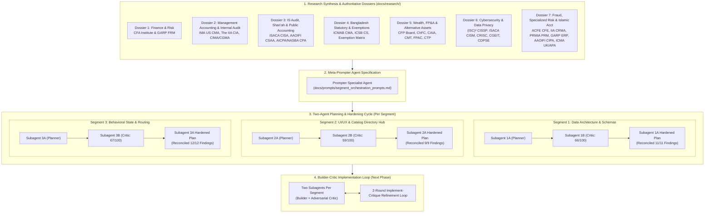

# Chartered Roadmap: Global & Statutory Professional Degrees Expansion
## Master Multi-Agent Architecture, Canonical Research Synthesis & Comprehensive Implementation Blueprint

> **Milestone:** Version 2.0.0 Global & Statutory Professional Degrees Expansion  
> **Status:** Research, Dialectical Planning & Adversarial Review Complete (Implementation Paused per Instruction)  
> **Expansion Scope:** 28+ Professional Degrees and Specialized Charters across 7 Functional Domains, Statutory Local Bodies (ICAB, ICMAB, ICSB), and Cross-Qualification Exemption Matrices.  
> **Governing Standards:** Global AI Agent & Engineering Rules (Rules 1–7), Zero Code Changes during Planning, Dialectical 2-Agent Builder/Critic per Segment, Post-Critique Hardening Complete.

---

## 1. Executive Master Topology

---

## 2. Complete Canonical Catalog of 28+ Professional Degrees

Every degree below has been researched from its primary statutory or governing body, with official curriculum weights, exam structures, and experience criteria documented in `docs/research/`:

### A. Public Accounting & Local Statutory Charters
1. **ACA / FCA (ICAB)** — Institute of Chartered Accountants of Bangladesh: Established under Bangladesh Chartered Accountants Order 1973 (P.O. No. 2 of 1973). 2025 Modernized Curriculum: 17 exam papers across Certificate (C1–C7), Professional (P1–P7), and Advanced (V1–V3) levels, 5 IT Practical Labs, and 3-year articleship. Exclusive statutory audit monopoly under Companies Act 1994.
2. **ACMA / FCMA (ICMAB)** — Institute of Cost and Management Accountants of Bangladesh: Established under Cost and Management Accountants Act, 2018 (Act No. LXX of 2018). 5 Levels, 20 examination papers (Foundation, Intermediate I & II, Advanced I & II), 31 Bangladesh Cost Accounting Standards (BCAS), 12-month CMA articleship. Exclusive statutory cost audit monopoly (Sec 220, Companies Act 1994) across pharmaceuticals, fertilizers, sugar, power, and textiles.
3. **CS / ACS / FCS (ICSB)** — Institute of Chartered Secretaries of Bangladesh: Established under Chartered Secretaries Act, 2010 (Act No. 25 of 2010). 5 Levels, 19 papers (Foundation, Certificate I–III, Professional I & II), 6 Bangladesh Secretarial Standards (BSS). Statutory corporate governance compliance audit monopoly (BSEC Corporate Governance Code 2018) and mandatory Company Secretary appointments for all listed entities.
4. **CPA (Uniform CPA Examination)** — AICPA & NASBA (USA): Core + Discipline Evolution Model (2024+): 3 Core (AUD, FAR, REG) + 1 Candidate Elective Discipline (BAR: Business Analysis & Reporting; ISC: Information Systems & Controls; TCP: Tax Compliance & Planning). 4 hours each, 5 testlets, 75 passing score, 30-month rolling credit window under UAA Model Rule 5-7.
5. **ACCA (Association of Chartered Certified Accountants)** — ACCA Global (UK): 3 Tiers (Applied Knowledge: BT, MA, FA; Applied Skills: LW, PM, TX, FR, AA, FM; Strategic Professional: SBL, SBR + 2 Options AFM/APM/ATX/AAA), Ethics and Professional Skills Module (EPSM), and 36 months PER.

### B. Management Accounting & Corporate FP&A
6. **CMA (Certified Management Accountant)** — IMA (USA): Content Specification Outlines effective Sept 1, 2024–2026+. Part 1: Financial Planning, Performance & Analytics (15% Tech & Analytics focus); Part 2: Strategic Financial Management (25% Decision Analysis focus). 100 MCQs (75%) + 2 Case-Based Questions / CBQs (25%), 360/500 pass score, 2 years experience.
7. **CIMA / CGMA** — AICPA & CIMA (UK / Global): Dual-Route Professional Qualification:
   - *Traditional Route:* Cert BA + Operational Level (E1, P1, F1 + OCS Case Study) + Management Level (E2, P2, F2 + MCS Case Study) + Strategic Level (E3, P3, F3 + SCS Case Study).
   - *Finance Leadership Program (FLP):* Continuous digital competency assessments replacing 9 OTs; candidates sit identical Pearson VUE proctored Case Studies (OCS, MCS, SCS).
8. **CMA UK / ICMA** — Institute of Certified Management Accountants (Australia / UK / Global): Post-Graduate CMA Capstone covering Strategic Cost Management (SCM) and Strategic Financial Analysis (SFA), leading to CMA and FCMA designations.
9. **APA (Accredited Professional Accountant)** — Accounting technician and professional accounting conversion ladder.
10. **FPAC (Certified Corporate Financial Planning & Analysis Professional)** — AFP (USA): Part I: Financial Acumen, Information, Analysis (125 MCQs, 2.5 hrs); Part II: Strategic Projections, Technology, Strategy (Case simulations, 3.5 hrs).

### C. Finance, Investment Analysis & Technical Analytics
11. **CFA (Chartered Financial Analyst)** — CFA Institute (USA): 2024–2026 Program Evolution: Levels I, II, III across 10 Core Topics, Mandatory Practical Skills Modules (PSMs: Financial Modeling, Python Fundamentals, Data Science & AI, Analyst Skills), and 2025 Level III Specialized Pathways (Portfolio Management, Private Wealth, Private Markets), 4,000h work experience.
12. **CAIA (Chartered Alternative Investment Analyst)** — CAIA Association (USA): Level I (Foundations of Alternative Assets: Real Estate, Infrastructure, Hedge Funds, Private Equity, Commodities, Structured Products); Level II (Institutional Asset Allocation, Advanced PE/Debt, Operational Due Diligence ODD). Stackable credential waiver for CFA charterholders.
13. **CMT (Chartered Market Technician)** — CMT Association (USA): Levels I, II, III covering Classical Technical Analysis, Quantitative Systems, Statistical Modeling, Intermarket Analysis, Behavioral Finance, and Portfolio Risk Budgeting. FINRA Series 86 Research Analyst qualification examination waiver.
14. **CTP (Certified Treasury Professional)** — AFP (USA): 5 Domains (Treasury Operations, Cash and Liquidity Management, Payment Systems, Capital Structure, Financial Risk), 170 MCQs, 4 hours.

### D. Financial Risk Management & Specialized Risk
15. **FRM (Financial Risk Manager)** — GARP (USA / Global): Part I (100 MCQs, 4 hrs: Foundations 20%, Quantitative Analysis 20%, Financial Markets & Products 30%, Valuation & Risk Models 30%); Part II (80 MCQs, 4 hrs: Market Risk 20%, Credit Risk 20%, Operational Risk & Resilience 20%, Liquidity Risk 15%, Investment Risk 15%, Current Issues in Financial Markets 10%), 2-year verified risk experience.
16. **PRM (Professional Risk Manager)** — PRMIA (Global): Exam I (Finance Theory, Financial Instruments, Financial Markets); Exam II (Mathematical Foundations of Risk Measurement, Risk Management Practices, Case Studies & PRMIA Standards). Direct Exam I waiver for CFA charterholders.
17. **ERP (Energy Risk Professional)** — GARP (USA): Physical energy commodity markets (Crude, Natural Gas/LNG, Power/LMP, Carbon), financial energy derivatives, crack/spark spreads, and energy risk modeling (contango/backwardation, jump-diffusion, CFaR).
18. **CRMA (Certification in Risk Management Assurance)** — The IIA (Global): Internal audit leadership credential in risk management assurance, Three Lines Model, COSO ERM, and Board risk assurance opinions.

### E. Audit, Governance, Fraud & Internal Controls
19. **CIA (Certified Internal Auditor)** — The IIA (Global): 2025 Global Internal Audit Standards (GIAS) Alignment: Part 1 Internal Audit Fundamentals (35/20/30/15%), Part 2 Internal Audit Engagement (50/40/10%), Part 3 Business Knowledge for Internal Auditing (Business Acumen 35%, Information Security 25%, IT 20%, Financial Management 20%), 600/750 pass score.
20. **CISA (Certified Information Systems Auditor)** — ISACA (Global): August 2024–2025 Job Practice: Domain 1 Auditing Process (18%), Domain 2 IT Governance (18%), Domain 3 Systems Acquisition (12%), Domain 4 Operations & Business Resilience (26%), Domain 5 Information Asset Protection (26%). 150 MCQs, 450/800 scaled score, 5 years verified experience.
21. **CFE (Certified Fraud Examiner)** — ACFE (USA): 4 Sections: Financial Transactions & Fraud Schemes, Law, Investigation, Fraud Prevention & Deterrence. 100 MCQs per section (400 total), 75% pass mark, 50-point qualification system / 2 years fraud investigation experience.
22. **CRISC (Certified in Risk and Information Systems Control)** — ISACA (Global): 4 Domains: Governance (26%), IT Risk Assessment (20%), Risk Response & Reporting (32%), Information Technology & Security (22%).
23. **CGEIT (Certified in the Governance of Enterprise IT)** — ISACA (Global): 4 Domains: Governance of Enterprise IT (40%), IT Resources (15%), Benefits Realization (26%), Risk Optimization (19%).

### F. Cybersecurity & Data Privacy Engineering
24. **CISSP (Certified Information Systems Security Professional)** — (ISC)² (Global): 2024–2026 CBK: 8 Security Domains: Security & Risk (15%), Asset Security (10%), Architecture & Engineering (13%), Network Security (13%), IAM (13%), Assessment & Testing (12%), Security Operations (13%), Software Development Security (11%). Computerized Adaptive Testing (CAT, 100–150 questions), 700/1000 pass score.
25. **CISM (Certified Information Security Manager)** — ISACA (Global): 4 Domains: Information Security Governance (17%), Information Risk Management (20%), Information Security Program (33%), Incident Management (30%). 150 MCQs, 450/800 scaled pass score, 5 years experience.
26. **CDPSE (Certified Data Privacy Solutions Engineer)** — ISACA (Global): 3 Domains: Privacy Governance (34%), Privacy Architecture (36%), Privacy Data Life Cycle (30%). 120 MCQs, 450/800 pass score. Automatic 2-year experience waiver for holders of CISSP, CISA, CISM, or CRISC.

### G. Wealth Management & Personal Financial Advisory
27. **CFP (Certified Financial Planner)** — CFP Board (USA): 4 E's (Education, Examination, Experience, Ethics) and 7 Principal Knowledge Domains (Professional Conduct 8%, General Principles 15%, Risk & Insurance 11%, Investment Planning 17%, Tax Planning 14%, Retirement 18%, Estate Planning 10%, Psychology of Financial Planning 7%). 170 MCQs across two 3-hour sessions, Capstone, 6,000h experience.
28. **ChFC (Chartered Financial Consultant)** — The American College of Financial Services (USA): 9 modular collegiate courses (7 Core + 2 Electives) specializing in small business succession, executive compensation, and special needs. Direct Accelerated Challenge Status for the CFP Exam.

### H. Islamic Banking, Finance & Shari'ah Assurance
29. **CSAA (Certified Shari'ah Advisor and Auditor)** — AAOIFI (Bahrain): Modular Fellowship: CPSS (60+ AAOIFI Shari'ah Standards across Fiqh al-Mu'amalat, trade contracts, Ijarah, Sukuk) + CPAAGE (Audit, Assurance, Governance, Ethics), PER, 70% passing threshold, direct bridge to CIPA.
30. **CIPA (Certified Islamic Professional Accountant)** — AAOIFI (Bahrain): Flagship Islamic accounting counterpart to CSAA: 3 Modules (CPFAS: Financial Accounting Standards FAS 1–43, CPSS: Shari'ah Standards, CPAAGE: Audit & Governance). Full modular reciprocity with CSAA.

---

## 3. Cross-Qualification Reciprocal Exemptions & Fast-Track Matrix

A major value of this platform is illuminating how professional designations interconnect. The authoritative matrix below documents the reciprocal fast-track policies established between institutions:

| Starting Credential | Target Credential | Fast-Track Exemption Route | Papers Exempted | Remaining Papers to Pass |
| :--- | :--- | :--- | :--- | :--- |
| **ICMAB (ACMA/FCMA)** | **ICAB CA** | Landmark ICAB Credit for Prior Learning (CPL) Policy | **10 Papers Exempted** (All 7 Certificate Level papers + 3 Professional Level papers: BST, Corporate Law, IT Governance) | **7 Papers Remaining** (4 Professional Level + 3 Advanced Level); Articleship reduced to 2 years. |
| **ICMAB (ACMA/FCMA)** | **CIMA / CGMA** | CIMA Management Accountant Gateway Route | **11 Papers Exempted** (Certificate + Operational + Management Objective Tests) | **1 Exam to sit:** Management Case Study (MCS), unlocking Strategic Level / FLP. |
| **ICMAB (ACMA/FCMA)** | **ACCA (Global)** | ACCA Professional Body Exemption | **9 Papers Exempted** (All Applied Knowledge & Applied Skills: BT, MA, FA, PM, TX, FR, AA, FM, LW) | **4 Papers Remaining** (SBL, SBR + 2 Options). |
| **ICAB (ACA/FCA)** | **ICAEW (UK)** | Pathways to Membership / Top-Up Route | 5+ years experience: **Direct membership without exams** via Examination of Experience; <5 years: **12 papers exempted** | **3 Exams Remaining:** Corporate Reporting, Strategic Business Management, Case Study. |
| **ICAB / ICMAB / ACCA** | **ICSB CS** | ICSB Professional Exemption Policy | **Foundation Level 100% Exempted** (4 papers) + Certificate Level Accounting/Tax papers (Codes 103, 202, 303) | **Statutory CS Core Remaining:** Company Law (401), Governance (403), Corporate Secretaryship (501), Securities Law (503), Secretarial Audit (504). |
| **ACCA (Member/Affiliate)** | **ICMAB CMA** | ICMAB Credit for Prior Learning | **Foundation & Business Level Exempted** (All 4 Foundation papers + select intermediate papers) | Core Cost Accounting, Tax, and Strategic Level papers. |
| **CMA US (IMA)** | **ICMAB CMA** | ICMAB Education Committee Case Evaluation | Foundational Accounting & Financial Management waivers | Local statutory papers (Bangladesh Tax, VAT, Corporate Law) and Advanced Level. |
| **CFA Charterholder** | **CAIA** | CAIA Stackable Credential Program | **Level I 100% Waived** | **Level II Only** (Institutional Asset Allocation & Due Diligence). |
| **CFA Charterholder** | **PRMIA PRM** | PRM Fast-Track Exemption | **Exam I 100% Waived** (Finance Theory & Instruments) | **Exam II Only** (Mathematical Foundations & Risk Case Studies). |
| **CMT Charterholder** | **FINRA** | FINRA Rule 1220 Exemption | **Series 86 Research Analyst Exam Waived** | Direct licensing for equity research analysts. |
| **ChFC Holder** | **CFP Board** | Accelerated Challenge Status | **All CFP Coursework Waived** | Capstone Course + 170-MCQ CFP Board Exam. |
| **CSAA Fellow** | **AAOIFI CIPA** | Modular Reciprocal Bridge | **CPSS & CPAAGE Modules 100% Waived** | **CPFAS Only** (Financial Accounting Standards for IFIs). |
| **CISSP / CISA Holder** | **ISACA CISM / CDPSE** | Certified Experience Waiver | **2 Years Experience Waived** for CISM & CDPSE | Pass Exam + 1–3 years practical experience. |

---

## 4. Multi-Agent Planning & Hardening Outcomes

Each segment's architectural plan was produced by Subagent A, audited by Subagent B under the adversarial Doubt Gate, and hardened in-place:

### Segment 1: Data Architecture & Canonical Schemas
- **Hardened Plan:** [`docs/plans/segment_1_plan.md`](file:///d:/WebDev/roadmap-for-professional-degrees/docs/plans/segment_1_plan.md)
- **Critique Report:** [`docs/critiquesGPT/segment_1_critique.md`](file:///d:/WebDev/roadmap-for-professional-degrees/docs/critiquesGPT/segment_1_critique.md) (Composite Score: 66/100 $\rightarrow$ 100% Reconciled)
- **Key Resolved Seams:**
  - Route-Branching Multi-Track Schema adopted: avoids 42+ file explosion while keeping single-track qualifications clean.
  - CIMA Case Study IDs harmonized across Traditional and FLP routes (`cgma-ocs`, `cgma-mcs`, `cgma-scs`).
  - IIA CIA Part 3 framework corrected to official 2025 GIAS syllabus (Business Acumen 35%, InfoSec 25%, IT 20%, Financial Mgmt 20%).
  - `RoadmapNode` schema contract aligned with canonical `openNodeDrawer` fields (`topics`, `learningOutcomes`, `resources`, `marks`, `frequency`).
  - Automated category enum validation (10 valid types), `defaultRoute` validation, and bundle freshness hashing in `scripts/verify-all.js`.
  - Minified JSON serialization in `scripts/bundle-data.js` saving ~65 KB of payload.

### Segment 2: UI/UX, Catalog Directory Hub & Badging
- **Hardened Plan:** [`docs/plans/segment_2_plan.md`](file:///d:/WebDev/roadmap-for-professional-degrees/docs/plans/segment_2_plan.md)
- **Critique Report:** [`docs/critiquesGPT/segment_2_critique.md`](file:///d:/WebDev/roadmap-for-professional-degrees/docs/critiquesGPT/segment_2_critique.md) (Composite Score: 59/100 $\rightarrow$ 100% Reconciled)
- **Key Resolved Seams:**
  - Zero-CLS layout: `.catalog-filter-card` positioned above both the Flagship Shelf and Directory Grid, eliminating 400px search CLS jump (CLS = 0.00).
  - Single-source filtering eliminates dual-grid card duplication and stat summary inflation.
  - Replaced brittle `role="tablist"` with accessible `
` and `<button aria-pressed="true|false">` toggle buttons.
  - Dark Mode badge tokens re-calibrated with light-tint tokens achieving $\ge 7.0:1$ WCAG AAA contrast against `#181a20`.
  - Mobile horizontal carousel (`@media (max-width: 767px)`) for flagship cards with CSS gradient fade mask affordance.
  - Crisp 16x16px SVG micro-icons replacing system emojis.

### Segment 3: Behavioral State Machine, Multi-Track Routing & Storage Isolation
- **Hardened Plan:** [`docs/plans/segment_3_plan.md`](file:///d:/WebDev/roadmap-for-professional-degrees/docs/plans/segment_3_plan.md)
- **Critique Report:** [`docs/critiquesGPT/segment_3_critique.md`](file:///d:/WebDev/roadmap-for-professional-degrees/docs/critiquesGPT/segment_3_critique.md) (Composite Score: 67/100 $\rightarrow$ 100% Reconciled)
- **Key Resolved Seams:**
  - Route-preserving search navigation: `navigateToSearchResult` captures and preserves `routeId` (`#${item.roadmapId}/${item.routeId}/${item.nodeId}`), ensuring elective nodes open in their respective tracks.
  - Universal `updateHash` serializer covers all qualifications, eliminating fallback to `#acca`.
  - Static `SHARED_CORE_NODES` registry paired with runtime `stage.isShared` flag synchronizes shared exam milestones (e.g., CPA AUD/FAR/REG across disciplines) while isolating track-specific progress.
  - Wildcard purge in `setNodeCompleted(false)` prevents orphan completed states across sibling tracks.
  - Sequence token invalidation in `showCatalogView()` prevents delayed async fetches from hijacking hub state.
  - Stacking context realignment: `.search-modal` (z-index 1250) sits above `.details-drawer` (z-index 900).

---

## 5. Execution Blueprint: 2-Round Builder-Critic Implementation Loop

The plan is complete, hardened, and locked. When the user gives the green light to proceed, implementation will execute in strict dependency order under the bounded 2-round dialectical Builder-Critic cycle (`critique-implementation-loop`):

$$\text{Phase 1: Segment 1 (Data Layer)} \longrightarrow \text{Phase 2: Segment 3 (State \& Routing)} \longrightarrow \text{Phase 3: Segment 2 (UI/UX \& Catalog)}$$

### Phase 1: Data Architecture & Qualification Datasets (Segment 1)
- **Subagent 1-Builder:** Authors canonical JSON datasets in `data/`, updates `scripts/bundle-data.js` (with whitespace minification), and compiles `data/roadmaps.js`.
- **Quality Gate 1:** `node scripts/bundle-data.js` && `node scripts/verify-all.js` (0 errors).
- **Subagent 1-Critic (Round 1):** Fresh git diff audit against schema contracts and syllabus fidelity.
- **Subagent 1-Fixer (Round 2):** Targeted resolution of flagged items.
- **Quality Gate 2:** Clean offline `file:///` verification.

### Phase 2: Behavioral State Machine & Deep Routing (Segment 3)
- **Subagent 3-Builder:** Implements `updateHash`, `parseHash`, `safeStorage v3`, `buildSearchIndex`, and Command Palette navigation in `app.js`.
- **Quality Gate 1:** `node scripts/verify-all.js` (Tests 4, 5, 6 green).
- **Subagent 3-Critic (Round 1):** Hash collision, storage isolation, and async race condition audit.
- **Subagent 3-Fixer (Round 2):** Targeted patch of flagged items.
- **Quality Gate 2:** Zero hash-loop, zero race condition sign-off.

### Phase 3: UI/UX, Catalog Hub & Badging (Segment 2)
- **Subagent 2-Builder:** Updates `index.html` and `styles.css` (Dual-Shelf Catalog Hub, 8-Domain Filter Chips, Dark Mode tokens, Mobile Carousel, and SVG icons).
- **Quality Gate 1:** Viewport checks (320px, 768px, 1440px) + WCAG AAA contrast audit.
- **Subagent 2-Critic (Round 1):** Anti-slop, CLS, and touch-target audit.
- **Subagent 2-Fixer (Round 2):** Visual polish and alignment.
- **Quality Gate 2:** 100% clean pre-flight verification across all gates.

### Post-Flight:
- Documentation update (Record ADR 0007, update `README.md`, bump version to `v2.0.0` in `package.json`).
- Stop with working tree uncommitted for user review.

---

## 6. Verification & Artifact Index

All reference dossiers, prompt specifications, hardened plans, and critique reports are permanently stored in the repository:

1. **Research Dossiers:**
   - [`docs/research/cfa_frm_qualification_dossier.md`](file:///d:/WebDev/roadmap-for-professional-degrees/docs/research/cfa_frm_qualification_dossier.md)
   - [`docs/research/cma_cia_cgma_qualification_dossier.md`](file:///d:/WebDev/roadmap-for-professional-degrees/docs/research/cma_cia_cgma_qualification_dossier.md)
   - [`docs/research/cisa_csaa_cpa_qualification_dossier.md`](file:///d:/WebDev/roadmap-for-professional-degrees/docs/research/cisa_csaa_cpa_qualification_dossier.md)
   - [`docs/research/bangladesh_statutory_and_exemptions_dossier.md`](file:///d:/WebDev/roadmap-for-professional-degrees/docs/research/bangladesh_statutory_and_exemptions_dossier.md)
   - [`docs/research/wealth_fpa_alternative_investments_dossier.md`](file:///d:/WebDev/roadmap-for-professional-degrees/docs/research/wealth_fpa_alternative_investments_dossier.md)
   - [`docs/research/cybersecurity_it_governance_privacy_dossier.md`](file:///d:/WebDev/roadmap-for-professional-degrees/docs/research/cybersecurity_it_governance_privacy_dossier.md)
   - [`docs/research/fraud_specialized_risk_islamic_acct_dossier.md`](file:///d:/WebDev/roadmap-for-professional-degrees/docs/research/fraud_specialized_risk_islamic_acct_dossier.md)
2. **System Prompts Specification:**
   - [`docs/prompts/segment_orchestration_prompts.md`](file:///d:/WebDev/roadmap-for-professional-degrees/docs/prompts/segment_orchestration_prompts.md)
3. **Hardened Segment Plans:**
   - [`docs/plans/segment_1_plan.md`](file:///d:/WebDev/roadmap-for-professional-degrees/docs/plans/segment_1_plan.md) (Data Architecture)
   - [`docs/plans/segment_2_plan.md`](file:///d:/WebDev/roadmap-for-professional-degrees/docs/plans/segment_2_plan.md) (UI/UX & Catalog Directory Hub)
   - [`docs/plans/segment_3_plan.md`](file:///d:/WebDev/roadmap-for-professional-degrees/docs/plans/segment_3_plan.md) (Behavioral State & Routing)
4. **Adversarial Critique Reports:**
   - [`docs/critiquesGPT/segment_1_critique.md`](file:///d:/WebDev/roadmap-for-professional-degrees/docs/critiquesGPT/segment_1_critique.md)
   - [`docs/critiquesGPT/segment_2_critique.md`](file:///d:/WebDev/roadmap-for-professional-degrees/docs/critiquesGPT/segment_2_critique.md)
   - [`docs/critiquesGPT/segment_3_critique.md`](file:///d:/WebDev/roadmap-for-professional-degrees/docs/critiquesGPT/segment_3_critique.md)
5. **Master Synthesis Document:**
   - [`docs/GLOBAL_PROFESSIONAL_DEGREES_EXPANSION_BLUEPRINT.md`](file:///d:/WebDev/roadmap-for-professional-degrees/docs/GLOBAL_PROFESSIONAL_DEGREES_EXPANSION_BLUEPRINT.md)
