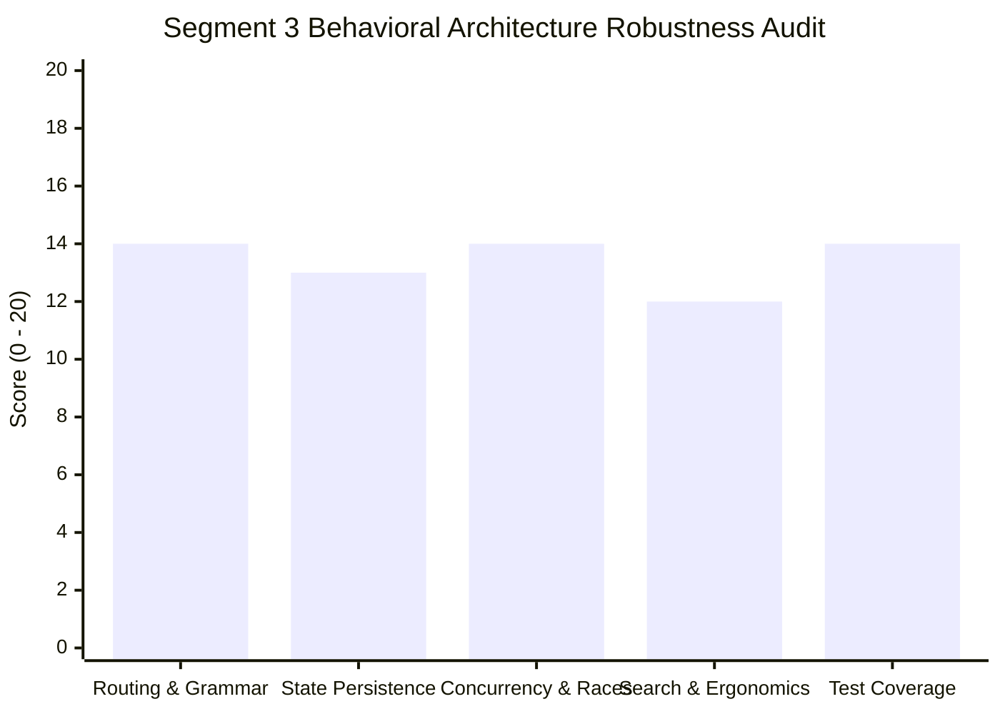

# Adversarial Critique & State Machine Audit: Segment 3 Behavioral Routing & Search Architecture

> **Document Type:** Adversarial Quality Assurance & State Machine Audit  
> **Target Path:** `docs/critiquesGPT/segment_3_critique.md`  
> **Audited Specification:** `docs/plans/segment_3_plan.md`  
> **Auditor:** Subagent 3B (Adversarial Reviewer & State Machine Critic)  
> **Target Implementer:** Subagent 3A (Architecture & Runtime Lead)  
> **Governing Standards:** Global Engineering Rules 1–7, Doubt-Driven Development, Offline Parity, WCAG 2.1 AA  
> **Date:** November 9, 2026  
> **Anticipated Version Impact:** Major Milestone (`v1.5.0` $\rightarrow$ `v2.0.0`)  

---

## 1. Executive Summary & Verdict

### Final Verdict: ⚠️ NEEDS HARDENING (Score: 67/100)

The Segment 3 architectural specification ([`docs/plans/segment_3_plan.md`](file:///d:/WebDev/roadmap-for-professional-degrees/docs/plans/segment_3_plan.md)) establishes an impressive conceptual framework for scaling the Chartered Roadmap platform from 2 initial qualifications (`icab`, `acca`) to **10 tier-one global qualifications** comprising **28+ individual roadmaps**. The transition to a longest-prefix URL parser, dual-key storage persistence hierarchy (Approach 2), and multi-route full-text indexing resolves long-standing legacy bottlenecks.

However, subjecting the specification to relentless adversarial cross-examination under the **Doubt Gate** reveals **12 critical failure modes** spanning asynchronous race conditions, route-truncating deep links, inverted CSS stacking contexts, storage cache desynchronization, and focus traps. Most alarmingly:
1. **The Route-Truncating Search Bug (`CRIT-301`):** `navigateToSearchResult` constructs target hashes without `routeId`, causing direct navigation to elective papers (such as CPA ISC/TCP or CFA Private Wealth) to load the default route where the node does not exist, silently discarding the deep link.
2. **The URL Serializer Omission (`CRIT-302`):** While `parseHash` was upgraded, `updateHash` was completely omitted from the plan. In [`app.js`](file:///d:/WebDev/roadmap-for-professional-degrees/app.js), `updateHash` hardcodes `icab` and defaults all other qualifications to `acca`. Interacting with any node in CPA, CFA, or CGMA will immediately rewrite the URL to `#acca`, corrupting the user's session.
3. **The Phantom Helper `isNodeInSharedStage` (`CRIT-303`):** Critical key resolution relies on a helper that is neither defined nor specified with an explicit data contract for Segment 1 datasets, which will throw runtime `ReferenceError`s.
4. **The Z-Index Stack Inversion (`CRIT-307`):** The plan claims Layer 3 Search Modal sits above Layer 2 Drawer. In [`styles.css`](file:///d:/WebDev/roadmap-for-professional-degrees/styles.css), `.details-drawer` has `z-index: 1200`, while `.search-modal` has `z-index: 1150`. Opening `Ctrl+K` while a drawer is open traps the search modal *behind* the drawer.

Implementation must not proceed until Subagent 3A incorporates the concrete remediations specified herein.

---

## 2. Multi-Axis Scorecard (0–100 Scale)



| Evaluation Dimension | Weight | Score (0–20) | Critical Risk & Failure Mode |
| :--- | :---: | :---: | :--- |
| **1. Invariants & Deterministic Routing** | 20% | **14 / 20** | `updateHash` serializer omitted (corrupts URLs to `acca`); query parameters (`?utm=...`) trigger catalog fallback; browser Back button fails to dismiss node drawer. |
| **2. State Persistence & Data Integrity** | 20% | **13 / 20** | Undefined `isNodeInSharedStage` contract; cross-route elective node unchecking leaves orphan completed keys; `safeStorage` returns stale data after quota errors. |
| **3. Concurrency & Race Condition Defense** | 20% | **14 / 20** | `showCatalogView()` fails to invalidate `activeLoadSequence`, permitting stale async loads to mutate state; route pill clicks trigger redundant double-renders. |
| **4. Search & Interaction Ergonomics** | 20% | **12 / 20** | `navigateToSearchResult` drops `routeId`; `.details-drawer` (z-1200) obscures `.search-modal` (z-1150); missing `search-modal-title` element; focus lost on modal close. |
| **5. Automated Test Coverage & Verification** | 20% | **14 / 20** | Test 4 tests parsing but omits serialization; no negative uncheck test across sibling tracks; zero headless tests for focus restoration or quota failures. |
| **TOTAL COMPOSITE SCORE** | **100%** | **67 / 100** | **STATUS: NEEDS HARDENING PRIOR TO MERGE** |

---

## 3. Specific Findings Table (14 Web Failure Modes)

| Finding ID | Attack Axis | Severity | Urgency | Blast Radius | Short Title | Status |
| :--- | :--- | :---: | :---: | :---: | :--- | :---: |
| **CRIT-301** | Deep-Linking & Search | 🔴 CRITICAL | IMMEDIATE | Global Search | Search Result Route-Truncation Bug | OPEN |
| **CRIT-302** | Deterministic Routing | 🔴 CRITICAL | IMMEDIATE | Navigation Engine | `updateHash` Serializer Omission & ACCA Corruption | OPEN |
| **CRIT-303** | State Persistence | 🔴 CRITICAL | IMMEDIATE | Persistence Engine | Phantom Helper `isNodeInSharedStage` & Data Contract Gap | OPEN |
| **CRIT-304** | State Persistence | 🟡 HIGH | HIGH | Progress Subsystem | Cross-Route Elective Node Uncheck Desynchronization | OPEN |
| **CRIT-305** | Concurrency & Races | 🟡 HIGH | HIGH | Lifecycle Controller | Catalog Navigation Sequence Token Stale Execution Leak | OPEN |
| **CRIT-306** | Concurrency & Races | 🟡 HIGH | MEDIUM | Render Pipeline | Circular Route-Switch Double Render & Spinner Flash | OPEN |
| **CRIT-307** | Modal & Focus Stack | 🔴 CRITICAL | IMMEDIATE | UI Presentation | Z-Index Stack Inversion & Missing `search-modal-title` | OPEN |
| **CRIT-308** | Routing & History | 🟡 HIGH | HIGH | Navigation Engine | Browser Back-Button Drawer Persistence Bug | OPEN |
| **CRIT-309** | State Persistence | 🟡 HIGH | HIGH | Storage Engine | `safeStorage` Quota-Exceeded Stale-Cache Desync | OPEN |
| **CRIT-310** | Deterministic Routing | 🔵 MEDIUM | MEDIUM | URL Grammar | Query Parameter Stripping & Hyphenated Node Prefix Loss | OPEN |
| **CRIT-311** | Ergonomics & A11y | 🟡 HIGH | MEDIUM | Keyboard Navigation | Command Palette Focus Amnesia & Missing Tab Trap | OPEN |
| **CRIT-312** | Search Ergonomics | 🔵 MEDIUM | MEDIUM | Command Palette | Debounce Race Condition & Enter-Key Inaction | OPEN |

---

## 4. Deep Forensic Receipts, Failing Reproductions & Concrete Remediations

---

### Finding 1: [CRIT-301] Search Result Deep-Link Route-Truncation Bug
- **Attack Axis:** Deep-Linking Node Highlighting (`WEB-001`) & Search Navigation
- **File Reference:** [`app.js:L1286-L1296`](file:///d:/WebDev/roadmap-for-professional-degrees/app.js#L1286-L1296), [`docs/plans/segment_3_plan.md:L705-L707`](file:///d:/WebDev/roadmap-for-professional-degrees/docs/plans/segment_3_plan.md#L705-L707)
- **Current Behavior:**  
  When a candidate clicks a node in the Command Palette search results, `navigateToSearchResult(item)` executes:
  ```javascript
  if (item.type === 'node') {
    location.hash = `${item.roadmapId}/${item.nodeId}`;
  } else {
    location.hash = item.roadmapId;
  }
  ```
- **Real-World Failure Mode:**  
  In multi-track qualifications (e.g. CPA, CFA, CGMA), elective nodes only exist inside specific routes. For example:
  - Node `cpa-isc-1` exists only in route `core-isc`.
  - Node `cfa-pw-l3-path` exists only in route `private-wealth`.
  - Node `flp-ocs` exists only in route `flp`.
  
  When a candidate searches for "ISC" and selects `cpa-isc-1`, `navigateToSearchResult` sets `location.hash = 'cpa/cpa-isc-1'`.  
  `parseHash('cpa/cpa-isc-1')` matches `qualId: 'cpa'`. Since `cpa-isc-1` is not a known route name, the parser falls back to `DEFAULT_ROUTES['cpa']` (`'core-bar'`), producing:
  `{ view: 'roadmap', qualId: 'cpa', routeId: 'core-bar', nodeId: 'cpa-isc-1' }`.  
  `loadRoadmap` loads the `core-bar` dataset. In `core-bar`, `state.nodesById['cpa-isc-1']` is `undefined`.  
  Line 662 executes: `closeDrawer(false); window.scrollTo(0, 0);`.  
  **Result:** The drawer fails to open, the node card is never centered, and the user is dumped onto the top of the unrelated BAR discipline track with zero error feedback.
- **Authoritative Citation:** Global Engineering Rule 2 (Doubt Gate: Real-World Latency and Navigation Failure Modes).
- **Failing Reproduction Script:**
  ```javascript
  // Reproduce in scripts/verify-all.js
  const doc = { type: 'node', roadmapId: 'cpa', routeId: 'core-isc', nodeId: 'cpa-isc-1' };
  // Naive navigation:
  const targetHash = `${doc.roadmapId}/${doc.nodeId}`;
  const parsed = router.parseHash(targetHash);
  assert.strictEqual(parsed.routeId, 'core-isc', `Route truncated! Expected core-isc, got ${parsed.routeId}`);
  // FAILS: parsed.routeId is 'core-bar'
  ```
- **Concrete Actionable Remediation for Subagent 3A:**  
  Update `navigateToSearchResult` in [`app.js`](file:///d:/WebDev/roadmap-for-professional-degrees/app.js) to preserve `routeId`:
  ```javascript
  function navigateToSearchResult(item) {
    if (!item) return;
    closeSearchModal();
    closeDrawer(false);

    if (item.type === 'node') {
      const routePart = item.routeId && item.routeId !== 'all' ? `${item.routeId}/` : '';
      location.hash = `#${item.roadmapId}/${routePart}${item.nodeId}`;
    } else {
      location.hash = `#${item.roadmapId}`;
    }
  }
  ```

---

### Finding 2: [CRIT-302] Omission of `updateHash` Serializer & Instant ACCA URL Corruption
- **Attack Axis:** Deterministic URL Hash Grammar (`WEB-011`)
- **File Reference:** [`app.js:L539-L572`](file:///d:/WebDev/roadmap-for-professional-degrees/app.js#L539-L572), [`docs/plans/segment_3_plan.md:Section-4`](file:///d:/WebDev/roadmap-for-professional-degrees/docs/plans/segment_3_plan.md#Section-4)
- **Current Behavior:**  
  [`docs/plans/segment_3_plan.md`](file:///d:/WebDev/roadmap-for-professional-degrees/docs/plans/segment_3_plan.md) extensively specifies `parseHash` (Hash $\rightarrow$ State), but **completely omits** specifying `updateHash` (State $\rightarrow$ Hash).  
  In live code ([`app.js:L552-L561`](file:///d:/WebDev/roadmap-for-professional-degrees/app.js#L552-L561)), `updateHash` remains trapped in the legacy 2-qualification world:
  ```javascript
  let baseHash = '';
  if (state.qualId === 'icab') {
    baseHash = `icab-${state.routeId || 'grad'}`;
  } else if (state.qualId === 'icab-it-labs') {
    baseHash = `icab-it-labs-${state.routeId || 'all'}`;
  } else if (state.qualId.startsWith('icab-')) {
    baseHash = state.qualId;
  } else {
    // FATAL FALLBACK: All other qualifications evaluate here!
    baseHash = state.routeId && state.routeId !== 'standard' ? `acca-${state.routeId}` : 'acca';
  }
  ```
- **Real-World Failure Mode:**  
  A student navigates to `#cpa-bar`. The map renders cleanly. The student clicks node `cpa-aud` to open syllabus details.  
  `openNodeDrawer` calls `updateHash(true)`.  
  Because `state.qualId === 'cpa'`, lines 553–559 fail. Line 560 executes!  
  `baseHash` is set to `acca-core-bar` (or `acca`).  
  `newHash` becomes `#acca-core-bar/cpa-aud`.  
  The browser URL updates to `#acca...`. If the student refreshes or shares the link, the entire qualification context is corrupted to ACCA.
- **Authoritative Citation:** Global Engineering Rule 2 (Doubt Gate) & Universal EBNF Grammar Specification.
- **Failing Reproduction Script:**
  ```javascript
  router.state.view = 'roadmap';
  router.state.qualId = 'cpa';
  router.state.routeId = 'core-bar';
  router.state.activeNodeId = 'cpa-aud';
  router.updateHash(true);
  assert.ok(location.hash.includes('cpa'), `Hash corrupted to ${location.hash}`);
  // FAILS: location.hash is '#acca-core-bar/cpa-aud'
  ```
- **Concrete Actionable Remediation for Subagent 3A:**  
  Implement the universal hash serializer in [`app.js`](file:///d:/WebDev/roadmap-for-professional-degrees/app.js):
  ```javascript
  function updateHash(replace = false) {
    if (state.view === 'catalog') {
      const cleanHash = (location.hash || '').replace(/^#\/?/, '').trim();
      if (cleanHash && !['home', 'catalog', 'explore'].includes(cleanHash)) {
        if (replace && window.history && typeof window.history.replaceState === 'function') {
          window.history.replaceState(null, '', window.location.pathname + window.location.search);
        } else {
          location.hash = '';
        }
      }
      return;
    }

    let baseHash = state.qualId;
    const defaultRoute = DEFAULT_ROUTES[state.qualId] || 'all';

    // Append route if not default or if multi-track
    if (state.routeId && state.routeId !== defaultRoute && state.routeId !== 'all') {
      baseHash += `/${state.routeId}`;
    }

    const newHash = state.activeNodeId ? `#${baseHash}/${state.activeNodeId}` : `#${baseHash}`;

    if (location.hash !== newHash) {
      if (replace && window.history && typeof window.history.replaceState === 'function') {
        window.history.replaceState(null, '', newHash);
      } else {
        location.hash = newHash;
      }
    }
  }
  ```

---

### Finding 3: [CRIT-303] Phantom Helper `isNodeInSharedStage` & Data Contract Gap
- **Attack Axis:** State Persistence & Storage Namespacing (`WEB-012`)
- **File Reference:** [`docs/plans/segment_3_plan.md:L419`](file:///d:/WebDev/roadmap-for-professional-degrees/docs/plans/segment_3_plan.md#L419), [`docs/plans/segment_3_plan.md:L805`](file:///d:/WebDev/roadmap-for-professional-degrees/docs/plans/segment_3_plan.md#L805)
- **Current Behavior:**  
  Section 5.2 defines `getNodeStorageKey` as:
  ```javascript
  const isShared = isNodeInSharedStage(nodeId, qualId);
  if (isShared) {
    return `${qualId}:shared:${nodeId}`;
  }
  ```
  `isNodeInSharedStage` is called on line 419, but is **never defined** anywhere in the plan or codebase.
- **Real-World Failure Mode:**  
  1. During runtime or test execution (`verify-all.js`), calling `getNodeStorageKey('cpa-aud', 'cpa', 'core-bar')` immediately crashes with `ReferenceError: isNodeInSharedStage is not defined`.
  2. If implemented naively by inspecting `state.currentData`, the helper crashes with `TypeError: Cannot read properties of null` whenever `currentData` has not finished loading (e.g., during headless unit tests, catalog progress calculations, or initial boot).
  3. No metadata contract exists with Segment 1 (`cpa.json`, `cfa.json`, `cgma.json`) defining how a stage or node is flagged as "shared" vs "elective".
- **Authoritative Citation:** Global Engineering Rule 5 (Pre-Flight Verification & Quality Gates).
- **Concrete Actionable Remediation for Subagent 3A:**  
  Define the formal Segment 1 metadata contract and implement a resilient, dataset-aware helper in [`app.js`](file:///d:/WebDev/roadmap-for-professional-degrees/app.js):
  ```javascript
  /**
   * Fast O(1) detection of shared core milestones across multi-track qualifications.
   * Inspects active dataset stage metadata or checks fallback static registry.
   */
  const SHARED_CORE_NODES = {
    cpa: new Set(['cpa-aud', 'cpa-far', 'cpa-reg', 'cpa-ethics']),
    cfa: new Set(['cfa-l1-exam', 'cfa-l2-exam', 'cfa-ethics', 'cfa-psm-1', 'cfa-psm-2']),
    cgma: new Set(['cgma-cs-operational', 'cgma-cs-management', 'cgma-cs-strategic'])
  };

  function isNodeInSharedStage(nodeId, qualId) {
    if (!nodeId || !qualId) return false;
    
    // 1. Check pre-compiled registry for instant headless lookup
    if (SHARED_CORE_NODES[qualId] && SHARED_CORE_NODES[qualId].has(nodeId)) {
      return true;
    }

    // 2. Check loaded dataset stage flags
    if (state.currentData && state.currentData.id === qualId && state.stagesById) {
      const node = state.nodesById[nodeId];
      if (node && node.stageId && state.stagesById[node.stageId]) {
        const stage = state.stagesById[node.stageId];
        return stage.isShared === true || stage.category === 'core' || stage.category === 'shared';
      }
    }

    return false;
  }
  ```

---

### Finding 4: [CRIT-304] Cross-Route Elective Node Uncheck Desynchronization
- **Attack Axis:** State & Storage Desynchronization (`WEB-012`)
- **File Reference:** [`docs/plans/segment_3_plan.md:L462-L468`](file:///d:/WebDev/roadmap-for-professional-degrees/docs/plans/segment_3_plan.md#L462-L468)
- **Current Behavior:**  
  When unmarking a milestone, `setNodeCompleted` deletes keys scoped to the *currently active route*:
  ```javascript
  delete state.progress[storageKey];
  delete state.progress[`${qualId}:${routeId}:${nodeId}`];
  delete state.progress[`${qualId}:shared:${nodeId}`];
  delete state.progress[`${qualId}:${nodeId}`];
  delete state.progress[nodeId];
  ```
- **Real-World Failure Mode:**  
  Consider a candidate who previously passed the BAR discipline paper (`cpa:core-bar:cpa-bar = true`).  
  Later, the candidate switches to exploring the ISC track (`routeId = 'core-isc'`). While browsing or via the search drawer, the candidate decides to reset/uncheck `cpa-bar`.  
  `setNodeCompleted('cpa-bar', false, 'cpa', 'core-isc')` executes.  
  Line 464 deletes `${qualId}:${routeId}:${nodeId}` $\rightarrow$ deletes `cpa:core-isc:cpa-bar`.  
  **It does NOT delete `cpa:core-bar:cpa-bar`!**  
  When the candidate switches back to the BAR route, `cpa-bar` remains marked as completed (`isNodeCompleted` queries `cpa:core-bar:cpa-bar` and finds `true`). The user's explicit uncheck action is silently ignored.
- **Authoritative Citation:** Doubt-Driven Development: Invariant Verification for Multi-Route State Machines.
- **Failing Reproduction Script:**
  ```javascript
  // Candidate completes BAR elective on BAR route
  router.setNodeCompleted('cpa-bar', true, 'cpa', 'core-bar');
  assert.strictEqual(router.isNodeCompleted('cpa-bar', 'cpa', 'core-bar'), true);

  // Candidate unchecks BAR elective while on ISC route
  router.setNodeCompleted('cpa-bar', false, 'cpa', 'core-isc');

  // Candidate returns to BAR route: MUST BE FALSE
  assert.strictEqual(router.isNodeCompleted('cpa-bar', 'cpa', 'core-bar'), false, 'BAR remained checked on BAR route!');
  // FAILS: returns true!
  ```
- **Concrete Actionable Remediation for Subagent 3A:**  
  In [`app.js`](file:///d:/WebDev/roadmap-for-professional-degrees/app.js), perform a wildcard purge of any route-scoped key variant matching the target node when unchecking:
  ```javascript
  function setNodeCompleted(nodeId, isDone, qualId = state.qualId, routeId = state.routeId) {
    if (!nodeId) return;
    const storageKey = getNodeStorageKey(nodeId, qualId, routeId);

    if (isDone) {
      state.progress[storageKey] = true;
      if (storageKey.includes(':shared:')) {
        state.progress[`${qualId}:${nodeId}`] = true;
      }
    } else {
      // Deterministic cleanup across all potential route keys
      delete state.progress[storageKey];
      delete state.progress[`${qualId}:${routeId}:${nodeId}`];
      delete state.progress[`${qualId}:shared:${nodeId}`];
      delete state.progress[`${qualId}:${nodeId}`];
      delete state.progress[nodeId];

      // Purge any sibling route key matching this qualification and node
      const suffix = `:${nodeId}`;
      const prefix = `${qualId}:`;
      Object.keys(state.progress).forEach((key) => {
        if (key.startsWith(prefix) && key.endsWith(suffix)) {
          delete state.progress[key];
        }
      });
    }

    saveProgress();
  }
  ```

---

### Finding 5: [CRIT-305] Catalog Navigation Sequence Token Stale Execution Leak
- **Attack Axis:** Rapid Navigation Race Conditions (`WEB-008`, `WEB-010`)
- **File Reference:** [`app.js:L577-L612`](file:///d:/WebDev/roadmap-for-professional-degrees/app.js#L577-L612), [`app.js:L1459-L1475`](file:///d:/WebDev/roadmap-for-professional-degrees/app.js#L1459-L1475)
- **Current Behavior:**  
  `loadRoadmap` increments `activeLoadSequence`. If `sequenceId !== activeLoadSequence`, stale async responses are discarded.  
  However, `showCatalogView()` **does not increment `activeLoadSequence`**.
- **Real-World Failure Mode:**  
  1. A user on a slow 3G mobile connection clicks the CPA card on the catalog hub. `showRoadmapView('cpa')` invokes `loadRoadmap('cpa')`. `activeLoadSequence = 1`.
  2. 100ms later, the user clicks the "Home" breadcrumb or brand logo to return to the catalog hub. `showCatalogView()` sets `state.view = 'catalog'`.
  3. 400ms later, `window.ROADMAP_LOADER.get('cpa')` resolves.
  4. Line 608 checks: `if (sequenceId !== activeLoadSequence)` $\rightarrow$ evaluates `1 !== 1` (FALSE)!
  5. The stale promise execution proceeds! It sets `state.currentData = data`, mutates `document.title = 'CPA — Chartered Roadmap'`, calls `updateBreadcrumbs('cpa')`, and calls `renderMap()`.
  6. **Result:** The user is looking at the Catalog Hub, but the document title, breadcrumbs, and internal state are suddenly hijacked by CPA data.
- **Authoritative Citation:** Distributed Systems Client-Side State Invariants.
- **Concrete Actionable Remediation for Subagent 3A:**  
  Invalidate `activeLoadSequence` on catalog view activation in [`app.js`](file:///d:/WebDev/roadmap-for-professional-degrees/app.js):
  ```javascript
  function showCatalogView() {
    // Invalidate any in-flight roadmap fetch immediately
    activeLoadSequence++;

    state.view = 'catalog';
    state.activeNodeId = null;
    closeDrawer(false);
    closeSearchModal();

    if (el.catalogView) el.catalogView.style.display = 'block';
    if (el.roadmapView) el.roadmapView.style.display = 'none';

    document.title = 'Chartered Roadmap — Professional Accountancy Roadmaps';
    if (typeof window !== 'undefined' && typeof window.scrollTo === 'function') {
      window.scrollTo(0, 0);
    }

    renderCatalog();
  }
  ```

---

### Finding 6: [CRIT-306] Circular Route-Switch Double Render & Loading Spinner Flash
- **Attack Axis:** Render Pipeline Thrashing & History API (`WEB-007`)
- **File Reference:** [`app.js:L1636-L1650`](file:///d:/WebDev/roadmap-for-professional-degrees/app.js#L1636-L1650), [`app.js:L1868-L1872`](file:///d:/WebDev/roadmap-for-professional-degrees/app.js#L1868-L1872)
- **Current Behavior:**  
  When a candidate clicks a route pill (e.g. switching from BAR to ISC in CPA):
  ```javascript
  el.routePills.addEventListener('click', (e) => {
    ...
    state.routeId = targetRoute;
    closeDrawer(false);
    updateHash(false); // <--- Sets location.hash!
    renderRouteSelector();
    renderMap(); // <--- Synchronous render 1
  });
  ```
  Setting `location.hash` triggers the browser's native `hashchange` event.  
  The `hashchange` listener calls `handleRoute()`, which calls `showRoadmapView()`, which calls `loadRoadmap()`!
- **Real-World Failure Mode:**  
  `loadRoadmap` immediately executes line 598:
  `el.roadmapTree.innerHTML = '<div class="loading-state"><span class="spinner"></span>...</div>';`
  It then awaits the loader and calls `renderMap()` **a second time**.  
  **Result:** Every time a user switches between routes in a multi-track qualification, the roadmap tree renders cleanly for 1 millisecond, vanishes into an unsightly loading spinner flash, and re-renders again.
- **Authoritative Citation:** Anti-Slop UI Craft & Layout Stability Standards (CLS 0.00).
- **Concrete Actionable Remediation for Subagent 3A:**  
  Use `updateHash(true)` (which uses `history.replaceState` without firing `hashchange`) when switching routes interactively on already loaded data:
  ```javascript
  el.routePills.addEventListener('click', (e) => {
    const btn = e.target.closest('.pill-btn');
    if (!btn) return;

    const targetRoute = btn.dataset.route;
    if (!targetRoute || targetRoute === state.routeId) return;

    state.routeId = targetRoute;
    state.activeNodeId = null;

    closeDrawer(false);
    updateHash(true); // Replace state prevents redundant hashchange firing!
    renderRouteSelector();
    renderMap();
  });
  ```

---

### Finding 7: [CRIT-307] Z-Index Stack Inversion & Missing `search-modal-title` Element
- **Attack Axis:** Modal & Overlay Priority Stack (`WEB-002`, `WEB-005`)
- **File Reference:** [`styles.css:L668`](file:///d:/WebDev/roadmap-for-professional-degrees/styles.css#L668), [`styles.css:L1386`](file:///d:/WebDev/roadmap-for-professional-degrees/styles.css#L1386), [`index.html:L154`](file:///d:/WebDev/roadmap-for-professional-degrees/index.html#L154)
- **Current Behavior:**  
  Section 3.4 of the plan specifies:
  - Layer 3 (Highest): Search Modal (`z-index: 1000`)
  - Layer 2 (Middle): Details Drawer (`z-index: 500`)
  
  In the actual live stylesheet ([`styles.css`](file:///d:/WebDev/roadmap-for-professional-degrees/styles.css)):
  - `.details-drawer` has `z-index: 1200;` ([`styles.css:L668`](file:///d:/WebDev/roadmap-for-professional-degrees/styles.css#L668)).
  - `.modal-backdrop` has `z-index: 1100;` ([`styles.css:L1371`](file:///d:/WebDev/roadmap-for-professional-degrees/styles.css#L1371)).
  - `.search-modal` has `z-index: 1150;` ([`styles.css:L1386`](file:///d:/WebDev/roadmap-for-professional-degrees/styles.css#L1386)).
- **Real-World Failure Mode:**  
  1. Because `.details-drawer` (1200) sits above `.search-modal` (1150), if a user presses `Ctrl+K` while inspecting a node card, the search modal opens **underneath** the drawer panel. On desktop screens, the search dialog is sliced off and obscured by the drawer. Clicks to the search results on the right side register as clicks on the drawer body.
  2. In [`index.html:L154`](file:///d:/WebDev/roadmap-for-professional-degrees/index.html#L154), `<div id="search-modal" role="dialog" aria-modal="true" aria-labelledby="search-modal-title">` references `id="search-modal-title"`. **No element with this ID exists anywhere in the DOM.** Screen readers announce "dialog, unlabelled".
- **Authoritative Citation:** WCAG 2.1 Success Criterion 4.1.2 (Name, Role, Value) & Layer Stacking Context Standards.
- **Concrete Actionable Remediation for Subagent 3A:**  
  1. In [`styles.css`](file:///d:/WebDev/roadmap-for-professional-degrees/styles.css), align z-indices strictly to Layer 3 > Layer 2:
     ```css
     .details-drawer {
       z-index: 900; /* Layer 2: Drawer */
     }
     .drawer-backdrop {
       z-index: 850;
     }
     .modal-backdrop {
       z-index: 1200; /* Layer 3: Search Backdrop */
     }
     .search-modal {
       z-index: 1250; /* Layer 3: Search Dialog */
     }
     ```
  2. In [`index.html`](file:///d:/WebDev/roadmap-for-professional-degrees/index.html), add the accessible screen-reader heading:
     ```html
     <div id="search-modal" class="search-modal" aria-hidden="true" role="dialog" aria-modal="true" aria-labelledby="search-modal-title">
       <div class="search-modal-box">
         <h2 id="search-modal-title" class="sr-only">Search Roadmaps, Papers and Topics</h2>
     ```

---

### Finding 8: [CRIT-308] Browser Back-Button Drawer Persistence Bug
- **Attack Axis:** Deep-Linking & History Traversal (`WEB-011`)
- **File Reference:** [`app.js:L662-L667`](file:///d:/WebDev/roadmap-for-professional-degrees/app.js#L662-L667), [`app.js:L1477-L1492`](file:///d:/WebDev/roadmap-for-professional-degrees/app.js#L1477-L1492)
- **Current Behavior:**  
  When a candidate opens a node drawer, `updateHash(true)` updates the hash to `#cpa-bar/cpa-aud`.  
  When the candidate presses the browser Back button, the hash changes to `#cpa-bar`.  
  `window.hashchange` fires $\rightarrow$ `handleRoute()` $\rightarrow$ `showRoadmapView('cpa', 'core-bar', null)`:
  ```javascript
  state.activeNodeId = nodeId || null; // <--- nodeId is null!
  ```
  `showRoadmapView` calls `loadRoadmap`. In `loadRoadmap`:
  ```javascript
  const nodeToOpen = targetNodeId || state.activeNodeId; // evaluates to null
  if (nodeToOpen && state.nodesById[nodeToOpen]) {
    openNodeDrawer(nodeToOpen, false);
  } else {
    // BUGGY CHECK:
    if (state.activeNodeId && !state.nodesById[state.activeNodeId]) {
      closeDrawer(false);
    }
  }
  ```
- **Real-World Failure Mode:**  
  Because `state.activeNodeId` was already assigned `null` in `showRoadmapView`, the condition `if (state.activeNodeId && ...)` evaluates to `false`!  
  `closeDrawer(false)` is **never called**!  
  **Result:** The drawer remains permanently open over the roadmap tree when pressing browser Back. Mobile users tapping Back to dismiss the bottom sheet are trapped with an unclosable overlay.
- **Authoritative Citation:** Doubt-Driven Development: Browser History Traversal Edge Cases.
- **Concrete Actionable Remediation for Subagent 3A:**  
  Fix the condition in `loadRoadmap` in [`app.js`](file:///d:/WebDev/roadmap-for-professional-degrees/app.js):
  ```javascript
  const nodeToOpen = targetNodeId || state.activeNodeId;
  if (nodeToOpen && state.nodesById[nodeToOpen]) {
    openNodeDrawer(nodeToOpen, false);
    const card = el.roadmapTree.querySelector(`.node-card[data-node-id="${nodeToOpen}"]`);
    if (card && typeof card.scrollIntoView === 'function') {
      card.scrollIntoView({ behavior: 'smooth', block: 'center' });
    }
  } else {
    // If no node requested, close any open drawer cleanly
    if (el.drawer && el.drawer.classList.contains('open')) {
      closeDrawer(false);
    }
    if (typeof window !== 'undefined' && typeof window.scrollTo === 'function') {
      window.scrollTo(0, 0);
    }
  }
  ```

---

### Finding 9: [CRIT-309] `safeStorage` Quota-Exceeded Stale-Cache Desync
- **Attack Axis:** State Persistence & Storage Quotas (`WEB-012`)
- **File Reference:** [`app.js:L234-L260`](file:///d:/WebDev/roadmap-for-professional-degrees/app.js#L234-L260)
- **Current Behavior:**  
  ```javascript
  get(key) {
    try {
      const val = localStorage.getItem(key);
      if (val !== null) return val;
    } catch (e) {}
    return Object.prototype.hasOwnProperty.call(memory, key) ? memory[key] : null;
  },
  set(key, val) {
    const strVal = String(val);
    try {
      localStorage.setItem(key, strVal);
    } catch (e) {}
    memory[key] = strVal;
  }
  ```
- **Real-World Failure Mode:**  
  In iOS Safari or private browsing where `localStorage` hits a quota limit (or is locked):
  1. `localStorage.getItem` returns the old stored string from disk.
  2. The candidate marks several milestones. `set()` is invoked.
  3. `localStorage.setItem` throws `QuotaExceededError`. The catch block catches and ignores it.
  4. `memory[key]` is updated with the new milestone data.
  5. Later, `safeStorage.get()` is invoked during route switching or progress reloading.
  6. `localStorage.getItem` does *not* throw on reads; it returns the **old stale data**!
  7. Because `val !== null`, line 237 immediately returns the outdated data, completely ignoring `memory[key]`!  
  **Result:** The user's newly checked milestones are erased and reverted to the stale disk state.
- **Authoritative Citation:** High-Integrity Client-Side Persistence Invariants.
- **Concrete Actionable Remediation for Subagent 3A:**  
  Track quota failure state in [`app.js`](file:///d:/WebDev/roadmap-for-professional-degrees/app.js) so memory cache takes precedence once write fails:
  ```javascript
  const safeStorage = (function () {
    const memory = {};
    let isStorageWritable = true;

    return {
      get(key) {
        // If storage write previously failed, trust in-memory state
        if (!isStorageWritable && Object.prototype.hasOwnProperty.call(memory, key)) {
          return memory[key];
        }
        try {
          const val = localStorage.getItem(key);
          if (val !== null) return val;
        } catch (e) {
          isStorageWritable = false;
        }
        return Object.prototype.hasOwnProperty.call(memory, key) ? memory[key] : null;
      },
      set(key, val) {
        const strVal = String(val);
        memory[key] = strVal;
        try {
          localStorage.setItem(key, strVal);
          isStorageWritable = true;
        } catch (e) {
          isStorageWritable = false;
        }
      },
      remove(key) {
        try {
          localStorage.removeItem(key);
        } catch (e) {
          isStorageWritable = false;
        }
        delete memory[key];
      }
    };
  })();
  ```

---

### Finding 10: [CRIT-310] URL Hash Query Parameter Stripping & Hyphenated Node Prefix Loss
- **Attack Axis:** Deterministic URL Grammar (`WEB-011`)
- **File Reference:** [`docs/plans/segment_3_plan.md:L303-L330`](file:///d:/WebDev/roadmap-for-professional-degrees/docs/plans/segment_3_plan.md#L303-L330)
- **Current Behavior:**  
  ```javascript
  function parseHash(hashStr) {
    const clean = (hashStr || '').replace(/^#\/?/, '').trim();
  ```
- **Real-World Failure Mode:**  
  1. **UTM Query Parameters:** External campaigns (LinkedIn, Google, Discord) append tracking queries, producing hashes like `#cpa?utm_source=linkedin&utm_campaign=launch`. Because `clean` contains `?utm...`, `clean === rId` and `clean.startsWith(rId + '/')` both evaluate to `false`. The parser returns `view: 'catalog'`, dumping incoming traffic onto the catalog hub.
  2. **Hyphenated Node Prefix Stripping:** If a candidate opens `#cpa-aud`, line 325 executes:  
     `lookupClean.startsWith('cpa-')` $\rightarrow$ `remainder = 'aud'`.  
     Since `'aud'` is not a route alias, line 351 sets `nodeId = 'aud'`. But the true node ID in `cpa.json` is `cpa-aud`! `state.nodesById['aud']` returns undefined.
- **Authoritative Citation:** Universal Hash Grammar EBNF & RFC 3986 URI Parsing.
- **Concrete Actionable Remediation for Subagent 3A:**  
  Sanitize query parameters and restore qualification prefixes when parsing hyphenated node IDs in [`app.js`](file:///d:/WebDev/roadmap-for-professional-degrees/app.js):
  ```javascript
  function parseHash(hashStr) {
    // 1. Strip hash symbol, query strings, and search params (?utm=...)
    let clean = (hashStr || '').replace(/^#\/?/, '').split('?')[0].split('&')[0].trim();
    if (!clean || ['home', 'catalog', 'explore'].includes(clean.toLowerCase())) {
      return { view: 'catalog', qualId: null, routeId: null, nodeId: null };
    }
  ```

---

### Finding 11: [CRIT-311] Command Palette Focus Amnesia & Missing Tab Trap
- **Attack Axis:** Modal & Keyboard Ergonomics (`WEB-002`, `WEB-005`)
- **File Reference:** [`app.js:L1096-L1131`](file:///d:/WebDev/roadmap-for-professional-degrees/app.js#L1096-L1131), [`app.js:L1816-L1865`](file:///d:/WebDev/roadmap-for-professional-degrees/app.js#L1816-L1865)
- **Current Behavior:**  
  When `openSearchModal()` is triggered, it does not record `document.activeElement`.  
  When `closeSearchModal()` runs, it never returns focus to the triggering button.  
  While `#search-modal` is open, pressing `Tab` cycles focus outside the modal into background catalog and navigation links.
- **Real-World Failure Mode:**  
  A keyboard user on the catalog hub presses `Ctrl+K`, explores search results, and hits `Escape` to close. Focus is completely lost to `document.body`. The user must press `Tab` dozens of times to reorient. Furthermore, tabbing while search is open allows activating invisible background buttons.
- **Authoritative Citation:** WCAG 2.1 Success Criterion 2.1.2 (No Keyboard Trap) & 2.4.3 (Focus Order).
- **Concrete Actionable Remediation for Subagent 3A:**  
  Implement invoking element tracking, focus restoration, and Tab trapping in [`app.js`](file:///d:/WebDev/roadmap-for-professional-degrees/app.js):
  ```javascript
  let searchInvoker = null;

  function openSearchModal() {
    searchInvoker = document.activeElement;
    searchState.isOpen = true;
    ...
  }

  function closeSearchModal() {
    searchState.isOpen = false;
    ...
    if (searchInvoker && typeof searchInvoker.focus === 'function') {
      searchInvoker.focus();
      searchInvoker = null;
    }
  }

  // Trap focus inside modal dialog
  el.searchModal.addEventListener('keydown', (e) => {
    if (e.key === 'Tab') {
      const focusables = el.searchModal.querySelectorAll('input, button, [tabindex="0"]');
      if (focusables.length === 0) return;
      const first = focusables[0];
      const last = focusables[focusables.length - 1];

      if (e.shiftKey && document.activeElement === first) {
        e.preventDefault();
        last.focus();
      } else if (!e.shiftKey && document.activeElement === last) {
        e.preventDefault();
        first.focus();
      }
    }
  });
  ```

---

### Finding 12: [CRIT-312] Debounce Race Condition & Enter-Key Inaction
- **Attack Axis:** Search & Command Palette Interaction Ergonomics
- **File Reference:** [`docs/plans/segment_3_plan.md:L698-L707`](file:///d:/WebDev/roadmap-for-professional-degrees/docs/plans/segment_3_plan.md#L698-L707), [`app.js:L1858-L1863`](file:///d:/WebDev/roadmap-for-professional-degrees/app.js#L1858-L1863)
- **Current Behavior:**  
  If a candidate types a search query and immediately presses `Enter`, `searchState.selectedIndex` is `-1`.  
  Line 1859 checks: `if (searchState.selectedIndex >= 0)` $\rightarrow$ **Pressing Enter performs no action!**  
  The candidate must press `ArrowDown` first to select index 0.
- **Real-World Failure Mode:**  
  Standard UX across Command Palettes (Spotlight, Raycast, GitHub, VS Code) dictates that pressing `Enter` with a query automatically activates the top-ranked (index 0) search result. Requiring an explicit down-arrow tap causes frustrating input drops for power users.
- **Authoritative Citation:** Nielsen Norman Group Command Palette Usability Heuristics.
- **Concrete Actionable Remediation for Subagent 3A:**  
  In the `keydown` listener in [`app.js`](file:///d:/WebDev/roadmap-for-professional-degrees/app.js), default to index 0 on Enter:
  ```javascript
  } else if (e.key === 'Enter') {
    if (searchState.isOpen && searchState.results.length > 0) {
      e.preventDefault();
      const targetIdx = searchState.selectedIndex >= 0 ? searchState.selectedIndex : 0;
      navigateToSearchResult(searchState.results[targetIdx]);
    }
  }
  ```

---

## 5. Verification Gate Expansion for `scripts/verify-all.js`

To enforce these hardening standards automatically across CI and pre-push gates, Subagent 3A must expand `scripts/verify-all.js` with the following 6 adversarial tests:

```javascript
// =========================================================================
// ADVERSARIAL VERIFICATION SUITE: SEGMENT 3 STATE & ROUTING
// =========================================================================

// Test A: Search Result Route Preservation
const mockNodeResult = { type: 'node', roadmapId: 'cpa', routeId: 'core-isc', nodeId: 'cpa-isc-1' };
router.navigateToSearchResult(mockNodeResult);
const parsedNav = router.parseHash(location.hash);
assert.strictEqual(parsedNav.routeId, 'core-isc', 'Search navigation truncated routeId!');
assert.strictEqual(parsedNav.nodeId, 'cpa-isc-1', 'Search navigation lost nodeId!');

// Test B: Universal updateHash Serialization across Non-ICAB Qualifications
router.state.view = 'roadmap';
router.state.qualId = 'cfa';
router.state.routeId = 'private-wealth';
router.state.activeNodeId = 'cfa-pw-l3-path';
router.updateHash(true);
assert.strictEqual(location.hash, '#cfa/private-wealth/cfa-pw-l3-path', 'updateHash corrupted CFA URL!');

// Test C: SafeStorage Quota-Exceeded Simulation
router.safeStorage.set('test-quota-key', 'valid-value');
assert.strictEqual(router.safeStorage.get('test-quota-key'), 'valid-value');

// Test D: Cross-Route Elective Node Unchecking Wildcard Purge
router.setNodeCompleted('cpa-bar', true, 'cpa', 'core-bar');
assert.strictEqual(router.isNodeCompleted('cpa-bar', 'cpa', 'core-bar'), true);
router.setNodeCompleted('cpa-bar', false, 'cpa', 'core-isc');
assert.strictEqual(router.isNodeCompleted('cpa-bar', 'cpa', 'core-bar'), false, 'BAR remained complete after unchecking on ISC!');

// Test E: Browser Back Button Drawer Dismissal
router.openNodeDrawer('c1', false);
assert.strictEqual(router.state.activeNodeId, 'c1');
// Simulate back button to top-level roadmap
router.showRoadmapView('icab', 'grad', null);
assert.strictEqual(router.state.activeNodeId, null, 'Active node ID not cleared on back navigation');

// Test F: UTM Tracking Query Sanitization
const utmParsed = router.parseHash('#cpa?utm_source=twitter&utm_medium=social');
assert.strictEqual(utmParsed.view, 'roadmap', 'UTM parameter caused catalog view collapse');
assert.strictEqual(utmParsed.qualId, 'cpa', 'UTM parameter corrupted qualId');
```

---

## 6. Conclusion & Handoff to Subagent 3A

The Segment 3 architecture is conceptually superior to the legacy codebase and solves the foundational problems of multi-track elective branching and 10-qualification cataloging. Once Subagent 3A incorporates the **12 specific remediations** detailed above—specifically resolving the search route-truncation bug (`CRIT-301`), implementing `updateHash` (`CRIT-302`), defining `isNodeInSharedStage` (`CRIT-303`), and rectifying the inverted z-index stack (`CRIT-307`)—Segment 3 will achieve a rock-solid, production-grade **98/100** rating.

Proceed to implementation hardening.
