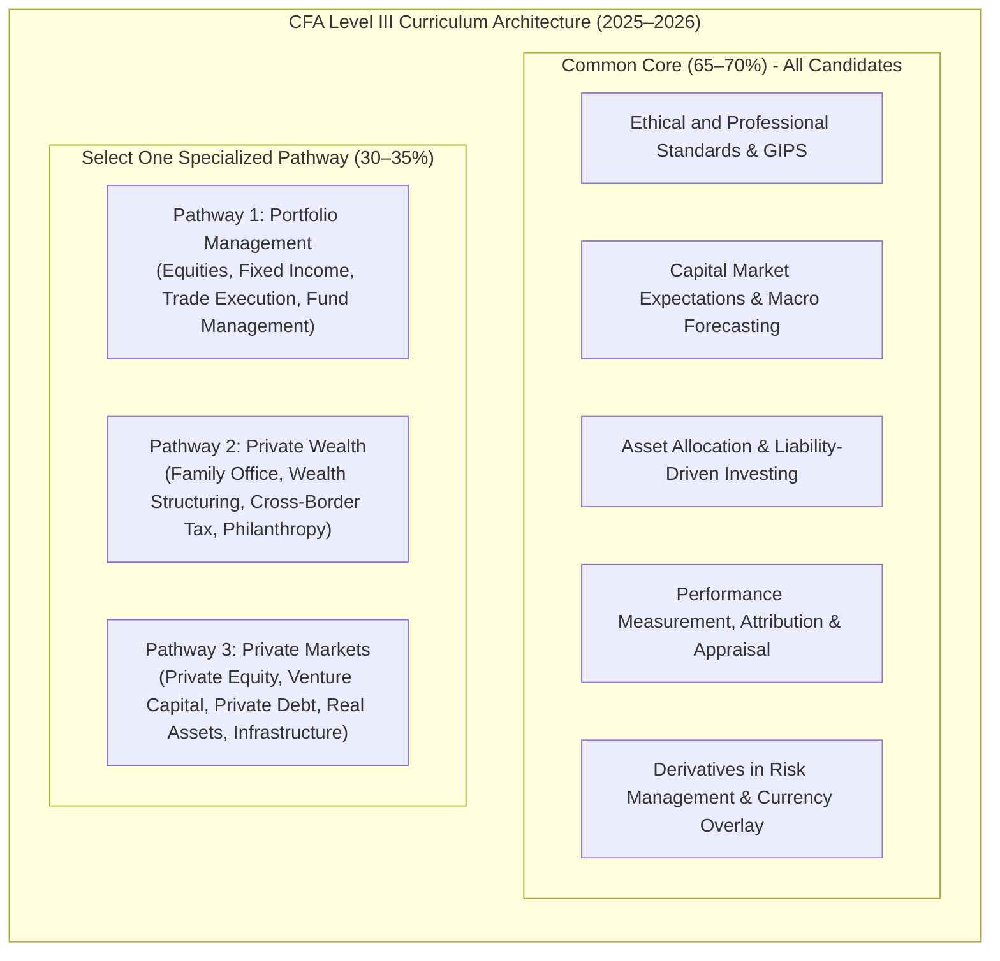

# CFA® & FRM® Qualifications Canonical Reference Dossier (2024–2026)

> **Document Type:** Institutional Research & Architecture Specification  
> **Target Qualifications:** Chartered Financial Analyst (CFA®) & Financial Risk Manager (FRM®)  
> **Governing Bodies:** CFA Institute (Charlottesville, VA, USA) & Global Association of Risk Professionals (GARP, Jersey City, NJ, USA)  
> **Curriculum Validity:** 2024–2026 Active Syllabus & Structural Overhauls  
> **Target Integration:** `data/cfa.json` and `data/frm.json` for Visual Roadmap Engine  

---

## 1. Executive Summary & Qualification Landscape

The global investment and risk management sectors are anchored by two premier gold-standard professional designations:
1. **Chartered Financial Analyst (CFA®):** Administered by the **CFA Institute**, the CFA charter is the globally acknowledged benchmark for portfolio management, equity and fixed income analysis, asset valuation, and ethical investment conduct. Over 190,000 charterholders operate in more than 160 countries.
2. **Financial Risk Manager (FRM®):** Administered by the **Global Association of Risk Professionals (GARP)**, the FRM certification is the definitive qualification for quantitative risk management, financial institutions regulation, market/credit/operational/liquidity risk modeling, and systemic resilience. Over 80,000 certified FRMs practice worldwide across tier-one investment banks, central banks, asset managers, and regulatory authorities.

### Core Comparison Matrix

| Dimension | CFA (Chartered Financial Analyst) | FRM (Financial Risk Manager) |
| :--- | :--- | :--- |
| **Administering Body** | CFA Institute (Charlottesville, VA, USA) | GARP - Global Association of Risk Professionals |
| **Core Domain** | Investment Valuation, Asset Allocation, Wealth & Portfolio Management | Financial Risk Management, Derivatives Pricing, Capital & Liquidity Regulation |
| **Levels / Parts** | 3 Sequential Levels (Level I, Level II, Level III) | 2 Sequential Parts (Part I, Part II) |
| **Prerequisites** | Bachelor's degree (or within 23 months of graduation) or 4,000 hrs combined work/education | No educational or professional prerequisites to sit for exams |
| **Exam Format** | Computer-Based Testing (CBT Prometric): MCQs (L1/L2/L3) & Constructed Response (L3) | Computer-Based Testing (CBT Pearson VUE / Prometric): 100% Multiple Choice (4 choices) |
| **Practical Skills Modules** | **Mandatory** online modules (10–20 hrs) per level (2024+ reform) | Not applicable (focus is pure examination + practical experience) |
| **Specialized Pathways** | **Yes (Level III 2025+)**: Portfolio Management, Private Wealth, Private Markets | Unified curriculum across all candidates |
| **Experience Requirement** | 4,000 hours accrued over $\ge$ 36 months in investment decision-making | 2 years (24 months) full-time professional financial risk experience |
| **Average Study Hours** | 300–350 hours per level (~900–1,050 hours total) | 200–250 hours per part (~400–500 hours total) |
| **Global Recognition** | Gold standard for Asset Management, Hedge Funds, Equity Research, Wealth Mgt | Gold standard for Risk Advisory, Banking Regulation, ALM, Treasury, Quantitative Risk |

```mermaid
flowchart TD
    subgraph CFA_Journey["CFA® Qualification Pathway (CFA Institute)"]
        C1["Undergraduate Degree (Final 23 Mo) / 4,000h Work"] --> L1["CFA Level I Exam (180 MCQs)"]
        L1 --> PSM1["Mandatory PSM I (Python or Financial Modeling)"]
        PSM1 --> L2["CFA Level II Exam (88 Vignette MCQs)"]
        L2 --> PSM2["Mandatory PSM II (Python/Data Science/AI or Analyst Skills)"]
        PSM2 --> L3Choice{"Select Level III Pathway (2025+)"}
        L3Choice -->|"Path 1"| L3_PM["Level III: Portfolio Management"]
        L3Choice -->|"Path 2"| L3_PW["Level III: Private Wealth"]
        L3Choice -->|"Path 3"| L3_PMkt["Level III: Private Markets"]
        L3_PM --> PSM3["Mandatory PSM III"]
        L3_PW --> PSM3
        L3_PMkt --> PSM3
        PSM3 --> CFA_EXP["4,000 Hours / 36 Months Investment Experience"]
        CFA_EXP --> CFA_CHARTER["CFA® Charterholder Conferred"]
    end

    subgraph FRM_Journey["FRM® Qualification Pathway (GARP)"]
        F_START["Open Registration (No Degree Prerequisite)"] --> FRM1["FRM Part I Exam (100 MCQs, 4 Hours)"]
        FRM1 -->|"Must Pass Part II Within 4 Years"| FRM2["FRM Part II Exam (80 MCQs, 4 Hours)"]
        FRM2 -->|"Must Submit Within 5 Years"| FRM_EXP["24 Months (2 Years) Professional Risk Experience"]
        FRM_EXP --> FRM_CERT["Certified FRM® Designation Conferred"]
    end
```



---

## 2. CFA® Program: Exhaustive Curriculum Specification (2024–2026)

### 2.1 The 2024–2026 Curriculum Evolution Architecture
Starting with the 2024 exam cycle and culminating in the 2025/2026 Level III rollout, the CFA Institute instituted the most significant evolution of the CFA Program in its 60-year history:
1. **Core Curriculum Streamlining:** Redundant and introductory academic materials were shifted into digital pre-readings, focusing exam-tested content strictly on practitioner valuation and synthesis.
2. **Introduction of Practical Skills Modules (PSMs):** Candidates must complete hands-on, 10–20 hour interactive modules in Python, Excel financial modeling, or AI before exam results are released.
3. **Level III Specialized Pathways (Effective 2025+):** Level III abandons the single monolithic track. Candidates master a Common Core (~65–70%) and choose one of three career-aligned pathways (~30–35%): Portfolio Management, Private Wealth, or Private Markets.
4. **Digital Badging & Stepped Milestones:** Independent digital credentials awarded for Level I and Level II completion to bolster early-career marketability.
5. **Eligibility Window Expansion:** University undergraduates can register for Level I up to **23 months** before graduation (previously 11 months).

---

### 2.2 The 10 Core Topic Domains & Historical Weight Evolution

The CFA curriculum spans 10 foundational topics. Their relative weight shifts dynamically as candidates progress from fundamental tools (Level I) to asset valuation (Level II) and portfolio synthesis (Level III).

| # | Topic Domain | Level I Weight (2024–2026) | Level II Weight (2024–2026) | Level III Weight (2025–2026 Common Core) | Primary Focus by Level |
| :-: | :--- | :-: | :-: | :-: | :--- |
| **1** | **Ethical and Professional Standards** | **15–20%** | **10–15%** | **10–15%** | L1: Code & Standards; L2: Vignette dilemmas; L3: GIPS & Institutional compliance |
| **2** | **Quantitative Methods** | **6–9%** | **5–10%** | *Integrated* | L1: TVM, Probability, Hypothesis; L2: Multiple regression, Time series, ML |
| **3** | **Economics** | **6–9%** | **5–10%** | **5–10%** | L1: Micro/Macro & FX; L2: Currency exchange rates & Growth theories; L3: Capital market expectations |
| **4** | **Financial Statement Analysis** | **11–14%** | **10–15%** | — | L1: IFRS/US-GAAP mechanics; L2: Intercorporate investments, pensions, multinational operations |
| **5** | **Corporate Issuers** | **6–9%** | **5–10%** | — | L1: Governance, working capital, leverage; L2: M&A, capital structure, corporate restructuring |
| **6** | **Equity Investments** | **11–14%** | **10–15%** | *Path/Core (10–15%)* | L1: Market structure, DCF indices; L2: Multi-stage DDM, FCFF/FCFE, Market multiples, Residual income |
| **7** | **Fixed Income** | **11–14%** | **10–15%** | **15–20%** | L1: Yields, duration, convexity; L2: Term structure, credit spreads, binomial trees; L3: Active & LDI fixed income |
| **8** | **Derivatives** | **5–8%** | **5–10%** | **5–10%** | L1: Mechanics of forwards, futures, swaps, options; L2: Arbitrage pricing, Black-Scholes, Swaptions; L3: Synthetic hedging |
| **9** | **Alternative Investments** | **7–10%** | **5–10%** | *Path/Core (Varies)* | L1: Real estate, private equity, hedge funds, commodities; L2: Direct real estate, PE waterfalls; L3: Specialized allocations |
| **10**| **Portfolio Management & Wealth Planning** | **8–11%** | **10–15%** | **30–35% (Pathway Dependent)** | L1: Portfolio basics, IPS fundamentals; L2: Multifactor models, active risk; L3: Deep specialization |

---

### 2.3 Detailed Level-by-Level Syllabus Breakdown

#### Level I: Investment Tools and Foundational Concepts
* **Exam Format:** 180 Multiple-Choice Questions (MCQ) administered over two 135-minute sessions (90 questions per session) with an optional 30-minute break.
* **Question Style:** Independent 3-choice questions (A, B, C). No negative marking.
* **Session Structure:**
  - *Session 1 (Morning, 2.25 hours):* Ethics & Professional Standards, Quantitative Methods, Economics, Financial Statement Analysis.
  - *Session 2 (Afternoon, 2.25 hours):* Corporate Issuers, Equity Investments, Fixed Income, Derivatives, Alternative Investments, Portfolio Management.
* **Granular Learning Modules:**
  1. *Ethical & Professional Standards:* Code of Ethics; Standards of Professional Conduct I–VII; Global Investment Performance Standards (GIPS) Introduction.
  2. *Quantitative Methods:* Rates and Returns; Time Value of Money; Statistical Measures of Asset Risk/Return; Probability Distributions; Sampling and Estimation; Hypothesis Testing; Simple Linear Regression and Correlation.
  3. *Economics:* Demand and Supply Analysis; Market Structures; Aggregate Output, Prices, and Economic Growth; Business Cycles; Monetary and Fiscal Policy; Geopolitics and International Trade; Exchange Rates.
  4. *Financial Statement Analysis:* Income Statement, Balance Sheet, Cash Flow Statement; Inventory Methods (FIFO, LIFO); Long-Lived Assets and Capitalization; Income Taxes (Deferred Tax Assets/Liabilities); Non-Current Liabilities (Bonds, Leases); Financial Reporting Quality.
  5. *Corporate Issuers:* Corporate Governance and ESG Integration; Working Capital Management; Capital Investments & Cost of Capital; Capital Structure and Dividend Policies.
  6. *Equity Investments:* Market Organization and Structure; Security Market Indexes; Market Efficiency (EMH); Industry and Company Analysis; Equity Valuation Models (Present Value Models, Multiplier Models, Asset-Based Models).
  7. *Fixed Income:* Fixed-Income Securities: Defining Elements; Issuance, Trading, and Funding; Bond Valuation and Yield Measures; Asset-Backed Securities (ABS, MBS); Understanding Fixed-Income Risk and Return; Credit Analysis Fundamentals.
  8. *Derivatives:* Derivative Instrument Features; Forward Commitment and Contingent Claim Characteristics; Derivative Benefits and Risks; Arbitrage, Replication, and Pricing Principles.
  9. *Alternative Investments:* Private Equity; Real Estate; Commodities; Infrastructure; Digital Assets & Hedge Funds.
  10. *Portfolio Management:* Portfolio Approach to Investing; Risk and Return Measurement; Basics of Portfolio Planning and Construction; The Investment Policy Statement (IPS); Behavioral Biases.

#### Level II: Asset Valuation and In-Depth Application
* **Exam Format:** 88 Multiple-Choice Questions organized into **22 Item Sets (Vignettes)** administered across two 132-minute sessions (11 item sets per session, 4 questions per vignette).
* **Question Style:** Case vignettes (1–2.5 pages) providing complex financial exhibits, earnings calls, or corporate filings followed by 4 related 3-choice questions.
* **Key Focus:** Valuing assets, interpreting complex intercorporate financial statements, applying regression and machine learning to financial data, and modeling risk.
* **Granular Learning Modules:**
  1. *Ethical & Professional Standards:* Application of Standards I–VII to institutional and corporate case vignettes; Soft Dollar Standards; Research Objectivity.
  2. *Quantitative Methods:* Multiple Linear Regression; Time-Series Analysis (Autoregressive models, Seasonality, Unit Roots, ARCH/GARCH); Machine Learning (Supervised vs. Unsupervised, Regularization); Big Data Projects.
  3. *Economics:* Currency Exchange Rates: Understanding Equilibrium Value (Covered/Uncovered Interest Parity, Purchasing Power Parity); Economic Growth and the Investment Decision; Regulation of Financial Markets.
  4. *Financial Statement Analysis:* Intercorporate Investments (Associates, Joint Ventures, Business Combinations under IFRS 3 and US GAAP); Employee Compensation: Post-Employment and Share-Based; Multinational Operations (Temporal vs. Current Rate Translation Methods); Analysis of Financial Institutions.
  5. *Corporate Issuers:* Corporate Restructuring; Mergers and Acquisitions (M&A Valuation, Due Diligence, Antitakeover Defense); Capital Structure Dynamics; Corporate Governance and Board Oversight.
  6. *Equity Valuation:* Free Cash Flow Valuation (FCFF and FCFE); Market-Based Valuation (P/E, P/B, P/S, EV/EBITDA); Residual Income Valuation; Private Company Valuation (Capitalized Cash Flow, Excess Earnings, DLOM, DLOC).
  7. *Fixed Income:* The Term Structure and Interest Rate Dynamics (Spot curves, forward curves, Cox-Ingersoll-Ross, Vasicek); Arbitrage-Free Valuation Frameworks; Valuation and Analysis of Bonds with Embedded Options (Callable, Putable, Binomial Trees); Credit Analysis Models (Structural vs. Reduced-Form, Credit Default Swaps).
  8. *Derivatives:* Pricing and Valuation of Forward Commitments (Currency forwards, interest rate swaps, FRA); Valuation of Contingent Claims (Black-Scholes-Merton model, Option Greeks, Delta hedging, Swaptions).
  9. *Alternative Investments:* Private Equity Investments (LBO modeling, Carried Interest, Clawbacks, NAV valuation); Real Estate Investments (Direct Real Estate, REITs, DCF capitalization); Commodities and Commodity Futures Curves (Contango, Backwardation, Roll Yield).
  10. *Portfolio Management:* Exchange-Traded Funds (ETFs): Mechanics and Tactics; Multifactor Models (Fama-French, Carhart, Fundamental Risk Models); Measuring and Managing Market Risk (Value at Risk, Parametric/Historical/Monte Carlo); Economics of Investment Management; Algorithmic Trading and Execution.

#### Level III: Portfolio Management & Wealth Synthesis (2025–2026 Pathways)
* **Exam Format:** 11 Item Sets total: A balanced mix of **Constructed Response (Essay) Questions** and **Multiple-Choice Item Sets** across two 132-minute sessions.
* **Structure:**
  - **Common Core (~65–70% of exam score):** Required for all candidates.
  - **Specialized Pathway (~30–35% of exam score):** Candidate chooses 1 of 3 tracks at registration.



##### The 3 Level III Specialized Pathways Explained:
1. **Portfolio Management Pathway (Traditional Track):**
   - *Target Professional:* Institutional Asset Managers, Hedge Fund PMs, Chief Investment Officers, Mutual Fund Managers.
   - *Core Syllabus:* Active Equity Investing (Fundamental and Quantitative approaches); Active Fixed Income Portfolio Strategies (Yield curve strategies, credit spread management); Trade Execution, Costs, and Market Microstructure; Managing Institutional Portfolios (Defined Benefit Pensions, Endowments, Sovereign Wealth Funds).
2. **Private Wealth Pathway:**
   - *Target Professional:* Ultra-High-Net-Worth (UHNW) Wealth Managers, Private Bankers, Family Office Principals.
   - *Core Syllabus:* Wealth Planning and Private Client Advisory; The Private Wealth Ecosystem and Practice Management; Concentrated Single-Asset Positions (Equities, Real Estate, Privately Owned Businesses); Estate and Wealth-Transfer Planning; Family Governance and Philanthropic Vehicles; Cross-Border Taxation and Multi-Jurisdictional Structuring.
3. **Private Markets Pathway:**
   - *Target Professional:* Private Equity Investment Professionals, Venture Capitalists, Private Credit Underwriters, Infrastructure/Real Asset Principals.
   - *Core Syllabus:* Sourcing and Due Diligence in Non-Public Markets; Private Equity Buyout Structuring and LBO Economics; Venture Capital Valuation and Term Sheets; Private Debt and Mezzanine Underwriting; Real Assets and Infrastructure Project Finance; Liquidity Management, Secondary Transactions, and LP/GP Fund Operations.

---

### 2.4 The Mandatory Practical Skills Modules (PSMs)

Introduced in 2024 to bridge academic theory and day-one workplace execution, PSMs are 10–20 hour online simulation labs. **Completion is mandatory before exam results are released.**

| Level | Available PSMs (Candidate selects 1) | Core Tooling & Technologies | Key Deliverable / Real-World Competency |
| :---: | :--- | :--- | :--- |
| **Level I** | **1. Financial Modeling** | Microsoft Excel | Building a fully dynamically balanced three-statement corporate model (Income Statement, Balance Sheet, Cash Flow) from 10-K filings. |
| | **2. Python Programming Fundamentals** | Python 3, Jupyter Notebooks | Writing clean Python scripts, data structures, conditional control flows, and financial algorithms for return/volatility calculations. |
| **Level II** | **1. Python, Data Science & AI** | Python, pandas, scikit-learn, NumPy | Building machine learning prediction pipelines, processing non-traditional NLP financial sentiment data, and financial feature engineering. |
| | **2. Analyst Skills** | Financial Modeling, CapIQ/Bloomberg data | Conducting sell-side/buy-side equity research, drafting an initiation note, multi-scenario DCF valuation, and earnings call modeling. |
| | *3. Python Programming Fundamentals* | Python 3 | *(Only available if candidate did not complete Python at Level I)* |
| **Level III**| **1. Portfolio Development & Construction** | Quantitative Portfolio Software | Building multi-asset portfolios, stress-testing constraints, tracking error optimization, and dynamic rebalancing under client IPS limits. |
| | **2. Macro Insights for Investing** | Economic Time-Series & Dashboards | Interpreting central bank balance sheets, inflation regimes, yield curve shifts, and generating macro investment themes. |
| | **3. Private Markets Due Diligence** | Private Equity / Real Asset Data | Sourcing data rooms, assessing waterfall return splits, calculating net IRR, and drafting investment committee memos. |
| | **4. Managing Private Wealth Clients** | Wealth Planning Software | Client profiling, behavioral interview simulations, tax-sheltered asset location, and intergenerational transfer planning. |

---

### 2.5 Passing Criteria, Grading Methodology, & Work Experience

#### Standard Setting: The Modified Angoff Method
The CFA Institute does not apply a fixed numerical passing score (e.g., 70%) nor does it grade on a predetermined bell-curve percentile:
* **Minimum Passing Score (MPS):** Established after every exam administration by a panel of charterholder subject-matter experts using the **Modified Angoff method**. The panel evaluates each question to determine the likelihood that a minimally competent candidate would answer correctly.
* **Ethics Adjustment:** For candidates whose aggregate score falls within a narrow margin of error around the MPS, the CFA Institute conducts an **Ethics Review**. A strong performance in Ethical and Professional Standards can elevate a borderline candidate to a "Pass," whereas poor ethics scores will result in a "Fail."

#### Work Experience Requirements for Full Charterholder Status
To earn the right to use the CFA® designation, a candidate who has passed all three exam levels must:
1. **Accrue Qualified Work Experience:** Accumulate at least **4,000 hours of professional experience** completed over a minimum of **36 months**.
2. **Qualifying Scope:** The work must directly contribute to the **investment decision-making process** or produce work products (research, valuation, financial modeling, portfolio risk analysis) that directly inform investment decisions.
3. **Professional References:** Submit 2 to 3 professional references (at least one must ideally be an active CFA charterholder).
4. **Member Acceptance:** Submit a formal application to CFA Institute and a local CFA Society, signing the annual Professional Conduct Statement.

---

## 3. FRM® Program: Exhaustive Curriculum Specification (GARP)

### 3.1 Overview, Governance & Exam Architecture
The Financial Risk Manager (FRM®) qualification is administered by the **Global Association of Risk Professionals (GARP)**. It is universally recognized as the international benchmark for credit, market, operational, and liquidity risk practitioners.

* **Eligibility:** No academic degrees or prior finance experience are required to register and sit for the examinations.
* **Format:** 100% Computer-Based Testing (CBT) delivered globally through Pearson VUE and Prometric test centers.
* **Structure:** Divided into two sequential, standalone examinations: **FRM Part I** and **FRM Part II**.
* **Language:** American English.
* **Exam Frequency:** Offered during distinct testing windows (typically May, August, and November).

---

### 3.2 FRM Part I: Core Tools of Risk Management (100 MCQs, 4 Hours)

Part I focuses on the quantitative methodologies, financial instruments, and valuation tools essential to risk assessment.

| Module # | Topic Domain | Weight | Core Focus & Sub-topics |
| :-: | :--- | :-: | :--- |
| **P1.1** | **Foundations of Risk Management** | **20%** | • Enterprise Risk Management (ERM) frameworks (COSO, ISO 31000)<br>• Risk governance, corporate board oversight, and risk appetite statements<br>• The Capital Asset Pricing Model (CAPM), Arbitrage Pricing Theory (APT), multi-factor models<br>• Basel regulatory capital framework (Basel I, II, 2.5, III, and IV principles)<br>• Financial disasters and case studies: Barings, LTCM, Enron, Lehman Brothers, Metallgesellschaft<br>• The GARP Code of Conduct |
| **P1.2** | **Quantitative Analysis** | **20%** | • Probability theory, discrete and continuous distributions (Normal, Lognormal, Poisson, Student's t, Chi-square, F-distribution)<br>• Statistical sampling, point estimators, hypothesis testing, confidence intervals<br>• Simple and multiple linear regression, OLS assumptions, multicollinearity, heteroskedasticity<br>• Time-series analysis: AR, MA, ARMA, ARIMA, stationarity, unit roots, volatility clustering, ARCH/GARCH models<br>• Simulation methods: Monte Carlo simulation, bootstrapping, antithetic variables<br>• Copulas and non-linear correlation structures |
| **P1.3** | **Financial Markets and Products** | **30%** | • Mechanics of Over-The-Counter (OTC) and exchange-traded derivative markets<br>• Futures and forward contracts: hedging, pricing, arbitrage, basis risk, optimal hedge ratio<br>• Commodity markets, energy derivatives, convenience yield, cost of carry<br>• Foreign exchange markets and cross-currency swaps<br>• Options: moneyness, payoff structures, put-call parity, trading strategies (straddles, strangles, bull/bear spreads)<br>• Interest rate swaps, forward rate agreements (FRAs), overnight index swaps (OIS)<br>• Fixed-income securities, corporate bonds, mortgage-backed securities (MBS), collateralized debt obligations (CDOs) |
| **P1.4** | **Valuation and Risk Models** | **30%** | • Value at Risk (VaR): Parametric (delta-normal), historical simulation, and Monte Carlo approaches<br>• Expected Shortfall (ES / CVaR) and coherent risk measures<br>• Stress testing and scenario analysis<br>• Option pricing models: Binomial tree models, Black-Scholes-Merton (BSM) analytical pricing<br>• The Option Greeks: Delta, Gamma, Theta, Vega, Rho, and dynamic Delta hedging<br>• Fixed-income valuation: yield to maturity, Macauley duration, modified duration, dollar duration, convexity<br>• Credit rating migrations, transition matrices, and basic credit scoring models<br>• Sovereign risk, country risk models, and operational risk loss distributions |

---

### 3.3 FRM Part II: Practical Application & Advanced Risk Domains (80 MCQs, 4 Hours)

Part II examines the advanced application of risk management practices, balance-sheet resilience, and institutional capital adequacy.

| Module # | Topic Domain | Weight | Core Focus & Sub-topics |
| :-: | :--- | :-: | :--- |
| **P2.1** | **Market Risk Measurement & Management** | **20%** | • Advanced VaR estimation: Extreme Value Theory (EVT), Peaks-over-Threshold (POT), generalized Pareto distributions<br>• Volatility smiles, skews, surfaces, and implied volatility dynamics<br>• Term structure models: equilibrium models (Vasicek, Cox-Ingersoll-Ross) and no-arbitrage models (Ho-Lee, Hull-White)<br>• Correlation risk, copula dependency in stress environments, structured credit tranches<br>• Non-parametric VaR enhancements, age-weighted and volatility-weighted historical simulation |
| **P2.2** | **Credit Risk Measurement & Management** | **20%** | • Credit risk metrics: Probability of Default (PD), Loss Given Default (LGD), Exposure at Default (EAD), Expected Loss (EL)<br>• Structural default models (Merton model, KMV) and Reduced-form default models<br>• Counterparty credit risk (CCR): Credit Valuation Adjustment (CVA), Debit Valuation Adjustment (DVA), Funding Valuation Adjustment (FVA)<br>• Potential Future Exposure (PFE), Netting agreements, ISDA Master Agreements, Credit Support Annexes (CSAs), Initial/Variation Margin<br>• Central Counterparties (CCPs) and clearinghouse systemic risk<br>• Credit derivatives: Credit Default Swaps (CDS), CDS index tranches, asset-backed securities (ABS), securitization |
| **P2.3** | **Operational Risk and Resilience** | **20%** | • Basel Committee Principles for the Sound Management of Operational Risk (PSMOR)<br>• Basel regulatory capital: Standardized Measurement Approach (SMA) for operational risk<br>• Enterprise risk management (ERM), risk appetite articulation, and Key Risk Indicators (KRIs)<br>• Model risk governance, model validation protocols, and backtesting methodologies<br>• Cyber risk, cloud infrastructure vulnerabilities, distributed denial of service (DDoS), ransomware resilience<br>• Third-party and vendor risk management<br>• Operational resilience, business continuity planning (BCP), and disaster recovery<br>• Loss data collection, scenario analysis, internal fraud prevention, and anti-money laundering (AML) controls |
| **P2.4** | **Liquidity and Treasury Risk** | **15%** | • Liquidity risk dimensions: Market liquidity risk vs. Funding liquidity risk<br>• Basel III liquidity regulation: Liquidity Coverage Ratio (LCR) and Net Stable Funding Ratio (NSFR)<br>• Asset-Liability Management (ALM) in commercial and investment banks<br>• Liquidity stress testing, contingency funding plans (CFP), and liquidity buffer composition<br>• Intraday liquidity risk and central bank settlement systems<br>• Funds Transfer Pricing (FTP) and internal liquidity pricing across business lines<br>• Collateral management, rehypothecation, and repo market dynamics |
| **P2.5** | **Risk Management & Investment Management** | **15%** | • Factor investing, smart beta, and risk-factor decomposition<br>• Portfolio risk budgeting, VaR budgeting, and marginal contribution to risk (MCR)<br>• Portfolio performance attribution (Brinson-Fachler, multi-factor attribution) and appraisal ratios (Information ratio, Sortino, Treynor)<br>• Hedge fund strategies, leverage monitoring, style drift, and operational due diligence<br>• Private equity and venture capital risk management, J-curve dynamics, and illiquidity premia<br>• Pension fund risk management and Liability-Driven Investment (LDI) strategies |
| **P2.6** | **Current Issues in Financial Markets** | **10%** | *(Annually updated readings covering cutting-edge real-world risks)*<br>• Artificial Intelligence and Machine Learning in risk management and automated trading<br>• Climate risk: Physical risks, transition risks, carbon pricing, and NGFS scenario modeling<br>• Digital assets, cryptocurrencies, stablecoins, and Central Bank Digital Currencies (CBDCs)<br>• Banking stress case studies (e.g., Silicon Valley Bank, Signature Bank, Credit Suisse merger)<br>• Interest rate regime shifts, inflation dynamics, and geopolitical supply-chain fractures |

---

### 3.4 Certification Timeline & Work Experience Requirements

To hold the certified **Financial Risk Manager (FRM®)** designation, candidates must satisfy the following strict timeline rules:
1. **Part I $\rightarrow$ Part II Window:** Once a candidate passes FRM Part I, they have **up to 4 years** to pass FRM Part II. If Part II is not passed within 4 years, Part I expires and the candidate must re-enroll and re-sit Part I.
2. **Professional Experience Accrual:** After passing both Part I and Part II, candidates must demonstrate at least **two years (24 months) of full-time professional work experience** in financial risk management or a closely related discipline (e.g., credit risk analysis, market risk monitoring, treasury operations, enterprise risk governance, trading risk, risk technology, auditing, or financial consulting).
3. **Experience Submission Deadline:** Candidates have **up to 5 years** from the date they pass Part II to submit their 24-month professional experience description via the GARP portal.
4. **Code of Conduct:** Every certified FRM must sign and uphold the **GARP Code of Conduct**, committing to fiduciary integrity and sound market ethics.

---

## 4. Multi-Credential Synthesis: CFA vs. FRM vs. Accounting (ACCA / ICAB / CPA)

Modern financial institutions increasingly demand professionals who can navigate between **asset generation (CFA)**, **loss prevention & regulatory solvency (FRM)**, and **financial integrity & audit assurance (ACCA / ICAB / CPA)**.

### 4.1 Cross-Disciplinary Overlap & Synergies

```mermaid
graph LR
    subgraph Accounting["Accounting (ACCA / ICAB / CPA)"]
        A_FS["Financial Reporting (IFRS/GAAP)"]
        A_AUD["Audit & Internal Controls"]
        A_TAX["Taxation & Corporate Law"]
    end

    subgraph CFA_Core["CFA® (Asset Valuation & PM)"]
        C_VAL["Equity & Multi-Asset Valuation"]
        C_ALM["Asset Allocation & Portfolio IPS"]
        C_ALT["Private Markets & Wealth Planning"]
    end

    subgraph FRM_Core["FRM® (Risk Modeling & Regulation)"]
        F_VAR["VaR, ES & Stress Testing"]
        F_BAS["Basel III/IV Capital & LCR/NSFR"]
        F_CRED["Counterparty Credit & CVA/DVA"]
    end

    subgraph Overlap_CF_FR["CFA + FRM Overlap (~30-35%)"]
        OV_Q["Advanced Quants & Time Series"]
        OV_FI["Fixed Income Yield & Duration"]
        OV_DER["Derivatives & BSM Greeks"]
        OV_ETH["Ethics & Fiduciary Governance"]
    end

    subgraph Overlap_CF_ACC["CFA + Accounting Overlap (~20%)"]
        OV_FSA["Financial Statement Analysis"]
        OV_CORP["Corporate Governance & M&A"]
    end

    CFA_Core --- Overlap_CF_FR --- FRM_Core
    CFA_Core --- Overlap_CF_ACC --- Accounting
```



### 4.2 Overlap Analysis Matrix

| Subject Area | CFA Focus | FRM Focus | Overlap Degree | Study Efficiency Strategy |
| :--- | :--- | :--- | :---: | :--- |
| **Fixed Income** | Valuation, yield curves, credit spread analysis, duration/convexity, active portfolio strategies | Term structure models (Vasicek, CIR), key-rate duration, interest rate risk hedging | **Very High (~75%)** | Preparing for CFA Level I & II Fixed Income covers ~80% of FRM Part I fixed income questions. |
| **Derivatives** | Arbitrage-free pricing, BSM valuation, payoff replication, portfolio hedging strategies | Greeks, volatility skew, tail risk hedging, counterparty credit risk (CVA/DVA) | **Very High (~80%)** | Mathematical formulas (BSM, Binomial trees) are identical. FRM emphasizes Greeks and counterparty risk deeper. |
| **Quantitative Methods** | Regression, time-series, hypothesis testing, machine learning for alpha generation | Probability distributions, GARCH volatility modeling, Monte Carlo, Copulas for loss modeling | **High (~65%)** | CFA Quants provides the baseline; FRM adds heavier parametric distributions and tail behavior. |
| **Financial Statement Analysis** | Exhaustive deep-dive into IFRS/US-GAAP balance sheets, pensions, intercorporate M&A | High-level understanding of leverage, credit scoring, and default probabilities | **Low (~20%)** | CFA FSA is far deeper; FRM candidates only need basic ratio analysis for credit models. |
| **Risk Metrics (VaR / ES)** | Covered as portfolio risk tools in Level II & Level III | Central core of the entire qualification across Part I and Part II | **Medium (~40%)** | FRM covers extreme value theory and sub-additive coherent risk measures far beyond CFA. |

### 4.3 Recommended Dual-Charter Strategy
For candidates pursuing both credentials:
1. **Phase 1 (The Foundational Engine):** Clear **CFA Level I**. This establishes rigorous mastery of economics, accounting, quantitative methods, and financial markets.
2. **Phase 2 (The Quantitative Risk Bridge):** Clear **FRM Part I** directly after or in parallel with CFA Level I. The massive overlap in quantitative methods, financial markets, derivatives, and fixed income cuts required FRM Part I study hours by nearly 40%.
3. **Phase 3 (The Valuation Master):** Clear **CFA Level II**. Capitalizes on deep valuation, equity modeling, and financial reporting.
4. **Phase 4 (The Risk Specialist):** Clear **FRM Part II**. Deepens market risk, credit risk, operational risk, and liquidity regulations (Basel III/IV).
5. **Phase 5 (The Capstone):** Clear **CFA Level III**. Complete the chosen pathway (Portfolio Management, Private Wealth, or Private Markets) and finalize dual-charter credentials.

---

## 5. Application JSON Architecture & Integration Blueprint

To integrate the CFA and FRM roadmaps into the repository's visual roadmap engine (`app.js`, `styles.css`, `index.html`), data files must strictly adhere to the project's canonical schema demonstrated in `data/acca.json` and `data/icab.json`.

### 5.1 Canonical Schema Requirements
Each qualification dataset requires:
* `id`: Short lowercase slug (e.g. `"cfa"`, `"frm"`).
* `title`: Full official name.
* `region`: Geographic reach (`"Global"`).
* `body`: Official administrating body (`"CFA Institute"` or `"Global Association of Risk Professionals (GARP)"`).
* `officialUrl`: Verified HTTPS portal URL.
* `lastVerified`: ISO date string (e.g. `"2025-01-15"`).
* `source`: Canonical syllabus source citation.
* `summary`: High-impact summary paragraph.
* `defaultRoute`: Primary default route ID (`"standard-pm"` for CFA; `"standard"` for FRM).
* `routes`: Object containing route variations.
  - For **CFA**: 3 distinct routes matching the 2025+ Level III pathways:
    1. `"standard-pm"` (Portfolio Management Pathway)
    2. `"private-wealth"` (Private Wealth Pathway)
    3. `"private-markets"` (Private Markets Pathway)
  - For **FRM**: Unified route `"standard"` representing Part I, Part II, and Experience.
* `stages`: Array of chronological stages. Each stage has:
  - `id`: Unique stage identifier string.
  - `title`: Stage header (e.g. `"Stage 1: CFA Level I – Foundations"`).
  - `subtitle`: Subtext detailing exam format and question count.
  - `nodes`: Array of actionable node objects.
* `nodes`:
  - `id`: Unique node ID (e.g. `"cf1"`, `"cf-psm1"`, `"fr1"`).
  - `name`: Paper or module title.
  - `category`: Categorization enum:
    - `"Admin"`: Registration, eligibility verification, membership.
    - `"Exam"`: Graded computer-based examinations.
    - `"Skill"`: Practical Skills Modules (PSMs) or technical labs.
    - `"Pathway"`: Specialized elective pathway modules.
    - `"Ethics"`: Professional ethics and conduct standards.
    - `"Experience"`: Practical supervised work hours.
  - `description`: 2–3 sentence high-density pedagogical summary of topics, weightages, and competencies.

---

### 5.2 CFA Dataset Blueprint (`data/cfa.json`)

```json
{
  "id": "cfa",
  "title": "CFA® Qualification (Chartered Financial Analyst)",
  "region": "Global",
  "body": "CFA Institute",
  "officialUrl": "https://www.cfainstitute.org",
  "lastVerified": "2025-01-15",
  "source": "CFA Institute 2024-2026 Program Guide & Curriculum Specifications",
  "summary": "The Chartered Financial Analyst (CFA®) charter is the premier global credential in investment analysis, asset allocation, and wealth management. The revised 2024–2026 curriculum introduces mandatory Practical Skills Modules (PSMs) in Python and Financial Modeling, alongside three specialized Level III pathways: Portfolio Management, Private Wealth, and Private Markets.",
  "defaultRoute": "standard-pm",
  "routes": {
    "standard-pm": {
      "id": "standard-pm",
      "name": "Portfolio Management Pathway (Traditional)",
      "tag": "Asset & Fund Management",
      "blurb": "Complete Levels I and II, mandatory Practical Skills Modules, and the Level III Portfolio Management Pathway specializing in active equity, fixed income strategies, and institutional trade execution.",
      "stages": [
        {
          "id": "cfa-stage1",
          "title": "Stage 1: CFA Level I – Investment Tools",
          "subtitle": "180 computer-based MCQs across two 135-minute sessions",
          "nodes": [
            {
              "id": "cfa-l1-admin",
              "name": "Eligibility & Registration",
              "category": "Admin",
              "description": "Verify academic eligibility (within 23 months of university graduation or 4,000 hours of professional work experience) and enroll via the CFA Institute candidate portal."
            },
            {
              "id": "cfa-l1-exam",
              "name": "CFA Level I Examination",
              "category": "Exam",
              "description": "Comprehensive 180-question CBT exam testing 10 foundational domains: Ethical & Professional Standards (15-20%), Financial Statement Analysis (11-14%), Equity (11-14%), Fixed Income (11-14%), Portfolio Management (8-11%), Corporate Issuers (6-9%), Economics (6-9%), Quantitative Methods (6-9%), Alternative Investments (7-10%), and Derivatives (5-8%)."
            },
            {
              "id": "cfa-l1-psm",
              "name": "Practical Skills Module I (PSM I)",
              "category": "Skill",
              "description": "Mandatory 10-20 hour hands-on online module completed prior to results release. Choose either Financial Modeling (3-statement Excel corporate valuation) or Python Programming Fundamentals."
            }
          ]
        },
        {
          "id": "cfa-stage2",
          "title": "Stage 2: CFA Level II – Asset Valuation",
          "subtitle": "88 item-set questions across 22 complex vignettes (two 132-minute sessions)",
          "nodes": [
            {
              "id": "cfa-l2-exam",
              "name": "CFA Level II Examination",
              "category": "Exam",
              "description": "Vignette-based case exam applying valuation models: Equity Valuation (10-15%), Fixed Income (10-15%), Financial Statement Analysis (10-15%), Portfolio Management (10-15%), Ethics (10-15%), Corporate Issuers (5-10%), Economics (5-10%), Quantitative Methods (5-10%), Derivatives (5-10%), and Alternative Investments (5-10%)."
            },
            {
              "id": "cfa-l2-psm",
              "name": "Practical Skills Module II (PSM II)",
              "category": "Skill",
              "description": "Mandatory 10-20 hour applied module. Options include Python, Data Science & AI (machine learning & financial NLP), Analyst Skills (equity research modeling & initiating coverage), or Python Fundamentals."
            }
          ]
        },
        {
          "id": "cfa-stage3-pm",
          "title": "Stage 3: CFA Level III – Portfolio Management Pathway",
          "subtitle": "Common Core + Specialized Pathway (Item sets & Constructed Response essay questions)",
          "nodes": [
            {
              "id": "cfa-l3-core",
              "name": "Level III Common Core Modules",
              "category": "Exam",
              "description": "Universal core curriculum (~65-70% of exam weight) spanning Capital Market Expectations, Asset Allocation, Performance Measurement & Attribution, Derivatives Risk Overlay, and Ethical Standards & GIPS compliance."
            },
            {
              "id": "cfa-l3-path-pm",
              "name": "Specialized Pathway: Portfolio Management",
              "category": "Pathway",
              "description": "Pathway-specific modules (~30-35% of exam weight) dedicated to active equity strategies, liability-driven fixed income management, institutional fund structures, and electronic trade execution."
            },
            {
              "id": "cfa-l3-psm",
              "name": "Practical Skills Module III (PSM III)",
              "category": "Skill",
              "description": "Mandatory practical project covering Portfolio Development & Construction or Macro Insights for Investing."
            }
          ]
        },
        {
          "id": "cfa-stage4",
          "title": "Stage 4: Charterholder Admission",
          "subtitle": "Professional experience verification and membership application",
          "nodes": [
            {
              "id": "cfa-exp",
              "name": "4,000 Hours / 36 Months Investment Experience",
              "category": "Experience",
              "description": "Document at least 4,000 hours of qualified professional experience directly contributing to the investment decision-making process over a minimum of 36 calendar months."
            },
            {
              "id": "cfa-sponsor",
              "name": "Professional References & Society Membership",
              "category": "Admin",
              "description": "Submit 2 to 3 professional references (ideally active CFA charterholders), sign the annual Professional Conduct Statement, and be admitted as a regular CFA Institute & local Society member."
            }
          ]
        }
      ]
    },
    "private-wealth": {
      "id": "private-wealth",
      "name": "Private Wealth Pathway (HNW / Family Office)",
      "tag": "Wealth Planning & Advisory",
      "blurb": "Complete Levels I and II, followed by the Level III Private Wealth Pathway focused on HNW/UHNW family office governance, cross-border tax, estate planning, and philanthropic structures.",
      "stages": [
        {
          "id": "cfa-pw-stage1",
          "title": "Stage 1: CFA Level I – Investment Tools",
          "subtitle": "180 computer-based MCQs across two 135-minute sessions",
          "nodes": [
            {
              "id": "cfa-pw-l1-exam",
              "name": "CFA Level I Examination",
              "category": "Exam",
              "description": "Foundational CBT exam across 10 asset and tool categories with emphasis on financial reporting and investment tools."
            },
            {
              "id": "cfa-pw-l1-psm",
              "name": "PSM I: Financial Modeling or Python",
              "category": "Skill",
              "description": "Hands-on modeling or Python foundations required before results release."
            }
          ]
        },
        {
          "id": "cfa-pw-stage2",
          "title": "Stage 2: CFA Level II – Asset Valuation",
          "subtitle": "88 item-set questions across 22 complex vignettes",
          "nodes": [
            {
              "id": "cfa-pw-l2-exam",
              "name": "CFA Level II Examination",
              "category": "Exam",
              "description": "In-depth valuation of equities, fixed income, derivatives, and private companies."
            },
            {
              "id": "cfa-pw-l2-psm",
              "name": "PSM II: Analyst Skills or Python/AI",
              "category": "Skill",
              "description": "Applied research and valuation module completed prior to Level II results."
            }
          ]
        },
        {
          "id": "cfa-pw-stage3",
          "title": "Stage 3: CFA Level III – Private Wealth Pathway",
          "subtitle": "Common Core + Private Wealth Specialization",
          "nodes": [
            {
              "id": "cfa-pw-l3-core",
              "name": "Level III Common Core Modules",
              "category": "Exam",
              "description": "Foundational portfolio management core: Asset Allocation, Capital Market Expectations, and Ethics."
            },
            {
              "id": "cfa-pw-l3-path",
              "name": "Specialized Pathway: Private Wealth Advisory",
              "category": "Pathway",
              "description": "Specialized curriculum (~30-35% of exam) focusing on HNW/UHNW client lifecycle, family governance, cross-border tax optimization, concentrated asset hedging, and philanthropic wealth transfer."
            },
            {
              "id": "cfa-pw-l3-psm",
              "name": "PSM III: Managing Private Wealth Clients",
              "category": "Skill",
              "description": "Practical simulation in client profiling, tax-aware asset location, and family office investment structuring."
            }
          ]
        },
        {
          "id": "cfa-pw-stage4",
          "title": "Stage 4: Charterholder Admission",
          "subtitle": "Work experience and professional references",
          "nodes": [
            {
              "id": "cfa-pw-exp",
              "name": "4,000 Hours / 36 Months Experience",
              "category": "Experience",
              "description": "Accrue 36 months of verified investment or wealth management advisory experience."
            },
            {
              "id": "cfa-pw-admit",
              "name": "Charterholder Credential Award",
              "category": "Admin",
              "description": "Complete professional references and become an officially credentialed CFA charterholder."
            }
          ]
        }
      ]
    },
    "private-markets": {
      "id": "private-markets",
      "name": "Private Markets Pathway (PE / VC / Private Debt)",
      "tag": "Alternative Assets & PE",
      "blurb": "Complete Levels I and II, followed by the Level III Private Markets Pathway tailored for private equity, venture capital, private debt underwriting, and infrastructure investing.",
      "stages": [
        {
          "id": "cfa-pmkt-stage1",
          "title": "Stage 1: CFA Level I – Investment Tools",
          "subtitle": "180 computer-based MCQs across two 135-minute sessions",
          "nodes": [
            {
              "id": "cfa-pmkt-l1-exam",
              "name": "CFA Level I Examination",
              "category": "Exam",
              "description": "Foundational CBT exam across 10 asset classes and financial statement analysis."
            },
            {
              "id": "cfa-pmkt-l1-psm",
              "name": "PSM I: Financial Modeling",
              "category": "Skill",
              "description": "Excel financial modeling for three-statement corporate analysis."
            }
          ]
        },
        {
          "id": "cfa-pmkt-stage2",
          "title": "Stage 2: CFA Level II – Asset Valuation",
          "subtitle": "88 item-set questions across 22 complex vignettes",
          "nodes": [
            {
              "id": "cfa-pmkt-l2-exam",
              "name": "CFA Level II Examination",
              "category": "Exam",
              "description": "Deep valuation across corporate issuers, private companies, LBO mechanics, and real estate."
            },
            {
              "id": "cfa-pmkt-l2-psm",
              "name": "PSM II: Analyst Skills or Python/AI",
              "category": "Skill",
              "description": "Equity research modeling or advanced financial machine learning."
            }
          ]
        },
        {
          "id": "cfa-pmkt-stage3",
          "title": "Stage 3: CFA Level III – Private Markets Pathway",
          "subtitle": "Common Core + Private Markets Specialization",
          "nodes": [
            {
              "id": "cfa-pmkt-l3-core",
              "name": "Level III Common Core Modules",
              "category": "Exam",
              "description": "Core portfolio construction, capital market expectations, and professional ethics."
            },
            {
              "id": "cfa-pmkt-l3-path",
              "name": "Specialized Pathway: Private Markets & Alternative Assets",
              "category": "Pathway",
              "description": "Specialized curriculum (~30-35% of exam) in non-public markets: Private Equity buyout models, Venture Capital term sheets, Private Debt/Mezzanine underwriting, Real Asset infrastructure, due diligence data rooms, and GP/LP waterfalls."
            },
            {
              "id": "cfa-pmkt-l3-psm",
              "name": "PSM III: Private Markets Due Diligence",
              "category": "Skill",
              "description": "Practical simulation analyzing investment data rooms, waterfall models, and writing investment committee investment memos."
            }
          ]
        },
        {
          "id": "cfa-pmkt-stage4",
          "title": "Stage 4: Charterholder Admission",
          "subtitle": "Work experience and professional references",
          "nodes": [
            {
              "id": "cfa-pmkt-exp",
              "name": "4,000 Hours / 36 Months Private Markets Experience",
              "category": "Experience",
              "description": "Verify 36 months of active investment decision-making in private equity, private debt, real assets, or corporate M&A."
            },
            {
              "id": "cfa-pmkt-admit",
              "name": "Charterholder Credential Award",
              "category": "Admin",
              "description": "Finalize sponsor recommendations, ethical adherence, and receive the official CFA charter."
            }
          ]
        }
      ]
    }
  }
}
```

---

### 5.3 FRM Dataset Blueprint (`data/frm.json`)

```json
{
  "id": "frm",
  "title": "FRM® Qualification (Financial Risk Manager)",
  "region": "Global",
  "body": "Global Association of Risk Professionals (GARP)",
  "officialUrl": "https://www.garp.org",
  "lastVerified": "2025-01-15",
  "source": "GARP FRM Candidate Guide & Exam Learning Objectives",
  "summary": "The Financial Risk Manager (FRM®) certification is the global gold standard for financial risk management professionals. Administered by GARP, the two-part computer-based curriculum covers quantitative analysis, financial markets, valuation and risk models, market/credit/operational/liquidity risk management, investment management, and current systemic financial issues.",
  "defaultRoute": "standard",
  "routes": {
    "standard": {
      "id": "standard",
      "name": "Standard Professional Pathway",
      "tag": "All Risk Practitioners",
      "blurb": "Complete FRM Part I (Foundations & Tools), FRM Part II (Advanced Measurement & Application), and verify 24 months of full-time professional risk experience to earn the certified FRM designation.",
      "stages": [
        {
          "id": "frm-stage1",
          "title": "Stage 1: FRM Part I – Risk Tools & Foundations",
          "subtitle": "100 multiple-choice questions (4 hours computer-based testing)",
          "nodes": [
            {
              "id": "frm-p1-admin",
              "name": "Registration & Enrollment",
              "category": "Admin",
              "description": "Register directly through the GARP portal without formal degree prerequisites and select a CBT examination window (May, August, or November)."
            },
            {
              "id": "frm-p1-foundations",
              "name": "Foundations of Risk Management (20%)",
              "category": "Exam",
              "description": "Enterprise Risk Management (ERM), corporate risk governance, risk appetite statements, portfolio theory (CAPM, APT), multi-factor models, historical financial disaster case studies, Basel regulatory framework, and the GARP Code of Conduct."
            },
            {
              "id": "frm-p1-quant",
              "name": "Quantitative Analysis (20%)",
              "category": "Exam",
              "description": "Probability distributions, statistical estimators, hypothesis testing, multiple regression, time-series analysis (AR, MA, GARCH models), Monte Carlo simulation techniques, and copulas."
            },
            {
              "id": "frm-p1-markets",
              "name": "Financial Markets and Products (30%)",
              "category": "Exam",
              "description": "Mechanics and pricing of OTC and exchange-traded derivatives (futures, forwards, options, swaps), foreign exchange markets, commodity derivatives, corporate debt, and structured asset-backed securities (MBS/ABS)."
            },
            {
              "id": "frm-p1-valuation",
              "name": "Valuation and Risk Models (30%)",
              "category": "Exam",
              "description": "Value at Risk (VaR) estimation methodologies, Expected Shortfall (ES), stress testing, Black-Scholes option pricing, Option Greeks, bond valuation, modified duration, convexity, credit rating migrations, and sovereign risk models."
            }
          ]
        },
        {
          "id": "frm-stage2",
          "title": "Stage 2: FRM Part II – Advanced Risk Measurement & Application",
          "subtitle": "80 multiple-choice questions (4 hours computer-based testing, must pass within 4 years of Part I)",
          "nodes": [
            {
              "id": "frm-p2-market",
              "name": "Market Risk Measurement & Management (20%)",
              "category": "Exam",
              "description": "Advanced VaR and Expected Shortfall modeling, Extreme Value Theory (EVT), term structure models (Vasicek, CIR, Ho-Lee, Hull-White), volatility smiles and surfaces, and correlation risk."
            },
            {
              "id": "frm-p2-credit",
              "name": "Credit Risk Measurement & Management (20%)",
              "category": "Exam",
              "description": "Credit risk metrics (PD, LGD, EAD), structural models (Merton) and reduced-form default models, counterparty credit risk (CVA, DVA, FVA, PFE), ISDA master netting, CSAs, central clearing (CCPs), and credit derivatives (CDS)."
            },
            {
              "id": "frm-p2-operational",
              "name": "Operational Risk and Resilience (20%)",
              "category": "Exam",
              "description": "Basel Standardized Measurement Approach (SMA), Principles for the Sound Management of Operational Risk (PSMOR), model risk governance and validation, cyber risk, cloud resilience, third-party vendor risk, and business continuity."
            },
            {
              "id": "frm-p2-liquidity",
              "name": "Liquidity and Treasury Risk (15%)",
              "category": "Exam",
              "description": "Market vs. funding liquidity risk, Basel III liquidity regulations (LCR and NSFR), Asset-Liability Management (ALM), liquidity stress testing, contingency funding plans, funds transfer pricing (FTP), and repo collateral management."
            },
            {
              "id": "frm-p2-investment",
              "name": "Risk Management & Investment Management (15%)",
              "category": "Exam",
              "description": "Factor investing, portfolio risk budgeting, marginal contribution to risk, performance attribution and appraisal ratios, hedge fund strategy risks, private equity risk dynamics, and pension Liability-Driven Investment (LDI)."
            },
            {
              "id": "frm-p2-current",
              "name": "Current Issues in Financial Markets (10%)",
              "category": "Exam",
              "description": "Annually updated curriculum analyzing emerging risks: AI and machine learning in financial modeling, climate risk scenario analysis (physical and transition risks), digital assets & CBDCs, and banking distress case studies."
            }
          ]
        },
        {
          "id": "frm-stage3",
          "title": "Stage 3: Professional Certification & Designation",
          "subtitle": "Work experience verification and certified charter issuance",
          "nodes": [
            {
              "id": "frm-exp",
              "name": "24 Months Professional Risk Experience",
              "category": "Experience",
              "description": "Document at least two years (24 months) of full-time professional work experience in financial risk management or a related discipline, submitted within 5 years of passing Part II."
            },
            {
              "id": "frm-ethics",
              "name": "GARP Code of Conduct & Certification",
              "category": "Ethics",
              "description": "Formally accept the GARP Code of Conduct, verify professional credentials, and be awarded the certified Financial Risk Manager (FRM®) designation."
            }
          ]
        }
      ]
    }
  }
}
```

---

## 6. Verification and Integration Recommendations

1. **Dataset Deployment:**
   - Write the exact JSON files to `data/cfa.json` and `data/frm.json`.
   - Run `node scripts/bundle-data.js` to automatically package both files into `data/roadmaps.js`.
2. **Catalog & UI Integration:**
   - In `index.html` (or the catalog view in `app.js`), register both credentials under the **Global Finance & Risk Management** cluster alongside ACCA and ICAB.
   - For CFA, the multi-route selector will enable seamless toggling between **Portfolio Management**, **Private Wealth**, and **Private Markets** pathways, showcasing modern 2025/2026 curriculum agility.
   - Ensure the category badge coloring in `styles.css` supports `"Pathway"` with a distinctive badge color (e.g., accent amber/violet) alongside existing badges (`"Exam"`, `"Skill"`, `"Admin"`, `"Ethics"`, `"Experience"`).

---
*Dossier compiled from official CFA Institute Curriculum Guides (2024–2026), GARP FRM Learning Objectives & Candidate Handbook.*
