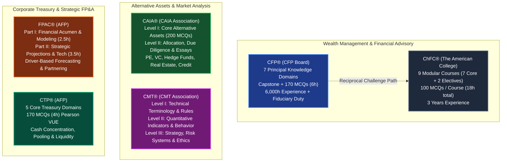

# Wealth Management, Financial Planning, Corporate FP&A, and Alternative Investment Qualifications Canonical Reference Dossier

> **Document Type:** Institutional Curriculum Specification & Architecture Reference Dossier  
> **Target Qualifications:**  
> 1. **CFP® (Certified Financial Planner)** — Certified Financial Planner Board of Standards (CFP Board)  
> 2. **ChFC® (Chartered Financial Consultant)** — The American College of Financial Services  
> 3. **CAIA® (Chartered Alternative Investment Analyst)** — CAIA Association  
> 4. **CMT® (Chartered Market Technician)** — CMT Association  
> 5. **FPAC® (Certified Corporate Financial Planning & Analysis Professional)** — Association for Financial Professionals (AFP)  
> 6. **CTP® (Certified Treasury Professional)** — Association for Financial Professionals (AFP)  
> **Status:** Active Authoritative Reference (2024–2026 Specifications)  
> **Target Application Files:** `data/cfp.json`, `data/chfc.json`, `data/caia.json`, `data/cmt.json`, `data/fpac.json`, `data/ctp.json`, and `data/roadmaps.js`  

---

## Executive Summary & Comprehensive Taxonomy Matrix

Modern finance has bifurcated into distinct, highly specialized professional disciplines that move beyond traditional public accounting and statutory audit. In the modern capital ecosystem, value creation, capital preservation, risk control, and strategic foresight require mastery across three critical industry verticals:

1. **Private Wealth Management & Personal Financial Advisory:** Delivering comprehensive fiduciary financial advisory to high-net-worth individuals, business owners, and families. Represented by the **CFP®** (the gold standard in holistic, fiduciary personal financial planning) and the **ChFC®** (the premier modular credential with specialized depth in small business, executive compensation, and estate structures).
2. **Alternative Investments & Advanced Market Analytics:** Navigating non-traditional asset classes and quantitative market timing. Represented by the **CAIA®** (private equity, venture capital, hedge funds, real assets, private debt, and structured products) and the **CMT®** (technical market analysis, behavioral finance, quantitative algorithmic systems, and market microstructure).
3. **Corporate Treasury & Strategic FP&A:** Steering corporate liquidity, working capital resilience, capital structure, and predictive driver-based enterprise budgeting. Represented by the **FPAC®** (corporate financial planning, variance analysis, financial modeling, and strategic business partnering) and the **CTP®** (global cash management, liquidity pooling, payment systems, bank relationship governance, and treasury financial risk management).

### Master Comparative Taxonomy

| Dimension | CFP® (CFP Board) | ChFC® (American College) | CAIA® (CAIA Association) | CMT® (CMT Association) | FPAC® (AFP) | CTP® (AFP) |
| :--- | :--- | :--- | :--- | :--- | :--- | :--- |
| **Administering Body** | Certified Financial Planner Board of Standards (USA) / FPSB | The American College of Financial Services | CAIA Association (Amherst, MA, USA) | CMT Association (New York, NY, USA) | Association for Financial Professionals (Bethesda, MD, USA) | Association for Financial Professionals (Bethesda, MD, USA) |
| **Primary Focus** | Fiduciary Personal Financial Planning, Tax, Retirement, Estate | Comprehensive Modular Financial Consulting & Business Owner Planning | Alternative Assets (PE, VC, Hedge Funds, Real Estate, Commodities) | Technical Market Analysis, Quantitative Systems, Behavioral Macro | Corporate FP&A, Projections, Driver Budgeting, Business Partnering | Corporate Treasury, Cash Concentration, Liquidity, Payment Systems |
| **Structure / Tiers** | Registered Education + Capstone + 1 Comprehensive Exam | 9 Discrete Modular Courses (7 Core + 2 Electives) | 2 Progressive Levels (Level I & Level II) | 3 Progressive Levels (Level I, Level II, Level III) | 2 Parts (Part I & Part II) | 1 Comprehensive Examination (5 Core Domains) |
| **Exam Delivery & Format** | Computer-Based Testing (Prometric): 170 MCQs across two 3-hour sessions | 9 Computer-Based Modular Exams (100 MCQs each, 2 hours per course) | Level I: 200 MCQs (4 hrs); Level II: 100 MCQs (2 hrs) + 3 Case Essays (2 hrs) | Level I: 132 MCQs (2 hrs); Level II: 170 MCQs (4 hrs); Level III: Essays & MCQs (4 hrs) | Part I: 125 MCQs (2.5 hrs); Part II: Case Studies, Simulations & MCQs (3.5 hrs) | Computer-Based Testing (Pearson VUE): 170 MCQs (4 hours) |
| **Educational Prerequisite** | Bachelor's Degree (within 5 yrs of passing exam) | High school diploma / open entry (degree recommended) | Bachelor's degree (or 4 yrs professional experience) | Open entry for Level I; Bachelor's degree recommended | Bachelor's degree (or enrolled undergraduate) | Bachelor's degree (or 2 yrs relevant experience) |
| **Experience Requirement** | 6,000 hours standard (or 4,000 hours direct Apprenticeship) | 3 years full-time qualifying business/financial experience | 1 year with Bachelor's degree (or 4 years without degree) | 3 years acceptable professional market analysis / investment experience | 2 to 3 years related corporate FP&A experience | 2 years full-time corporate treasury / cash management experience |
| **Passing Standard** | Criterion-referenced standard set by Board (historically ~60–65%) | 70% passing threshold per individual course exam | Criterion-referenced cut score (L1: ~50–55%; L2: ~55–65%) | Criterion-referenced cut score (L1: ~65%; L2: ~60%; L3: ~60%) | Scaled score $\ge$ 500 (200–800 scale) per part | Scaled score $\ge$ 500 (200–800 scale) |
| **Ethics Standard** | Mandatory adherence to CFP Board *Code of Ethics & Standards of Conduct* | Adherence to American College Code of Ethics & Pledge | Adherence to CAIA Code of Ethics / CFA Institute Standards | Adherence to CMT Code of Ethics (incorporates CFA Standards) | AFP Standards of Ethical Conduct | AFP Standards of Ethical Conduct |
| **Key Career Tracks** | Wealth Manager, RIA Principal, Financial Advisor, Private Banker | Financial Consultant, Wealth Strategist, Small Business Advisor | Alternative Investment Analyst, Fund-of-Funds Manager, PE Associate | Technical Analyst, Quantitative Strategist, Prop Trader, Portfolio Mgr | Corporate FP&A Manager, Strategic Finance Analyst, Director of Finance | Corporate Treasurer, Cash Manager, Liquidity Director, VP Finance |



---

# SECTION 1: CFP® (Certified Financial Planner) — CFP Board

## 1.1 Governance, Global Authority, and the "4 E's" Framework
- **Governing Body:** Certified Financial Planner Board of Standards, Inc. (CFP Board), Washington, D.C., USA. International standards are coordinated globally via the Financial Planning Standards Board (FPSB) across 27 territories and 223,000+ certified professionals.
- **Credential Standing:** The CFP mark is globally acknowledged as the gold standard for personal financial planning and wealth advisory. It requires meeting rigorous standards in the "4 E's": **Education, Examination, Experience, and Ethics**.
- **Fiduciary Invariant:** CFP professionals are bound by CFP Board's *Code of Ethics and Standards of Conduct* to act as a **fiduciary**—meaning they must act in the best interests of the client at all times when providing financial advice, placing client welfare above personal or firm financial gain.
- **Educational Prerequisite:** 
  1. Completion of a CFP Board-registered financial planning education program covering all Principal Knowledge Topics.
  2. Completion of a financial plan development **Capstone Course** (registered post-secondary course synthesizing real-world client data into a formal, deliverable financial plan).
  3. Holding a **Bachelor's degree** (or higher) in any discipline from an accredited university. (Candidates may sit for the exam before graduating, but have 5 years from their exam pass date to verify degree completion).
- **Accelerated Challenge Pathways:** Holders of certain elite credentials bypass the standard registered education coursework (though they must still complete the Capstone course and pass the CFP Exam):
  - Chartered Financial Analyst (CFA®)
  - Certified Public Accountant (CPA) / Chartered Professional Accountant
  - Chartered Financial Consultant (ChFC®)
  - Chartered Life Underwriter (CLU®)
  - Ph.D. in business, finance, or economics from an accredited institution
  - Licensed Attorney (JD)

---

## 1.2 Examination Architecture & Logistics
- **Delivery Platform:** Administered globally via Prometric Computer-Based Testing (CBT) centers and secure remote proctoring.
- **Testing Windows:** Offered three times per year across 8-day testing windows in **March, July, and November**.
- **Assessment Composition:**
  - **Total Items:** 170 Multiple-Choice Questions (MCQs), each with 4 answer choices.
  - **Structure:** Divided equally into two 3-hour sessions (85 questions each) with a mandatory/scheduled 40-minute break between sessions.
    - *Session 1:* 85 MCQs (180 minutes)
    - *Scheduled Break:* 40 minutes (clock stopped)
    - *Session 2:* 85 MCQs (180 minutes)
  - **Total Seat Time:** 7 hours (including 360 minutes of testing + tutorial, nondisclosure agreement, break, and exit survey).
- **Question Typologies:**
  1. *Standalone Conceptual & Calculation Items:* Individual questions evaluating specific rules, formulas, tax thresholds, or analytical steps.
  2. *Short Scenario Items:* Compact 2 to 3-paragraph vignettes followed by 2 to 5 targeted questions.
  3. *Comprehensive Case Studies:* Elaborate multi-page client profiles with detailed exhibits (tax returns, balance sheets, cash flow statements, insurance policies, estate wills/trusts, employee benefits summary) followed by 8 to 12 interconnected questions.
- **Passing Standard & Methodology:**
  - Evaluated on a **criterion-referenced basis** established through empirical Modified Angoff standard-setting studies.
  - No negative marking; scoring is based on total number of correctly answered questions.
  - Pass rates historically fluctuate between **60% and 67%** (first-time test-taker pass rates are typically 64%–68%).

---

## 1.3 The 7 Principal Knowledge Domains & Cognitive Weights

The CFP Board establishes the curriculum framework through a nationwide empirical Practice Analysis study. In the 2021–2026 curriculum cycle, the Principal Knowledge Topics are organized into **7 Core Functional Domains** (with the addition of Psychology of Financial Planning as a dedicated discipline):

```
CFP® Principal Knowledge Domains (100%)
├── 1. Professional Conduct and Regulation ──────── 8%
├── 2. General Principles of Financial Planning ── 15%
├── 3. Risk Management and Insurance Planning ──── 11%
├── 4. Investment Planning ──────────────────────── 17%
├── 5. Tax Planning ─────────────────────────────── 14%
├── 6. Retirement Savings and Income Planning ───── 18%
├── 7. Estate Planning ──────────────────────────── 10%
└── 8. Psychology of Financial Planning ─────────── 7%
```
*(Note: Industry curricula frequently present this as 7 domains by integrating Domain 1 and Domain 2 into General Principles, or maintaining the 8-domain taxonomy defined in the official CFP Board Candidate Handbook. Both classifications represent the identical weighted body of knowledge).*

### Detailed Domain Breakdown:

#### Domain 1: Professional Conduct and Regulation (8%)
- CFP Board Code of Ethics and Standards of Conduct (fiduciary duties, integrity, objectivity, competence, fairness, confidentiality, professionalism, diligence).
- Practice Standards for the Financial Planning Process (the 7-step financial planning process).
- Managing conflicts of interest, fee transparency, and full disclosure.
- Regulatory framework: SEC, FINRA, state blue sky laws, Investment Advisers Act of 1940, fiduciary vs. suitability standards.
- Disciplinary rules, investigative procedures, and sanctions.

#### Domain 2: General Principles of Financial Planning (15%)
- Financial planning process, relationship building, and engagement scope definition.
- Financial statement preparation and diagnostic analysis: Personal Balance Sheet, Cash Flow Statement, Budgeting, Liquidity Ratios, Debt-to-Income metrics.
- Economic and regulatory environment: Monetary/fiscal policy, inflation, interest rate cycles, yield curve analysis.
- Time Value of Money (TVM) applications: Annuities, perpetuities, Net Present Value (NPV), Internal Rate of Return (IRR), loan amortization schedules.
- Education funding vehicles: 529 College Savings Plans, Coverdell ESAs, UGMA/UTMA custodial accounts, financial aid mechanics (FAFSA, EFC/SAI).
- Debt management: Mortgage financing (fixed vs. ARM), refinancing analysis, consumer credit cards, bankruptcy chapters (Chapter 7 vs. Chapter 13).

#### Domain 3: Risk Management and Insurance Planning (11%)
- Risk identification, risk tolerance assessment, and personal risk management techniques (avoidance, retention, reduction, transfer).
- Legal aspects of insurance contracts: Indemnity, insurable interest, utmost good faith, adhesion, warranties, representations.
- Property and Casualty Insurance: Homeowners policies (HO-2, HO-3, HO-5, HO-8), replacement cost vs. actual cash value, coinsurance formulas, personal auto policies (PAP), personal liability umbrella policies (PUP).
- Health and Disability Insurance: High-Deductible Health Plans (HDHP), Health Savings Accounts (HSA), Flexible Spending Accounts (FSA), short-term vs. long-term disability, definition of disability (own-occupation vs. any-occupation).
- Long-Term Care (LTC) Insurance: Activities of Daily Living (ADLs), cognitive impairment triggers, partnership policies, tax treatment of premiums/benefits.
- Life Insurance Analysis: Term life, whole life, universal life, variable life, indexed universal life; policy surrender, 1035 exchanges, irrevocable life insurance trusts (ILIT).

#### Domain 4: Investment Planning (17%)
- Characteristics, valuation, and taxation of financial assets: Equities, corporate/municipal/treasury debt, mutual funds, ETFs, closed-end funds, real estate.
- Quantitative investment analysis: Holding Period Return (HPR), arithmetic vs. geometric mean, standard deviation, covariance, correlation coefficient, semi-variance.
- Modern Portfolio Theory (MPT): Efficient frontier, Capital Asset Pricing Model (CAPM), Beta, Capital Market Line (CML), Security Market Line (SML).
- Performance attribution and appraisal: Sharpe ratio, Treynor ratio, Jensen's Alpha, Information ratio, Tracking error.
- Asset allocation and portfolio construction: Strategic vs. tactical asset allocation, rebalancing thresholds, core-and-satellite structures.
- Derivative securities and hedging strategies: Puts, calls, covered calls, protective puts, collars, equity options tax rules.

#### Domain 5: Tax Planning (14%)
- Individual income tax fundamentals: Gross income inclusions/exclusions, Above-the-line adjustments to income (AGI deductions), standard vs. itemized deductions, personal income tax rates and brackets.
- Tax credits: Non-refundable vs. refundable credits (Child Tax Credit, Earned Income Tax Credit, American Opportunity Tax Credit, Lifetime Learning Credit).
- Capital gains taxation: Short-term vs. long-term rates, Net Investment Income Tax (NIIT), capital loss netting rules, Section 121 personal residence exclusion.
- Business entity taxation: Sole proprietorships, partnerships, S-corporations, C-corporations, Limited Liability Companies (LLCs); pass-through taxation and Section 199A Qualified Business Income (QBI) deduction.
- Alternative Minimum Tax (AMT): Calculation mechanics, preference items, AMT exemption phase-outs, Minimum Tax Credit (MTC).
- Tax reduction and deferral strategies: Charitable giving (Donor-Advised Funds, Private Foundations, Charitable Remainder Trusts), loss harvesting, installment sales.

#### Domain 6: Retirement Savings and Income Planning (18%)
- Retirement needs analysis: Capital accumulation models, wage replacement ratios, capital preservation vs. capital depletion approaches.
- Qualified retirement plans: Defined Benefit plans, Cash Balance plans, 401(k), Profit-Sharing, Money Purchase, Employee Stock Ownership Plans (ESOP).
- Non-qualified plans and government/tax-exempt plans: SEP-IRA, SIMPLE IRA, 403(b), 457(b), non-qualified deferred compensation (NQDC), Section 409A rules.
- Individual Retirement Accounts: Traditional IRA vs. Roth IRA, contribution eligibility, phase-out ranges, Backdoor Roth conversion mechanics, Mega-Backdoor Roth.
- Distribution rules and penalties: 10% early withdrawal penalty exceptions (Rule of 55, 72(t) SEPP), Required Minimum Distributions (RMDs) under SECURE Act 1.0 and 2.0, 10-year beneficiary rule for inherited IRAs.
- Social Security & Medicare: Primary Insurance Amount (PIA), Full Retirement Age (FRA), early claiming reductions (age 62) vs. delayed retirement credits (age 70), taxation of benefits; Medicare Parts A, B, C, D, and Medigap.

#### Domain 7: Estate Planning (10%)
- Estate planning documents and property titling: Wills, durable power of attorney for healthcare and finances, living wills, tenancy in common, joint tenancy with right of survivorship (JTWROS), tenancy by the entirety, community property.
- Probate process: Probate estate vs. gross estate, avoiding probate through beneficiary designations, transfer-on-death (TOD), payable-on-death (POD), revocable living trusts.
- Unified Federal Transfer Tax System: Gift tax annual exclusion, unified lifetime gift and estate tax exemption, generation-skipping transfer tax (GSTT), portability of unused spousal exemption (DSUE).
- Trust structures: Revocable vs. irrevocable trusts, Grantor Retained Annuity Trusts (GRAT), Qualified Personal Residence Trusts (QPRT), Dynasty Trusts, Special Needs Trusts (SNT).
- Estate tax liquidity and wealth transfer strategies: Section 303 stock redemptions, Section 6166 installment payments, Special Use Valuation (Section 2032A), cross-purchase vs. entity-purchase buy-sell agreements.

#### Domain 8: Psychology of Financial Planning (7%)
- Client and planner attitudes, values, and biases: Anchoring, confirmation bias, overconfidence, mental accounting, loss aversion (Prospect Theory), herd mentality.
- Behavioral finance applications: Identifying cognitive errors vs. emotional biases, counseling strategies to mitigate irrational financial behaviors.
- Communication techniques: Active listening, empathetic interviewing, reflective questioning, appreciative inquiry, open-ended dialogues.
- Counseling principles: Stages of change model, resolving financial conflict between spouses/partners, navigating traumatic financial events (death, divorce, job loss, sudden wealth syndrome).

---

## 1.4 The Capstone Course & The 7-Step Financial Planning Process

Before sitting for the examination, every standard CFP candidate must complete a formal **Financial Plan Development (Capstone) Course** registered with the CFP Board.
- **Capstone Objective:** Candidates receive raw, multi-faceted client case data (including tax returns, insurance policies, balance sheets, and qualitative family goals) and must independently draft and present a comprehensive written financial plan.
- **The 7-Step Financial Planning Process (CFP Board Practice Standards):**
  1. *Understand the Client's Personal and Financial Circumstances* (gathering quantitative and qualitative data, identifying goals).
  2. *Identify and Select Goals* (helping the client prioritize realistic, quantifiable life objectives).
  3. *Analyze the Client's Current Course of Action and Potential Alternative Course(s)*.
  4. *Develop the Financial Planning Recommendation(s)*.
  5. *Present the Financial Planning Recommendation(s)*.
  6. *Implement the Financial Planning Recommendation(s)* (assigning responsibilities, selecting products/actions).
  7. *Monitor Progress and Update* (regular reviews, life event adjustments, re-evaluating goals).

---

## 1.5 Experience Models & Ongoing Certification Requirements
- **Standard Experience Pathway:** **6,000 hours** of qualifying full-time professional experience in personal financial planning (equivalent to approximately 3 years of 40-hour workweeks). Qualifying roles include personal financial planning, direct client advisory, investment management for individuals, or supervising such activities.
- **Apprenticeship Pathway:** **4,000 hours** of experience earned under direct supervision of a CFP professional, involving personal financial planning across all 7 steps of the financial planning process directly with clients.
- **Time Window:** Experience must be accrued within 10 years before or 5 years after sitting for the CFP exam.
- **Continuing Education (CE):** 30 credit hours of approved CE every two-year reporting period, including a mandatory 2-hour CFP Board-approved ethics course.

---

# SECTION 2: ChFC® (Chartered Financial Consultant) — The American College

## 2.1 Institutional Heritage & Philosophy
- **Certifying Body:** The American College of Financial Services (King of Prussia, Pennsylvania, USA).
- **Historical Foundation:** Established in 1927 by **Dr. Solomon S. Huebner**, the pioneer of modern insurance and wealth risk management education (who also founded the Wharton School's insurance department). The ChFC designation was introduced in 1982 to provide an exhaustive, modular academic alternative to the CFP.
- **Philosophy:** While the CFP assesses readiness through a single cumulative board examination, the ChFC emphasizes **in-depth, cumulative, course-by-course mastery** across 9 comprehensive post-graduate-level courses.

---

## 2.2 Complete 9-Course Curriculum Architecture

The ChFC program requires the completion of **9 university-level courses** (27 credit-equivalent hours), consisting of **7 required core courses** and **2 specialized electives**.

```
ChFC® 9-Course Curriculum Architecture
├── 7 REQUIRED CORE COURSES
│   ├── HS 300: Financial Planning: Process and Environment
│   ├── HS 311: Planning for Business Owners and Executives
│   ├── HS 321: Investment Planning
│   ├── HS 326: Planning for Retirement Needs
│   ├── HS 328: Contemporary Applications in Financial Planning (Capstone)
│   ├── HS 330: Fundamentals of Estate Planning
│   └── HS 331: Personal Life, Health, and Disability Risk Management
└── 2 ELECTIVES (CHOOSE TWO)
    ├── HS 313: Income Taxation
    ├── HS 344: Financial Planning Applications
    ├── HS 347: Special Needs Financial Planning
    ├── HS 343: Executive Compensation
    └── HS 341: Financial Aspects of Aging
```

### Detailed Course Specifications:

#### Core Course 1: HS 300 – Financial Planning: Process and Environment
- The regulatory and economic environment of personal financial planning.
- Professional ethics, liability, and state/federal regulatory compliance.
- Time value of money mathematics, cash flow management, personal balance sheets, budgeting.
- Legal foundations of property ownership and consumer debt management.

#### Core Course 2: HS 311 – Planning for Business Owners and Executives
- Sole proprietorships, partnerships, LLCs, and corporations from an advisory perspective.
- Business valuation models (capitalization of earnings, asset-based approaches, book value).
- Buy-sell agreements: Cross-purchase, entity-purchase, wait-and-see arrangements, and funding mechanisms.
- Executive compensation: Stock options (ISOs vs. NQSOs), Restricted Stock Units (RSUs), phantom stock, SARs, golden parachutes, split-dollar life insurance.

#### Core Course 3: HS 321 – Investment Planning
- Equity, fixed-income, and derivative securities analysis.
- Portfolio construction, Modern Portfolio Theory, asset pricing models (CAPM, APT).
- Mutual funds, ETFs, closed-end funds, real estate investment trusts (REITs).
- Performance attribution, risk-adjusted return measurement (Sharpe, Treynor, Alpha).

#### Core Course 4: HS 326 – Planning for Retirement Needs
- Qualified retirement plan rules (Defined Benefit, 401(k), Profit-Sharing).
- Non-qualified deferred compensation, IRAs, Roth IRAs, SEPs, and SIMPLE plans.
- Retirement accumulation modeling, Monte Carlo simulations, withdrawal rate sustainability (4% rule).
- Social Security optimization strategies, Medicare integration, and post-retirement healthcare funding.

#### Core Course 5: HS 328 – Contemporary Applications in Financial Planning (Capstone)
- The practical synthesis course integrating all aspects of personal financial advisory.
- Comprehensive case studies analyzing complex client circumstances.
- Developing, structuring, and defending written financial plans.
- Evaluates the ethical dilemmas and practical trade-offs encountered in holistic client advisory.

#### Core Course 6: HS 330 – Fundamentals of Estate Planning
- Estate transfer mechanisms, probate administration, property titling.
- Unified federal estate and gift tax system, generation-skipping transfer tax (GSTT).
- Trust mechanics: Living trusts, testamentary trusts, bypass (credit shelter) trusts, QTIP trusts, ILITs, charitable trusts (CRTs/CLTs).
- Post-mortem estate planning, liquidity provision, and valuation discounts (FLPs).

#### Core Course 7: HS 331 – Personal Life, Health, and Disability Risk Management
- Principles of personal and commercial risk analysis.
- Life insurance contract analysis: Term, whole life, universal, variable universal, equity index life.
- Health insurance, Affordable Care Act provisions, Medicare supplement (Medigap) policies.
- Disability income insurance: Contractual definitions, residual benefits, own-occupation riders; long-term care insurance (LTC) underwriting.

#### Elective Course Options (Choose 2):
1. **HS 313: Income Taxation:** Deep dive into individual, fiduciary, and corporate income taxation, pass-through entities, AMT, and advanced tax shelter / credit mechanisms.
2. **HS 344: Financial Planning Applications:** Advanced scenario modeling, software utilization, and tactical case problem-solving across multi-generational wealth scenarios.
3. **HS 347: Special Needs Financial Planning:** Specialized planning for families with dependents with special needs; Government benefit preservation (SSI, Medicaid), Special Needs Trusts (First-Party vs. Third-Party), ABLE Accounts, guardianship.
4. **HS 343: Executive Compensation:** Deep corporate governance, Section 409A deferred compensation compliance, Rabbi trusts, secular trusts, executive supplemental retirement plans (SERPs).
5. **HS 341: Financial Aspects of Aging:** Gerontological wealth planning, incapacity planning, elder financial abuse mitigation, continuing care retirement communities (CCRCs), Medicaid spend-down rules.

---

## 2.3 Modular Assessment Methodology & Exam Mechanics
- **Individual Course Examinations:** Unlike the CFP (which combines everything into one single exam), the ChFC requires passing **9 independent course examinations**.
- **Delivery Platform:** Delivered through Pearson VUE computer-based testing centers or through The American College's secure online proctored testing engine.
- **Format per Course:** 100 Multiple-Choice Questions (MCQs) administered over **2 hours (120 minutes)** per course.
- **Passing Standard:** Minimum scaled score of **70%** on each course exam.
- **Total Testing Burden:** 900 MCQs across 18 hours of proctored testing throughout the entire program.
- **Prerequisites & Experience:** 3 years of full-time professional experience in business, banking, or financial advisory.
- **Continuing Education:** 30 hours of PACE (Professional Achievement in Continuing Education) every two years, including 1 hour of ethics.

---

## 2.4 Deep Comparative Analysis: ChFC vs. CFP

| Feature / Dimension | CFP® (Certified Financial Planner) | ChFC® (Chartered Financial Consultant) |
| :--- | :--- | :--- |
| **Administering Institution** | CFP Board of Standards (Washington, D.C.) | The American College of Financial Services (King of Prussia, PA) |
| **Exam Architecture** | Single, cumulative 6-hour Board Exam (170 MCQs in two 3-hr sessions) | 9 modular course exams (100 MCQs, 2 hours each; 18 hours total) |
| **Curriculum Scope** | 7–8 Principal Knowledge Domains covering personal wealth fundamentals | Identical core + advanced electives in small business, executive comp, and special needs |
| **Degree Requirement** | Mandatory Bachelor's degree (within 5 years of passing exam) | High school diploma or equivalent (Bachelor's degree recommended) |
| **Experience Requirement** | 6,000 hours (or 4,000 hours direct Apprenticeship) | 3 years full-time relevant professional business experience |
| **CFP Reciprocity / Waiver** | N/A (CFP is the destination mark) | **Accelerated Challenge Status:** ChFC holders are exempt from all CFP education courses; need only Capstone & CFP Board Exam |
| **Market Brand Identity** | Massive consumer recognition; preferred by retail clients and wirehouse RIA firms | High institutional prestige among insurance carriers, boutique wealth firms, and estate planners |

---

# SECTION 3: CAIA® (Chartered Alternative Investment Analyst) — CAIA Association

## 3.1 Role in Institutional Capital & Private Markets
- **Governing Body:** CAIA Association (Amherst, Massachusetts, USA).
- **Core Purpose:** The CAIA charter is the global benchmark for alternative investment education, spanning private equity, hedge funds, private debt, real estate, commodities, infrastructure, and structured digital assets.
- **Market Application:** Essential for sovereign wealth funds, endowment investment officers, family offices, private equity associates, hedge fund research analysts, and fund-of-funds portfolio managers.

---

## 3.2 Level I Examination Specification: Foundations of Alternative Assets
- **Format:** Computer-based examination administered via Pearson VUE test centers.
- **Total Items:** **200 Multiple-Choice Questions (MCQs)**.
- **Structure:** Two 120-minute sessions (100 questions per session) separated by an optional 30-minute break.
- **Level I Curriculum Domains & Target Weights:**

| Domain # | Domain Name | Level I Weight | Core Focus Areas |
| :-: | :--- | :-: | :--- |
| **1** | **Professional Standards and Ethics** | **15–25%** | CFA Institute Code of Ethics and Standards of Professional Conduct I–VII, fiduciary duty, soft dollars, trade allocation. |
| **2** | **Introduction to Alternative Investments** | **30–40%** *(Combined)* | What is an alternative asset; institutional asset allocation; return distributions (skewness, kurtosis, fat tails), Sharpe/Sortino ratios. |
| **3** | **Real Assets** | *Inc. above* | Natural resources, commodities (futures, contango, backwardation, roll yield), real estate (core, value-add, opportunistic, cap rates, NAV), infrastructure assets. |
| **4** | **Hedge Funds** | *Inc. above* | Macro, managed futures, event-driven (merger arb, distressed debt), equity long/short, relative value (convertible arb, fixed income arb), fee structures (2/20, high-water marks, hurdle rates). |
| **5** | **Private Equity & Private Debt** | *Inc. above* | Venture capital (seed, Series A/B), leveraged buyouts (LBO modeling, debt tranches), mezzanine finance, direct lending, distressed debt, waterfall distributions (American vs. European waterfalls). |
| **6** | **Structured Products** | *Inc. above* | Collateralized Debt Obligations (CDOs), Collateralized Loan Obligations (CLOs), Credit Default Swaps (CDS), credit tranching (senior, mezzanine, equity), catastrophe bonds. |

---

## 3.3 Level II Examination Specification: Advanced Asset Allocation & Due Diligence
- **Format:** 4-hour examination administered via Pearson VUE.
- **Composition:**
  - **Section 1 (2 Hours, 70% Weight):** 100 Multiple-Choice Questions (MCQs).
  - **Section 2 (2 Hours, 30% Weight):** 3 Constructed Response (Essay / Short Answer) multi-part questions evaluating practical due diligence and asset allocation.
- **Level II Curriculum Domains & Target Weights:**

| Domain # | Domain Name | Level II Weight | Core Focus Areas |
| :-: | :--- | :-: | :--- |
| **1** | **Professional Standards and Ethics** | **10%** | Application of ethical standards to alternative asset managers, side letters, valuation conflicts, GP/LP transparency. |
| **2** | **Emerging Topics & Current Issues** | **10%** | Annually curated academic readings: Decentralized finance (DeFi), tokenized real assets, ESG in private equity, carbon credits, AI in trading. |
| **3** | **Asset Allocation & Institutional Investors** | **15–25%** | Sovereign Wealth Funds, public/private pension plans, endowments (The Yale Model), risk parity, factor-based asset allocation, liquidity management. |
| **4** | **Private Equity and Private Debt Advanced** | **15–20%** | Secondary markets, co-investments, LP due diligence, venture capital valuation (First Chicago method), private debt restructuring. |
| **5** | **Real Assets Advanced Analysis** | **10–15%** | Direct commercial real estate valuation, discounted cash flow capitalization, timberland/farmland valuation, infrastructure concession contracts. |
| **6** | **Hedge Funds and Managed Futures Advanced** | **15–20%** | Quantitative factor exposures, volatility arbitrage, CTA trend-following algorithms, multi-strategy fund risk aggregation. |
| **7** | **Due Diligence and Manager Selection** | **10–15%** | Operational Due Diligence (ODD): Trade reconciliation, fund administrator verification, counterparty risk, valuation policy, fraud red flags; Investment Due Diligence (IDD). |

---

## 3.4 Stackable Credential Program & Experience Requirements
- **CFA Institute Reciprocity (CAIA Stackable Credential Program):**
  - Qualified CFA Charterholders are eligible to **waive Level I** and proceed directly to CAIA Level II, drastically accelerating certification.
- **Experience Requirement:**
  - Bachelor's degree (or equivalent) + **1 year** of qualifying professional experience in alternative investments, portfolio management, banking, or corporate finance; OR
  - At least **4 years** of professional financial experience without a bachelor's degree.
- **Pass Rates:** Level I historically ~50–55%; Level II historically ~55–65%.

---

# SECTION 4: CMT® (Chartered Market Technician) — CMT Association

## 4.1 Technical Analysis, Quantitative Modeling & FINRA Recognition
- **Governing Body:** CMT Association, Inc. (formerly Market Technicians Association - MTA), New York, NY, USA.
- **Regulatory Recognition:** Recognized globally by regulators. In the United States, **FINRA accepts passing CMT Levels I & II as a direct waiver for the Series 86 Research Analyst qualification exam** (under Rule 1220), granting immediate research analyst credentialing for equity analysts.
- **Core Domain:** Rigorous technical analysis, behavioral macroeconomics, systematic quantitative momentum, volatility modeling, and risk governance.

---

## 4.2 Level-by-Level Curriculum & Examination Architecture

```
CMT® 3-Level Modular Progression
├── Level I: Foundational Concepts & Terminology (132 MCQs | 2 Hours)
│   ├── Dow Theory & Classical Chart Construction
│   ├── Trend Analysis, Moving Averages, Support & Resistance
│   ├── Momentum Oscillators (RSI, MACD, Stochastics)
│   └── Volume, Open Interest & Basic Market Microstructure
├── Level II: Applied Market Analysis & Behavioral Finance (170 MCQs | 4 Hours)
│   ├── Statistical Analysis of Market Data & Regression
│   ├── Volatility Analysis (Bollinger Bands, ATR, Implied Vol)
│   ├── Intermarket Analysis (Equities, Bonds, Currencies, Commodities)
│   └── Behavioral Biases, Sentiment Indicators & Algorithmic Design
└── Level III: Strategy Integration, Risk Budgeting & Ethics (Essay + MCQs | 4 Hours)
    ├── Classical Technical Synthesis & Trade Formulation
    ├── Portfolio Risk Budgeting, Position Sizing & Drawdown Control
    ├── Systematic Trading System Backtesting & Walk-Forward Optimization
    └── CMT Association Code of Ethics (CFA Institute Standards)
```

### Detailed Level Specifications:

#### CMT Level I: Definitions, Terminology, and Foundational Tools
- **Format:** 132 Multiple-Choice Questions (120 scored items, 12 unscored experimental pretest questions).
- **Duration:** 2 hours (120 minutes) via Prometric CBT.
- **Content Outline:**
  - Basic definitions and chart types: Line charts, bar charts, candlestick patterns, Point & Figure charts.
  - Dow Theory: Primary, secondary, and minor trends; volume confirmation; indices confirmation.
  - Trend identification: Support and resistance lines, trend channels, breakout confirmation.
  - Technical indicators: Moving averages (SMA, EMA, WMA), momentum indicators, Relative Strength Index (RSI), Moving Average Convergence Divergence (MACD), Bollinger Bands, Average True Range (ATR).
  - Volume and liquidity metrics: On-Balance Volume (OBV), Volume Accumulation/Distribution, Open Interest in futures/options markets.

#### CMT Level II: Theory, Application, and Analytical Frameworks
- **Format:** 170 Multiple-Choice Questions (150 scored, 20 unscored).
- **Duration:** 4 hours (240 minutes) via Prometric CBT.
- **Content Outline:**
  - Applied statistical analysis: Probability distributions, correlation, simple and multiple linear regression in price time series.
  - Intermarket analysis: Inter-asset relationships (bonds vs. stocks, commodities vs. currencies), foreign exchange cross-currency dynamics, yield curve slope indicators.
  - Behavioral finance and market psychology: Heuristics, overconfidence, anchoring, herd behavior, sentiment gauges (Put/Call ratios, AAII investor sentiment surveys, Commitment of Traders - COT reports).
  - Advanced pattern recognition: Elliott Wave Theory, Fibonacci retracements/extensions, Gann analysis, cycle analysis.
  - Volatility modeling: Historical vs. implied volatility, volatility surface, VIX term structure.

#### CMT Level III: System Design, Risk Management, and Ethical Integration
- **Format:** Mixed format consisting of **Constructed Response (Short Answer / Essay) Questions** and Item-Set Multiple-Choice Questions.
- **Duration:** 4 hours (240 minutes).
- **Content Outline:**
  - Integrating technical analysis into a comprehensive institutional investment thesis.
  - Systematic and quantitative model development: Backtesting methodologies, survivorship bias, curve fitting, out-of-sample testing, walk-forward analysis.
  - Portfolio risk management and capital allocation: Value at Risk (VaR), Maximum Drawdown (MDD), Sharpe/Calmar ratios, Kelly criterion, position sizing, stop-loss discipline.
  - Professional Ethics: Complete mastery and application of the CMT Association Code of Ethics (which mirrors the CFA Institute Code of Ethics and Standards of Professional Conduct).

---

## 4.3 Prerequisites & Credential Maintenance
- **Prerequisites:** Open registration for Level I (no bachelor's degree strictly required to sit, though recommended).
- **Experience Requirement:** **3 years of acceptable professional work experience** in technical analysis, investment research, portfolio management, or quantitative trading.
- **Sponsorship & Membership:** Candidates must become full members of the CMT Association and provide 3 professional sponsor references upon completion of Level III.

---

# SECTION 5: FPAC® (Certified Corporate Financial Planning & Analysis Professional) — AFP

## 5.1 Mandate & Strategic Role in Corporate Finance
- **Governing Body:** Association for Financial Professionals (AFP), Bethesda, Maryland, USA.
- **Core Purpose:** The FPAC credential is the only global certification designed exclusively for corporate **Financial Planning & Analysis (FP&A)** practitioners. It addresses the gap left by traditional accounting certifications (CPA, CMA), which focus heavily on backward-looking statutory reporting, by focusing on **forward-looking business forecasting, financial modeling, driver analysis, and strategic business partnering**.

---

## 5.2 Examination Architecture: Part I & Part II

The FPAC examination consists of two computer-based testing parts administered worldwide via Pearson VUE test centers.

```
FPAC® Examination Architecture
├── Part I: Financial Acumen — Information, Tools, and Analysis
│   ├── Duration: 2.5 Hours (150 Minutes) | 125 MCQs & Mini-Cases
│   ├── Domain A: Gathering and Interpreting Information ───── 40%
│   │   ├── Financial reporting statements (US GAAP & IFRS nuances)
│   │   ├── Macroeconomic & industry data extraction
│   │   └── Relational business data interpretation
│   └── Domain B: Analyzing Information ────────────────────── 60%
│       ├── Financial ratio diagnostics & operating metrics
│       ├── Cost structure analysis (fixed vs. variable, absorption)
│       ├── Variance analysis (volume, price, mix variances)
│       └── Capital structure, WACC, and working capital dynamics
│
└── Part II: Strategic Financial Management — Projections, Technology, and Guiding Strategy
    ├── Duration: 3.5 Hours (210 Minutes) | MCQs, Case Studies & Task-Based Simulations
    ├── Domain A: Building Financial Projections ───────────── 40%
    │   ├── Revenue driver forecasting & sales pipeline modeling
    │   ├── Expense forecasting (headcount, OpEx, CapEx)
    │   ├── Integrated 3-statement financial modeling
    │   └── Scenario modeling, sensitivity analysis, and Monte Carlo
    ├── Domain B: Using Technology and Software ─────────────── 25%
    │   ├── ERP, EPM/CPM systems (Hyperion, Anaplan, OneStream)
    │   ├── Business Intelligence (Power BI, Tableau) & data hygiene
    │   └── Relational databases, SQL queries, and financial data governance
    └── Domain C: Guiding Strategy and Delivering Insights ─── 35%
        ├── Executive storytelling & presentation design
        ├── Strategic capital allocation (NPV, IRR, hurdle rates)
        ├── KPI dashboard design & performance management
        └── Business unit cross-functional partnering
```

### Detailed Domain Breakdown:

#### Part I: Financial Acumen (2.5 Hours | 125 MCQs)
- **Domain A: Gathering and Interpreting Information (40% Weight):**
  - Understanding income statement, balance sheet, and cash flow statement mechanics.
  - Analyzing operational data from multiple business units and ERP systems.
  - Evaluating macroeconomic indicators (GDP, CPI, interest rates, currency fluctuations) and their impact on corporate operations.
  - Benchmarking against industry competitors and SEC 10-K/10-Q peer filings.
- **Domain B: Analyzing Information (60% Weight):**
  - Cost behavior and contribution margin analysis (breakeven point, operating leverage).
  - Advanced variance analysis: Decomposing variances into price variance, volume variance, mix variance, and exchange rate variance.
  - Capital budgeting fundamentals: Time value of money, weighted average cost of capital (WACC), debt vs. equity cost of capital.
  - Working capital management analysis: Days Sales Outstanding (DSO), Days Payable Outstanding (DPO), Days Sales of Inventory (DSI), and Cash Conversion Cycle (CCC).

#### Part II: Strategic Financial Management (3.5 Hours | Case Studies + Simulations + MCQs)
- **Domain A: Building Financial Projections (40% Weight):**
  - Developing multi-period driver-based financial models.
  - Forecasting revenue through cohort modeling, sales pipeline conversion rates, and churn metrics.
  - Operating expense modeling: Headcount planning, fringe benefits, non-headcount OpEx, and depreciation/amortization schedules.
  - Fully integrated 3-statement financial models (linking net income to cash flow, working capital changes, and debt balances).
  - Risk quantification: Best/worst-case scenarios, sensitivity tables, and Monte Carlo probability distributions.
- **Domain B: Using Technology and Software (25% Weight):**
  - Corporate Performance Management (CPM/EPM) architecture (Oracle Hyperion, Anaplan, SAP BPC, OneStream).
  - Data pipelines, ETL processes, relational database design, and SQL query fundamentals.
  - Data visualization best practices: Designing executive dashboards in Power BI/Tableau that convey actionable variance signals.
  - Data governance, version control, and model auditability.
- **Domain C: Guiding Strategy and Delivering Insights (35% Weight):**
  - Financial business partnering: Collaborating with sales, marketing, engineering, and operations leaders.
  - Executive communication: Translating complex financial variances into clear, decision-focused executive summaries for the CFO and Board of Directors.
  - Strategic investment appraisal: M&A financial evaluation, post-merger integration synergy tracking, new product line ROI/NPV.
  - Performance measurement: Establishing corporate OKRs, financial KPIs (EBITDA margins, Return on Invested Capital - ROIC, Economic Value Added - EVA).

---

## 5.3 Eligibility, Practical Experience & Recertification
- **Educational Prerequisite:** Bachelor's degree (or equivalent international degree) in finance, accounting, economics, or business. Candidates may also sit if currently enrolled in their final year of undergraduate studies.
- **Experience Requirement:**
  - **2 years** of full-time professional experience in a dedicated corporate FP&A role; OR
  - **3 years** of related financial experience (e.g., corporate accounting, investment banking, consulting) plus a relevant degree; OR
  - **1 year** of dedicated FP&A experience if the candidate holds a Master's degree in Finance or Accounting (MBA, MSF, MAcc).
- **Recertification:** 45 Continuing Education (CE) credits every 3-year cycle, including at least 3 credits in ethics.

---

# SECTION 6: CTP® (Certified Treasury Professional) — AFP

## 6.1 The Global Benchmark for Corporate Treasury Management
- **Governing Body:** Association for Financial Professionals (AFP), Bethesda, Maryland, USA.
- **Credential Standing:** The CTP designation is the undisputed gold standard in global treasury management, corporate liquidity, and financial risk governance. Over 35,000 corporate treasurers, CFOs, and banking cash management officers hold the CTP across 100+ countries.
- **Official Body of Knowledge:** Based directly on the AFP's authoritative reference text, ***Essentials of Treasury Management*** (current 7th/8th edition).

---

## 6.2 The 5 Essential Treasury Domains & Cognitive Weights

```
CTP® 5 Essential Treasury Domains (100%)
├── Domain 1: Treasury Operations and Controls ────────── 20–25%
├── Domain 2: Cash and Liquidity Management ────────────── 25–30%
├── Domain 3: Payment Systems and Financial Technology ─── 15–20%
├── Domain 4: Corporate Finance & Capital Structure ────── 15–20%
└── Domain 5: Financial Risk Management ────────────────── 10–15%
```

### Detailed Domain Breakdown:

#### Domain 1: Treasury Operations and Controls (20–25% Weight)
- Treasury organization and architecture: Centralized vs. decentralized treasury departments, in-house banks, shared services centers (SSC).
- Treasury Management Systems (TMS): System integration with ERPs (SAP, Oracle), SWIFT connectivity (SWIFT for Corporates, Alliance Lite2), automated bank reconciliation.
- Bank relationship management: Request for Proposal (RFP) process, fee evaluation using Account Analysis Statements (EDI 822 / BSB format), counterparty credit risk of banking partners.
- Treasury policies and procedures: Investment policy statement (IPS), debt financing policy, foreign exchange hedging policy, delegation of authority limits.
- Regulatory compliance and internal controls: Sarbanes-Oxley (SOX), Dodd-Frank, Know Your Customer (KYC), anti-money laundering (AML), Foreign Bank and Financial Accounts (FBAR).
- Disaster recovery, business continuity planning (BCP), and treasury cyber-fraud safeguards.

#### Domain 2: Cash and Liquidity Management (25–30% Weight)
- Cash forecasting: Short-term operational forecasts (receipts and disbursements method), medium-to-long term forecasts (adjusted net income method), distribution analysis, forecast variance tracking.
- Cash concentration and sweeping architectures: Zero-Balance Accounts (ZBAs), Target Balancing Accounts (TBAs), physical sweeping, notional pooling (cross-border regulations).
- Short-term investing: Liquidity vs. yield vs. safety objectives; evaluating Treasury bills, Commercial Paper (CP), Certificates of Deposit (CDs), Repurchase Agreements (repos), Prime vs. Government Money Market Funds (MMFs).
- Short-term borrowing: Uncommitted bank lines, committed revolving credit facilities, commercial paper issuance, factoring, asset-based lending.
- Multi-currency liquidity management: Cross-border cash sweeping, FX netting centers, tax implications of intercompany cash transfers (Section 385 rules).

#### Domain 3: Payment Systems and Financial Technology (15–20% Weight)
- Domestic and international payment clearing networks:
  - High-value real-time gross settlement (RTGS) systems: Fedwire (USA), CHIPS (USA), TARGET2 (Eurozone), CHAPS (UK).
  - Low-value batch automated clearing houses (ACH): Direct deposits, direct debits, Same-Day ACH.
  - Cross-border messaging: SWIFT gpi (Global Payments Innovation), ISO 20022 XML messaging standards (pain, pacs, camt message formats).
- Commercial card solutions: Purchasing cards (P-Cards), corporate travel and entertainment (T&E) cards, virtual single-use account cards.
- Payment fraud mitigation: Positive Pay, Reverse Positive Pay, ACH blocks and filters, dual authorization controls, out-of-band verification.
- Emerging treasury technologies: Application Programming Interfaces (APIs) for real-time bank account reporting, electronic Bank Account Management (eBAM), FedNow and RTP instant payment systems.

#### Domain 4: Corporate Finance and Capital Structure Architecture (15–20% Weight)
- Capital structure optimization: Modigliani-Miller theorems with corporate taxes, trade-off theory, pecking order theory, target leverage ratios.
- Long-term debt instruments: Senior secured notes, debentures, subordinated debt, Eurobonds, private placements; covenant analysis (affirmative, negative, financial maintenance covenants).
- Equity capital and shareholder distributions: Initial public offerings (IPOs), secondary offerings, dividend policy (regular, special), share buyback programs (open market repurchases vs. Dutch auction tender offers).
- Working capital metrics and operational cash cycles:
  - Cash Conversion Cycle (CCC) = DSO + DSI – DPO.
  - Accounts receivable management: Credit terms (e.g., 2/10 net 30), aging schedules, lockbox networks.
  - Accounts payable management: Dynamic discounting, supply chain financing (reverse factoring).
- Credit rating agencies (Moody's, S&P, Fitch) and managing rating agency dialogues.

#### Domain 5: Financial Risk Management (10–15% Weight)
- Foreign exchange (FX) risk identification and measurement:
  - *Transaction exposure:* Cash flow risks arising from contracted foreign currency transactions.
  - *Translation exposure:* Balance sheet and income statement consolidation risk.
  - *Economic (operating) exposure:* Long-term competitive vulnerability due to macroeconomic currency shifts.
- FX hedging instruments: Forward contracts, currency futures, foreign currency options, cross-currency basis swaps.
- Interest rate risk management: Fixed-to-floating vs. floating-to-fixed interest rate swaps, interest rate caps, floors, and collars.
- Commodity price risk management: Futures, commodity swaps, and physical commodity forward agreements.
- Hedge accounting: ASC 815 / IFRS 9 criteria for fair value hedges, cash flow hedges, and net investment hedges.

---

## 6.3 Examination Format & Logistics
- **Delivery Mode:** Computer-Based Testing (CBT) delivered globally through Pearson VUE test centers.
- **Testing Windows:** Two 60-day testing windows annually:
  1. **Window A:** June 1 – July 31
  2. **Window B:** December 1 – January 31
- **Composition:** **170 Multiple-Choice Questions (MCQs)**:
  - 140 operational scored questions.
  - 30 unscored pretest trial items randomly distributed throughout the exam.
- **Duration:** 4 hours (240 minutes) of continuous testing.
- **Scoring & Pass Standard:** Scaled score ranging from **200 to 800**. The minimum passing cut-off score is **500 points**.
- **Historical Pass Rate:** Typically ranges between **48% and 54%**.

---

## 6.4 Experience Requirements & Treasury Career Trajectory
- **Experience Requirement:**
  - At least **2 years of full-time corporate work experience** in cash/treasury management or corporate finance; OR
  - **1 year of full-time experience** if the candidate possesses a graduate degree in business, finance, or accounting (e.g., MBA, MS Finance).
- **Maintenance:** 36 approved recertification credits (CPE) every 3-year cycle.

---

# SECTION 7: Canonical JSON Node Structure Recommendations

To integrate these 6 professional qualifications directly into the application's visual roadmap engine (`data/*.json` and `data/roadmaps.js`), the following production-ready JSON specifications define authentic stage hierarchies, node IDs, names, categories, and rich descriptions matching the application's existing data schemas.

```json
{
  "cfp": {
    "id": "cfp",
    "title": "CFP® Certification",
    "region": "USA & Global",
    "body": "Certified Financial Planner Board of Standards",
    "officialUrl": "https://www.cfp.net",
    "lastVerified": "2024-11-01",
    "source": "CFP Board Candidate Handbook & 2021-2026 Principal Knowledge Topics",
    "summary": "The gold standard in personal financial planning, requiring mastery across 7 Principal Knowledge Domains, completion of an approved Capstone financial plan, passing a 170-question computer-based board exam, 6,000 hours of qualifying experience, and strict adherence to a fiduciary standard of conduct.",
    "defaultRoute": "standard",
    "routes": {
      "standard": {
        "id": "standard",
        "name": "Standard Education & Exam Pathway",
        "tag": "All Candidates",
        "blurb": "Complete registered education coursework and capstone, pass the 170-MCQ board exam, complete 6,000 hours of experience, and uphold fiduciary ethics.",
        "stages": [
          {
            "id": "cfp-stage1",
            "title": "Stage 1: Core Educational Foundation & Registered Coursework",
            "subtitle": "Complete CFP Board-registered coursework covering the Principal Knowledge Domains",
            "nodes": [
              {
                "id": "cfp-edu-gen",
                "name": "General Principles & Professional Conduct",
                "category": "Exam",
                "description": "Financial planning process, client engagement standards, personal financial statement analysis, budgeting, debt management, economic concepts, and CFP Board Code of Ethics and Standards of Conduct."
              },
              {
                "id": "cfp-edu-risk",
                "name": "Risk Management & Insurance Planning",
                "category": "Exam",
                "description": "Personal risk evaluation, life insurance policy mechanics (term, whole, universal), health and disability income insurance, long-term care, property and casualty liability, and umbrella coverage."
              },
              {
                "id": "cfp-edu-inv",
                "name": "Investment Planning",
                "category": "Exam",
                "description": "Modern Portfolio Theory, risk-adjusted returns (Sharpe, Treynor, Alpha), equity and fixed-income valuation, asset allocation strategies, mutual funds, ETFs, and options hedging."
              },
              {
                "id": "cfp-edu-tax",
                "name": "Tax Planning",
                "category": "Exam",
                "description": "Individual income tax calculations, capital gains and losses, deduction strategies, AMT, business entity structures (sole prop, partnership, S-corp, C-corp), and tax-efficient wealth preservation."
              },
              {
                "id": "cfp-edu-ret",
                "name": "Retirement Savings & Income Planning",
                "category": "Exam",
                "description": "Qualified retirement plans (Defined Benefit, 401(k), 403(b)), IRAs and Roth conversions, distribution rules, RMDs under SECURE 2.0, Social Security claiming strategies, and Medicare."
              },
              {
                "id": "cfp-edu-est",
                "name": "Estate Planning",
                "category": "Exam",
                "description": "Property titling, wills, probate administration, revocable and irrevocable trust structures, unified gift and estate taxes, generation-skipping transfer tax (GSTT), and post-mortem estate liquidity."
              },
              {
                "id": "cfp-edu-psych",
                "name": "Psychology of Financial Planning",
                "category": "Exam",
                "description": "Behavioral finance biases, cognitive errors, emotional heuristics, client communication methodologies, multicultural counseling, and crisis resolution in advisory relationships."
              }
            ]
          },
          {
            "id": "cfp-stage2",
            "title": "Stage 2: Capstone Project & Board Examination",
            "subtitle": "Synthesize comprehensive client plans and pass the 6-hour cumulative examination",
            "nodes": [
              {
                "id": "cfp-capstone",
                "name": "Financial Plan Development (Capstone)",
                "category": "Skill",
                "description": "Complete a CFP Board-registered capstone course involving the preparation, financial modeling, and formal oral/written defense of a comprehensive personal financial plan."
              },
              {
                "id": "cfp-exam",
                "name": "CFP® Certification Examination",
                "category": "Exam",
                "description": "170-question computer-based examination administered over two 3-hour sessions via Prometric. Evaluates synthesis of all 7 Principal Knowledge Domains with scenario-based case vignettes."
              }
            ]
          },
          {
            "id": "cfp-stage3",
            "title": "Stage 3: Professional Certification & Credentialing",
            "subtitle": "Verify academic degree, work experience, and commit to fiduciary conduct",
            "nodes": [
              {
                "id": "cfp-degree",
                "name": "Bachelor's Degree Requirement",
                "category": "Admin",
                "description": "Hold or complete an accredited Bachelor's degree (or higher) in any discipline, verified within 5 years of passing the CFP Board Examination."
              },
              {
                "id": "cfp-exp",
                "name": "6,000 Hours Professional Experience",
                "category": "Experience",
                "description": "Demonstrate 6,000 hours of qualifying professional experience in the personal financial planning process (or 4,000 hours through an approved direct Apprenticeship model)."
              },
              {
                "id": "cfp-ethics",
                "name": "Fiduciary Oath & Background Verification",
                "category": "Ethics",
                "description": "Formally commit to adhere to the CFP Board Code of Ethics and Standards of Conduct, passing background checks and upholding fiduciary loyalty and duty of care."
              }
            ]
          }
        ]
      }
    }
  },

  "chfc": {
    "id": "chfc",
    "title": "ChFC® (Chartered Financial Consultant)",
    "region": "USA",
    "body": "The American College of Financial Services",
    "officialUrl": "https://www.theamericancollege.edu",
    "lastVerified": "2024-11-01",
    "source": "The American College of Financial Services ChFC Curriculum Guide",
    "summary": "An exhaustive, modular wealth management qualification consisting of 9 university-level courses (7 core + 2 electives) totaling 18 hours of proctored testing, emphasizing practical advisory for business owners, executive compensation, and estate design.",
    "defaultRoute": "standard",
    "routes": {
      "standard": {
        "id": "standard",
        "name": "9-Course Modular Curriculum",
        "tag": "All Candidates",
        "blurb": "Complete 7 required core courses and 2 electives, passing a 100-question proctored exam for each course.",
        "stages": [
          {
            "id": "chfc-core1",
            "title": "Stage 1: Foundational Wealth Planning Core",
            "subtitle": "4 comprehensive core courses establishing advisory fundamentals",
            "nodes": [
              {
                "id": "chfc-hs300",
                "name": "HS 300: Financial Planning: Process and Environment",
                "category": "Exam",
                "description": "Regulatory frameworks, professional ethics, TVM calculations, cash flow budgeting, personal balance sheets, and debt management mechanics."
              },
              {
                "id": "chfc-hs331",
                "name": "HS 331: Personal Life, Health, and Disability Risk Management",
                "category": "Exam",
                "description": "Risk assessment, life insurance contracts (whole, term, universal), individual health insurance, disability income policies, and long-term care."
              },
              {
                "id": "chfc-hs321",
                "name": "HS 321: Investment Planning",
                "category": "Exam",
                "description": "Portfolio theory, equity/debt valuation, asset allocation, mutual funds, ETFs, real estate, and portfolio performance attribution."
              },
              {
                "id": "chfc-hs326",
                "name": "HS 326: Planning for Retirement Needs",
                "category": "Exam",
                "description": "Qualified plans, 401(k), defined benefit plans, IRAs, distribution strategies, Social Security maximization, and post-retirement cash flow sustainability."
              }
            ]
          },
          {
            "id": "chfc-core2",
            "title": "Stage 2: Advanced Advisory & Capstone Core",
            "subtitle": "3 advanced core courses specializing in business owners and estate design",
            "nodes": [
              {
                "id": "chfc-hs311",
                "name": "HS 311: Planning for Business Owners and Executives",
                "category": "Exam",
                "description": "Business entity taxation, business valuation methods, buy-sell agreements, executive bonus plans, split-dollar insurance, and succession planning."
              },
              {
                "id": "chfc-hs330",
                "name": "HS 330: Fundamentals of Estate Planning",
                "category": "Exam",
                "description": "Probate avoidance, living and testamentary trusts, marital deductions, unified transfer taxes, generation-skipping trusts, and post-mortem estate liquidity."
              },
              {
                "id": "chfc-hs328",
                "name": "HS 328: Contemporary Applications in Financial Planning",
                "category": "Skill",
                "description": "The capstone course synthesizing complex real-world case studies into comprehensive, actionable financial plans."
              }
            ]
          },
          {
            "id": "chfc-electives",
            "title": "Stage 3: Specialized Elective Tracks",
            "subtitle": "Select 2 elective courses based on advisory specialization",
            "nodes": [
              {
                "id": "chfc-hs347",
                "name": "HS 347: Special Needs Financial Planning",
                "category": "Exam",
                "description": "Government entitlements preservation (SSI, Medicaid), Special Needs Trusts, ABLE Accounts, and lifetime care planning for individuals with disabilities."
              },
              {
                "id": "chfc-hs343",
                "name": "HS 343: Executive Compensation",
                "category": "Exam",
                "description": "Nonqualified deferred compensation, Section 409A compliance, stock option strategies (ISOs/NQSOs), RSUs, and executive benefits design."
              },
              {
                "id": "chfc-hs313",
                "name": "HS 313: Income Taxation",
                "category": "Exam",
                "description": "Advanced individual, corporate, and pass-through taxation, capital gain shelters, and IRS tax compliance."
              }
            ]
          },
          {
            "id": "chfc-cert",
            "title": "Stage 4: Experience & Credential Award",
            "subtitle": "Professional verification and ethical pledge",
            "nodes": [
              {
                "id": "chfc-exp",
                "name": "3 Years Professional Experience",
                "category": "Experience",
                "description": "Document at least three years of full-time professional experience in financial planning, banking, insurance, or wealth management."
              },
              {
                "id": "chfc-ethics",
                "name": "The American College Ethics Pledge",
                "category": "Ethics",
                "description": "Commit to the College's strict Code of Ethics and maintain 30 hours of PACE continuing education every two years."
              }
            ]
          }
        ]
      }
    }
  },

  "caia": {
    "id": "caia",
    "title": "CAIA® (Chartered Alternative Investment Analyst)",
    "region": "Global",
    "body": "CAIA Association",
    "officialUrl": "https://caia.org",
    "lastVerified": "2024-11-01",
    "source": "CAIA Association Candidate Handbook & Official Curriculum Outlines",
    "summary": "The global authority in alternative asset education, covering private equity, venture capital, hedge funds, real estate, commodities, infrastructure, and structured debt across two rigorous examination levels.",
    "defaultRoute": "standard",
    "routes": {
      "standard": {
        "id": "standard",
        "name": "Two-Level Progressive Pathway",
        "tag": "All Applicants",
        "blurb": "Master fundamental alternative asset classes in Level I and institutional portfolio allocation, due diligence, and risk governance in Level II.",
        "stages": [
          {
            "id": "caia-level1",
            "title": "Stage 1: CAIA Level I – Foundations of Alternative Assets",
            "subtitle": "200 multiple-choice questions (4 hours computer-based testing via Pearson VUE)",
            "nodes": [
              {
                "id": "caia-l1-ethics",
                "name": "Professional Standards and Ethics (15–25%)",
                "category": "Ethics",
                "description": "CFA Institute Code of Ethics and Standards of Professional Conduct I–VII, fiduciary duty, soft-dollar guidelines, and research objectivity."
              },
              {
                "id": "caia-l1-intro",
                "name": "Introduction to Alternative Investments",
                "category": "Exam",
                "description": "Alternative asset taxonomy, institutional portfolio allocation, return distribution characteristics (skewness, kurtosis), and risk-adjusted metrics."
              },
              {
                "id": "caia-l1-real",
                "name": "Real Assets (Real Estate, Commodities, Infrastructure)",
                "category": "Exam",
                "description": "Direct commercial real estate valuation, capitalization rates, REITs, timberland, farmland, commodities futures curves (contango/backwardation, roll yield), and infrastructure concessions."
              },
              {
                "id": "caia-l1-hedge",
                "name": "Hedge Funds & Liquid Alternatives",
                "category": "Exam",
                "description": "Macro, managed futures, event-driven, equity long/short, relative value arbitrage, high-water marks, hurdle rates, and fee mechanics."
              },
              {
                "id": "caia-l1-pe",
                "name": "Private Equity & Private Debt",
                "category": "Exam",
                "description": "Venture capital cycles, LBO financial modeling, mezzanine debt, direct lending, distressed debt, and GP/LP distribution waterfalls."
              },
              {
                "id": "caia-l1-struct",
                "name": "Structured Products",
                "category": "Exam",
                "description": "Collateralized Loan Obligations (CLOs), CDOs, Credit Default Swaps (CDS), credit tranche structuring, and catastrophe bonds."
              }
            ]
          },
          {
            "id": "caia-level2",
            "title": "Stage 2: CAIA Level II – Institutional Allocation & Due Diligence",
            "subtitle": "100 MCQs + 3 Constructed Response Essay sets (4 hours computer-based testing)",
            "nodes": [
              {
                "id": "caia-l2-ethics",
                "name": "Professional Standards & Ethics (10%)",
                "category": "Ethics",
                "description": "Application of ethical standards to alternative asset managers, side letters, valuation conflicts, and GP/LP transparency."
              },
              {
                "id": "caia-l2-current",
                "name": "Emerging Topics & Current Issues (10%)",
                "category": "Exam",
                "description": "Curated academic and practitioner papers on decentralized finance, tokenized private assets, ESG integration, and machine learning in trading."
              },
              {
                "id": "caia-l2-alloc",
                "name": "Asset Allocation & Institutional Investors (15–25%)",
                "category": "Exam",
                "description": "Sovereign wealth funds, public pensions, the Yale endowment model, risk parity, factor investing, and liquidity management."
              },
              {
                "id": "caia-l2-pe-adv",
                "name": "Private Equity & Debt Advanced Strategies (15–20%)",
                "category": "Exam",
                "description": "Secondary market transactions, GP-led restructurings, co-investments, First Chicago valuation method, and private credit workouts."
              },
              {
                "id": "caia-l2-hf-adv",
                "name": "Hedge Funds & Managed Futures Advanced (15–20%)",
                "category": "Exam",
                "description": "Quantitative factor exposure, volatility trading strategies, multi-strategy fund risk aggregation, and style drift detection."
              },
              {
                "id": "caia-l2-dd",
                "name": "Due Diligence & Manager Selection (10–15%)",
                "category": "Skill",
                "description": "Operational Due Diligence (ODD), background checks, fund administrator controls, trade reconciliation, and investment due diligence frameworks."
              }
            ]
          },
          {
            "id": "caia-cert",
            "title": "Stage 3: Professional Experience & Charter Issuance",
            "subtitle": "Experience verification and CAIA Association membership",
            "nodes": [
              {
                "id": "caia-exp",
                "name": "Professional Work Experience Verification",
                "category": "Experience",
                "description": "Verify 1 year of full-time professional experience in alternative assets, banking, or investment management (or 4 years without a bachelor's degree)."
              },
              {
                "id": "caia-charter",
                "name": "CAIA Charterholder Conferred",
                "category": "Admin",
                "description": "Join the CAIA Association as a regular member, accept the Member Agreement, and earn the right to use the CAIA® designation."
              }
            ]
          }
        ]
      }
    }
  },

  "cmt": {
    "id": "cmt",
    "title": "CMT® (Chartered Market Technician)",
    "region": "Global",
    "body": "CMT Association",
    "officialUrl": "https://cmtassociation.org",
    "lastVerified": "2024-11-01",
    "source": "CMT Association Program Guide & FINRA Rule 1220 Equivalency",
    "summary": "The preeminent qualification in technical market analysis, quantitative trading systems, behavioral finance, and risk budgeting. Recognized by FINRA with a direct waiver for the Series 86 Research Analyst examination.",
    "defaultRoute": "standard",
    "routes": {
      "standard": {
        "id": "standard",
        "name": "3-Level Progressive Examination Pathway",
        "tag": "All Candidates",
        "blurb": "Progress from foundational technical definitions in Level I to quantitative indicators in Level II, culminating in portfolio strategy synthesis in Level III.",
        "stages": [
          {
            "id": "cmt-level1",
            "title": "Stage 1: CMT Level I – Foundational Concepts & Terminology",
            "subtitle": "132 multiple-choice questions (2 hours computer-based testing via Prometric)",
            "nodes": [
              {
                "id": "cmt-l1-dow",
                "name": "Dow Theory & Chart Construction",
                "category": "Exam",
                "description": "Dow Theory tenets, candlestick construction, bar charts, Point & Figure plotting, and market trend taxonomy."
              },
              {
                "id": "cmt-l1-trends",
                "name": "Trend Analysis & Classical Patterns",
                "category": "Exam",
                "description": "Support and resistance, trendlines, channels, head-and-shoulders, triangles, flags, and breakout validation rules."
              },
              {
                "id": "cmt-l1-indicators",
                "name": "Moving Averages & Momentum Oscillators",
                "category": "Exam",
                "description": "Simple/Exponential moving averages, RSI, MACD, Stochastics, Bollinger Bands, Average True Range (ATR), and divergence analysis."
              },
              {
                "id": "cmt-l1-volume",
                "name": "Volume & Market Breadth",
                "category": "Exam",
                "description": "On-Balance Volume (OBV), advance-decline lines, open interest dynamics, and futures market microstructure."
              }
            ]
          },
          {
            "id": "cmt-level2",
            "title": "Stage 2: CMT Level II – Applied Analysis & Behavioral Finance",
            "subtitle": "170 multiple-choice questions (4 hours computer-based testing via Prometric)",
            "nodes": [
              {
                "id": "cmt-l2-stats",
                "name": "Statistical Market Analysis & Quantitative Methods",
                "category": "Exam",
                "description": "Probability distributions, regression analysis, time-series stationarity, and algorithmic model backtesting mechanics."
              },
              {
                "id": "cmt-l2-intermarket",
                "name": "Intermarket Analysis & Asset Cycles",
                "category": "Exam",
                "description": "Interactions between equity, bond, currency, and commodity markets; yield curve signals; and inflation asset rotation."
              },
              {
                "id": "cmt-l2-behavior",
                "name": "Behavioral Finance & Sentiment Indicators",
                "category": "Exam",
                "description": "Heuristics, prospect theory, herd behavior, put/call ratios, volatility skew, and Commitment of Traders (COT) report analysis."
              },
              {
                "id": "cmt-l2-advanced",
                "name": "Advanced Pattern Recognition",
                "category": "Exam",
                "description": "Elliott Wave principles, Fibonacci projections, cycle harmonics, and quantitative indicator parameter optimization."
              }
            ]
          },
          {
            "id": "cmt-level3",
            "title": "Stage 3: CMT Level III – Strategy Integration, Risk Budgeting & Ethics",
            "subtitle": "Constructed response short-answer essays and item sets (4 hours Prometric)",
            "nodes": [
              {
                "id": "cmt-l3-thesis",
                "name": "Investment Thesis Synthesis",
                "category": "Exam",
                "description": "Formulating actionable institutional investment recommendations combining technical analysis, macro trends, and quantitative models."
              },
              {
                "id": "cmt-l3-risk",
                "name": "Portfolio Risk Budgeting & Money Management",
                "category": "Skill",
                "description": "Value at Risk (VaR), Maximum Drawdown mitigation, position sizing models (Kelly criterion), volatility-based stop-losses, and leverage control."
              },
              {
                "id": "cmt-l3-systems",
                "name": "System Design & Walk-Forward Testing",
                "category": "Skill",
                "description": "Designing robust systematic trading strategies, avoiding curve fitting, out-of-sample stress testing, and slippage/execution modeling."
              },
              {
                "id": "cmt-l3-ethics",
                "name": "CMT Association Code of Ethics",
                "category": "Ethics",
                "description": "Professional conduct and regulatory compliance, incorporating the CFA Institute Standards of Professional Conduct."
              }
            ]
          },
          {
            "id": "cmt-cert",
            "title": "Stage 4: Charter Conferred & Regulatory Exemption",
            "subtitle": "Work experience review, sponsor recommendations, and FINRA Series 86 waiver",
            "nodes": [
              {
                "id": "cmt-exp",
                "name": "3 Years Professional Market Experience",
                "category": "Experience",
                "description": "Demonstrate at least 3 years of acceptable professional work experience in technical analysis, quantitative trading, or investment management."
              },
              {
                "id": "cmt-finra",
                "name": "FINRA Series 86 Waiver & Charter Award",
                "category": "Admin",
                "description": "Join the CMT Association as a full member, receive the CMT charter, and qualify for the direct FINRA Series 86 research analyst exam waiver."
              }
            ]
          }
        ]
      }
    }
  },

  "fpac": {
    "id": "fpac",
    "title": "FPAC® (Certified Corporate Financial Planning & Analysis Professional)",
    "region": "Global",
    "body": "Association for Financial Professionals (AFP)",
    "officialUrl": "https://fpacert.afponline.org",
    "lastVerified": "2024-11-01",
    "source": "AFP FPAC Candidate Handbook & Examination Specifications",
    "summary": "The premier global designation dedicated exclusively to corporate FP&A, validating forward-looking financial modeling, driver-based revenue and expense projections, ERP/EPM technology leverage, and executive strategic business partnering.",
    "defaultRoute": "standard",
    "routes": {
      "standard": {
        "id": "standard",
        "name": "2-Part Examination Pathway",
        "tag": "All Corporate Finance Professionals",
        "blurb": "Complete Part I (Financial Acumen & Analysis) and Part II (Strategic Forecasting & Business Partnering) via Pearson VUE.",
        "stages": [
          {
            "id": "fpac-part1",
            "title": "Stage 1: FPAC Part I – Financial Acumen: Information, Tools, and Analysis",
            "subtitle": "125 multiple-choice questions & mini-cases (2.5 hours via Pearson VUE)",
            "nodes": [
              {
                "id": "fpac-p1-gather",
                "name": "Gathering & Interpreting Information (40%)",
                "category": "Exam",
                "description": "Extracting operational data from ERP systems, understanding GAAP/IFRS nuances for FP&A, analyzing macroeconomic factors, and industry peer benchmarking."
              },
              {
                "id": "fpac-p1-variance",
                "name": "Advanced Variance & Financial Analysis (60%)",
                "category": "Exam",
                "description": "Cost behavior (fixed vs. variable), contribution margin breakeven, decomposing variances into price, volume, and mix effects, and capital structure (WACC)."
              }
            ]
          },
          {
            "id": "fpac-part2",
            "title": "Stage 2: FPAC Part II – Strategic Management: Projections, Technology, and Strategy",
            "subtitle": "Case studies, task-based simulations, and MCQs (3.5 hours via Pearson VUE)",
            "nodes": [
              {
                "id": "fpac-p2-proj",
                "name": "Building Financial Projections (40%)",
                "category": "Exam",
                "description": "Driver-based revenue models, headcount and OpEx forecasting, 3-statement integrated financial modeling, DCF capital budgeting, and Monte Carlo simulations."
              },
              {
                "id": "fpac-p2-tech",
                "name": "Leveraging Technology & Software (25%)",
                "category": "Skill",
                "description": "Enterprise Performance Management (EPM/CPM) systems (Hyperion, Anaplan, OneStream), BI dashboards (Power BI/Tableau), relational databases, and data hygiene."
              },
              {
                "id": "fpac-p2-strat",
                "name": "Guiding Strategy & Delivering Insights (35%)",
                "category": "Skill",
                "description": "Executive financial storytelling, business unit partnering, KPI dashboard architecture, M&A financial evaluation, and capital allocation recommendations."
              }
            ]
          },
          {
            "id": "fpac-cert",
            "title": "Stage 3: Credential Verification & Award",
            "subtitle": "Verify degree, corporate FP&A experience, and ethical adherence",
            "nodes": [
              {
                "id": "fpac-degree",
                "name": "Bachelor's Degree Verification",
                "category": "Admin",
                "description": "Hold an accredited Bachelor's degree in finance, accounting, business, or economics."
              },
              {
                "id": "fpac-exp",
                "name": "2–3 Years Corporate FP&A Experience",
                "category": "Experience",
                "description": "Verify at least 2 years of full-time dedicated FP&A experience (or 3 years of related finance experience, reduced to 1 year with a Master's in Finance)."
              },
              {
                "id": "fpac-ethics",
                "name": "AFP Standards of Ethical Conduct",
                "category": "Ethics",
                "description": "Commit to the AFP Standards of Ethical Conduct and complete 45 recertification credits every 3 years."
              }
            ]
          }
        ]
      }
    }
  },

  "ctp": {
    "id": "ctp",
    "title": "CTP® (Certified Treasury Professional)",
    "region": "Global",
    "body": "Association for Financial Professionals (AFP)",
    "officialUrl": "https://ctpcert.afponline.org",
    "lastVerified": "2024-11-01",
    "source": "AFP Essentials of Treasury Management & CTP Exam Outline",
    "summary": "The definitive global benchmark in corporate treasury management, validating cash concentration, global liquidity management, payment systems, working capital optimization, and financial risk hedging across 5 core domains.",
    "defaultRoute": "standard",
    "routes": {
      "standard": {
        "id": "standard",
        "name": "Comprehensive Examination Pathway",
        "tag": "All Corporate Treasury Candidates",
        "blurb": "Master the 5 Essential Treasury Domains and pass the 170-MCQ computer-based examination via Pearson VUE.",
        "stages": [
          {
            "id": "ctp-exam-stage",
            "title": "Stage 1: The 5 Essential Treasury Domains",
            "subtitle": "170 multiple-choice questions (4 hours computer-based testing via Pearson VUE)",
            "nodes": [
              {
                "id": "ctp-d1-ops",
                "name": "Domain 1: Treasury Operations and Controls (20–25%)",
                "category": "Exam",
                "description": "Treasury management systems (TMS), SWIFT for Corporates, bank relationship governance, Account Analysis statements (EDI 822), SOX controls, and treasury disaster recovery."
              },
              {
                "id": "ctp-d2-cash",
                "name": "Domain 2: Cash and Liquidity Management (25–30%)",
                "category": "Exam",
                "description": "Cash forecasting models, zero-balance accounts (ZBAs), target balancing, notional pooling, short-term investing (CP, repos, MMFs), and revolving credit facilities."
              },
              {
                "id": "ctp-d3-pay",
                "name": "Domain 3: Payment Systems & FinTech (15–20%)",
                "category": "Exam",
                "description": "Fedwire, CHIPS, ACH, SWIFT gpi, ISO 20022 XML formats, purchasing cards, Positive Pay fraud mitigation, and electronic Bank Account Management (eBAM)."
              },
              {
                "id": "ctp-d4-corpfin",
                "name": "Domain 4: Corporate Finance & Capital Structure (15–20%)",
                "category": "Exam",
                "description": "Capital structure theory, long-term bond covenants, dividend/share repurchase policies, credit rating agency management, and working capital optimization (CCC, DSO, DPO)."
              },
              {
                "id": "ctp-d5-risk",
                "name": "Domain 5: Financial Risk Management (10–15%)",
                "category": "Exam",
                "description": "Foreign exchange exposure identification (transaction, translation, economic), FX forwards/options, interest rate swaps/caps/floors, and hedge accounting (ASC 815 / IFRS 9)."
              }
            ]
          },
          {
            "id": "ctp-cert-stage",
            "title": "Stage 2: Professional Experience & Designation Award",
            "subtitle": "Work experience documentation and ongoing treasury recertification",
            "nodes": [
              {
                "id": "ctp-exp",
                "name": "2 Years Corporate Treasury Experience",
                "category": "Experience",
                "description": "Demonstrate at least 2 years of full-time professional corporate treasury or cash management experience (or 1 year with a relevant graduate degree)."
              },
              {
                "id": "ctp-ethics",
                "name": "AFP Ethical Standards & Recertification",
                "category": "Ethics",
                "description": "Uphold AFP Standards of Ethical Conduct and maintain certification through 36 continuing education credits every 3 years."
              }
            ]
          }
        ]
      }
    }
  }
}
```

---

## 8. Verification and Integration Recommendations

1. **Dataset Deployment Plan:**
   - Extract the individual qualification structures into their canonical files:
     - `data/cfp.json`
     - `data/chfc.json`
     - `data/caia.json`
     - `data/cmt.json`
     - `data/fpac.json`
     - `data/ctp.json`
   - Run the bundling script: `node scripts/bundle-data.js` to regenerate `data/roadmaps.js`.
2. **Catalog & Navigation Groupings:**
   - In `index.html` and `app.js`, place **CFP®** and **ChFC®** under a dedicated **Wealth Planning & Private Advisory** cluster.
   - Place **CAIA®** and **CMT®** under **Alternative Investments & Quantitative Analysis**.
   - Place **FPAC®** and **CTP®** under **Corporate Treasury & Strategic FP&A**.
3. **Cross-Credential Exemption Logic:**
   - In `docs/ROADMAP_PROGRESSION_AND_EXEMPTION_GUIDE.md`, document the formal pathways:
     - **ChFC® to CFP® Challenge Status:** ChFC holders skip CFP educational courses, completing only the Capstone before sitting for the CFP Exam.
     - **CFA® to CAIA® Level I Waiver:** CFA charterholders bypass CAIA Level I under the CAIA Stackable Credential Program.
     - **CMT® to FINRA Series 86 Exemption:** CMT charterholders are exempt from the Series 86 Research Analyst qualification exam.
4. **Visual Nodes & Badges:**
   - Ensure the category badges in `styles.css` consistently format:
     - `"Exam"` (Indigo/Blue badge)
     - `"Skill"` (Emerald/Teal badge)
     - `"Admin"` (Slate/Gray badge)
     - `"Ethics"` (Violet/Purple badge)
     - `"Experience"` (Amber/Gold badge)
     - `"Pathway"` (Rose/Orange badge)

---
*Dossier compiled from official CFP Board 2021–2026 Examination Specifications, The American College of Financial Services Curriculum Catalog, CAIA Association Candidate Handbook, CMT Association Program Guide, and AFP FPAC/CTP Candidate Specifications.*
